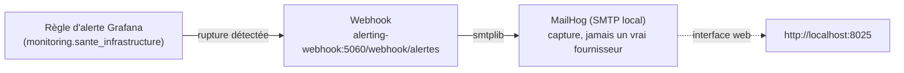

# Monitoring du data lake OMEGA LAKE

**Compétence couverte : C20 — Gérer le catalogue des données (volet monitoring), issue #80 (C20bis)**
**Épreuve associée : E7**

Le référentiel de compétences est explicite sur les deux derniers
critères d'évaluation de C20 (voir
[`Referentiel_Activites_Competences_Evaluation_DE.pdf`](../reference/Referentiel_Activites_Competences_Evaluation_DE.pdf),
page 24) :

> *Le monitorage permet le suivi des conditions matérielles et applicatives.*
> *Le monitorage génère une alerte lors d'une rupture de service.*

Un premier design (24/09/2026) ne couvrait que l'applicatif (fraîcheur/
volumétrie) sans le matériel, et ne prévoyait pas d'alerte réellement
déclenchée — corrigé après relecture du référentiel, voir §1 et §3
ci-dessous.

---

## 1. Ce qui est suivi

Trois relevés, en ajout seul (append-only) dans le schéma Postgres
`monitoring` (même base `datacore_omega_bi` que l'entrepôt OMEGA BI,
sobriété RGESN — pas de nouvelle base), pour tracer une évolution dans
le temps, pas seulement un dernier état :

| Table | Volet | Alimentée par |
|---|---|---|
| `monitoring.catalogue_lake` | **Applicatif** — volumétrie et fraîcheur par flux/zone | `datacore.storage.lake.monitoring.enregistrer_catalogue()`, réutilise `catalogue.construire_catalogue()` (C20) |
| `monitoring.purges_lake` | **Applicatif** — dernière purge RGPD exécutée par flux | `datacore.storage.lake.monitoring.enregistrer_purge()`, appelée depuis `purge.py::main()` (C21) |
| `monitoring.sante_infrastructure` | **Matériel** — MinIO accessible, capacité utilisée | `datacore.storage.lake.monitoring.verifier_sante_infrastructure()` |

Schéma créé par la migration Alembic `a487cd05b8d5` (même mécanisme que
`gouvernance`/`exploitation`, C14/C16). `bi_reader` a `SELECT` sur
`monitoring` (comme sur `exploitation`/`dimensions`/`commercial`) —
`gouvernance` reste exclu, ce choix n'est pas révisé ici (voir
`registre_rgpd_entrepot.md` §4).

Dashboard Grafana : « OMEGA LAKE — Monitoring (C20bis) »
(`infra/grafana/dashboards/monitoring_lake.json`), réutilise le
datasource `omega_bi_reader` déjà provisionné pour C16bis — même
principe de sobriété.

---

## 1bis. Bug trouvé par l'utilisateur : panel "Santé infrastructure" en "No data"

Signalé le 25/09/2026 : le panel affichait "No data" alors que le panel
voisin (même table, colonne `capacite_utilisee_octets`) affichait bien
une valeur réelle. Vérifié via l'API `/api/ds/query` : la requête
`SELECT minio_accessible FROM ...` renvoyait bien une ligne réelle
(`true`), mais avec un champ de type `boolean` -- le panel `stat` de
Grafana ne l'affiche pas correctement dans cette version. Corrigé en
convertissant le booléen en texte directement dans la requête SQL
(`CASE WHEN minio_accessible THEN 'Accessible' ELSE 'Injoignable' END`)
plutôt que de compter sur Grafana pour gérer un champ booléen -- même
type de champ (texte) que les autres panels déjà fonctionnels.

## 2. Vérifié en conditions réelles (25/09/2026)

```
$ python3 -m datacore.storage.lake.monitoring
catalogue : 15 entrée(s) enregistrée(s)
santé infrastructure : {'minio_accessible': True, 'capacite_utilisee_octets': 2050406}
```

Les 15 entrées correspondent aux 5 flux × 3 zones réellement présentes
dans le lake (voir `catalogue_omega_lake.md`). `bi_reader` confirmé
capable de lire `monitoring.*` (`SELECT` direct via `psql`), et refusé
sur `gouvernance.*` (`permission denied for schema gouvernance`) —
cohérent avec C16bis.

---

## 3. Alerte lors d'une rupture de service

**Choix du canal** (voir échange avec l'utilisateur, 25/09/2026) :
e-mail réel via `smtplib`, envoyé à un capteur SMTP **local** (MailHog,
`infra/docker/docker-compose.yml`) plutôt qu'un vrai fournisseur externe
(Gmail envisagé puis écarté — identifiant réel à gérer, et un e-mail
serait envoyé à chaque exécution automatisée des tests d'intégration).
MailHog expose une interface web (http://localhost:8025) pour visualiser
les e-mails reçus, et une API REST utilisée par les tests.

**Chaîne complète** :



- **Règle d'alerte** (`infra/grafana/provisioning/alerting/lake_monitoring.yaml`) :
  interroge le dernier relevé de `monitoring.sante_infrastructure`,
  déclenche si `minio_accessible = false`.
- **Point de contact** : webhook vers `alerting-webhook` (nouveau
  service Flask, `src/datacore/alerting/webhook.py`) — séparé
  d'`api-mock` (qui simule les sources de données externes d'Omega
  Logistics, sans rapport thématique avec l'observabilité interne).
- **Relais e-mail** : `envoyer_alerte()` construit et envoie un vrai
  e-mail via `smtplib.SMTP`, capté par MailHog.

### Test réel de bout en bout (25/09/2026)

Plutôt qu'une simulation sur papier — même exigence que le test
`kill -9` du consommateur SSE (C19,
[`integration_infrastructure_omega_lake.md` §3](integration_infrastructure_omega_lake.md)) :

1. `docker stop datacore-omega-lake` (coupure réelle de MinIO).
2. `verifier_sante_infrastructure()` relancé pour de vrai → enregistre
   `minio_accessible = false` dans Postgres.
3. Règle d'alerte Grafana évaluée (intervalle 30 s, `for: 30 s`) →
   passée à l'état `active` en ~30 s (vérifié via
   `/api/alertmanager/grafana/api/v2/alerts`).
4. E-mail réel reçu dans MailHog (~20 s après le passage à `active` —
   délai de groupement des notifications de Grafana, pas un délai
   anormal) :
   - Sujet : `[DATA CORE] Alerte Grafana (firing) : MinIO injoignable`
   - Corps : `MinIO est injoignable -- rupture de service détectée sur
     le dernier relevé de monitoring.sante_infrastructure.`
5. `docker start datacore-omega-lake`, nouveau relevé sain enregistré →
   l'alerte repasse à l'état résolu en ~15 s, confirmé par API.

Preuve d'une chaîne réellement fonctionnelle : détection → alerte →
notification → résolution, pas seulement une règle configurée et
jamais déclenchée.

**Ce que ce test ne couvre pas** : la fraîcheur des données
(`monitoring.catalogue_lake`) n'a pas encore de règle d'alerte dédiée
— une seule règle suffit à démontrer le critère du référentiel, une
seconde pourrait être ajoutée si le besoin s'en fait sentir (ex. aucune
nouvelle partition `raw/` déposée au-delà de la cadence attendue).

### Relecture utilisateur du 19/10/2026 : 4 vrais trous de robustesse trouvés

Après relecture des fichiers de tests, l'utilisateur a relevé 4 points
sur `webhook.py`, tous vérifiés et confirmés réels avant correction —
dont 2 bugs effectifs (pas seulement des trous de test) :

- **Payload JSON valide mais pas un objet** (ex. une liste `[1, 2, 3]`) :
  `silent=True` sur `request.get_json()` ne rattrape que le JSON
  *invalide*, pas le JSON valide d'une autre forme — `payload.get(...)`
  sur une liste levait une `AttributeError` non gérée (500 brut).
  Corrigé : contrôle explicite `isinstance(payload, dict)`, renvoie 400
  sinon.
- **Échec SMTP non géré** : si MailHog (ou un vrai serveur SMTP en
  production) est injoignable, `envoyer_alerte()` n'était entourée
  d'aucun `try/except` dans la route — 500 générique, rien
  d'exploitable pour Grafana. Corrigé : capture `OSError`/
  `smtplib.SMTPException`, renvoie 502 avec le détail de l'erreur.
- **Aucune authentification sur `/webhook/alertes`**, alors que le port
  est exposé sur l'hôte (`5060:5060` dans `docker-compose.yml`) —
  n'importe quel process local pouvait déclencher un envoi d'e-mail.
  Corrigé : secret partagé (`ALERTING_WEBHOOK_SECRET`, en-tête
  `X-Webhook-Secret`), même principe que `X-API-Key` sur `api-mock`
  (C8). Transmis par Grafana via `settings.headers` sur le point de
  contact (substitué depuis l'environnement du conteneur comme
  `GF_OMEGA_BI_DB`/`GF_BI_READER_PASSWORD`).
- **Tests insuffisants côté `test_monitoring.py`** (bucket non vérifié
  dans le fake paginateur, un seul enregistrement du catalogue
  contrôlé partiellement, assertion tautologique sur l'horodatage,
  panne Postgres non couverte) — tous renforcés : bucket réellement
  transmis tracé et vérifié, les deux enregistrements contrôlés dans
  leur intégralité, horodatage vérifié comme une vraie instance
  `datetime`, et deux tests dédiés confirment qu'une panne de connexion
  Postgres remonte bien telle quelle (comportement intentionnel, même
  principe que `journal.py::journaliser()`), pas avalée silencieusement.

**Revérifié en conditions réelles, avec l'authentification activée**
(19/10/2026) : même protocole que le 25/09 (`docker stop
datacore-omega-lake` → relevé → alerte Grafana `active` → e-mail réel
dans MailHog), rejoué de bout en bout après l'ajout du secret partagé
— confirmé dans les logs d'`alerting-webhook` que c'est bien Grafana
qui a appelé le webhook (pas un test manuel) et qu'il a été authentifié
(`200`, pas `401`). Le format exact du champ `settings.headers` pour un
point de contact webhook Grafana n'était pas garanti à l'avance —
vérifié par le provisioning réel (aucune erreur dans les logs) puis par
ce test de bout en bout, pas supposé.

---

## 4. Références

- [`catalogue_omega_lake.md`](catalogue_omega_lake.md) — C20, catalogue par introspection.
- [`registre_rgpd_lake.md`](registre_rgpd_lake.md) — C21, procédure de purge alimentant `monitoring.purges_lake`.
- [`gestion_operationnelle_omega_bi.md`](gestion_operationnelle_omega_bi.md) §3.5 — Grafana pour C16bis, même datasource réutilisé ici.
- [`Referentiel_Activites_Competences_Evaluation_DE.pdf`](../reference/Referentiel_Activites_Competences_Evaluation_DE.pdf) page 24 — critères C20 exacts.
