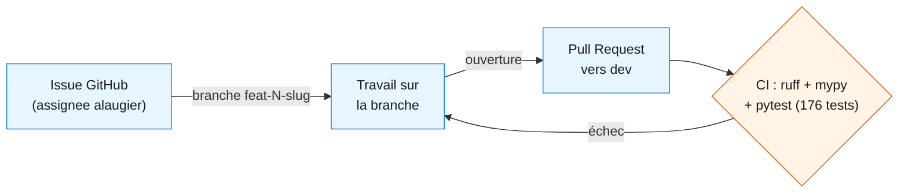
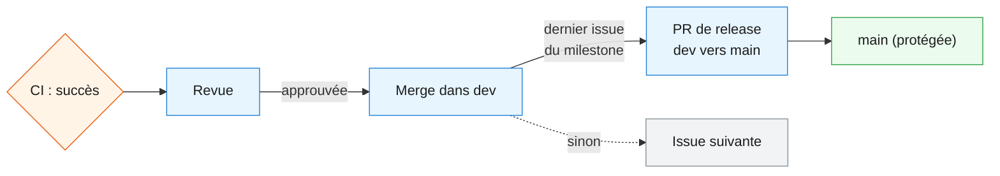

# Supervision du programme DATA CORE

**Compétence couverte : C6 — Superviser la réalisation d'un projet data**
**Épreuves associées : E2 (mise en situation professionnelle), E3 (jeu de rôle)**

Ce document s'appuie sur la [feuille de route](feuille_de_route.md) (C5,
composition d'équipe et budget prévisionnel) et documente les rituels de
supervision du programme : points d'équipe hebdomadaires, comité de suivi
mensuel (CoSu), tableau de suivi budgétaire et modalités d'encadrement du
prestataire externe SupervIT.

---

## 1. Rituels d'équipe

### 1.1 Point d'équipe hebdomadaire

| Élément | Détail |
|---|---|
| Fréquence | Chaque lundi, 30 minutes |
| Participants | Data Engineer / chef·fe de projet (moi), Sophie MARTIN (Lead DE), Yanis DUPONT (DE), Léa FONTAINE (Data Analyst), Thomas NGUYEN (DevOps) |
| Ordre du jour type | 1) Avancement des issues en cours (statut Kanban) — 2) Blocages à lever — 3) Priorités de la semaine — 4) Points de veille technique/réglementaire à signaler (C4) |
| Format de compte-rendu | 5-10 lignes, archivées ci-dessous, diffusées à l'équipe le jour même |

**Exemple — compte-rendu du 17/08/2026.**
Avancement : cadrage (C1-C3) en cours, entretiens de cadrage réalisés.
Blocage : aucun. Priorité de la semaine : finaliser la topographie des
données et démarrer l'étude d'architecture cible. Veille signalée :
comparatif orchestrateurs ETL légers (cf.
[veille technique et réglementaire](veille_technique_reglementaire.md#semaine-du-17082026)).

**Exemple — compte-rendu du 24/08/2026.**
Avancement : C1 à C3 et C5 livrés et mergés sur `dev` ; conteneurisation
(docker-compose) testée de bout en bout. Blocage : aucun. Priorité de la
semaine : pipeline CI (C8 infra) puis bascule sur le bloc 2. Décision
d'équipe : extension du Kanban à 6 statuts pour un suivi plus fin des PR
en revue.

**Exemple — synthèse des points hebdomadaires du 28/08 au 21/09/2026**
(période M1 → M2 ; synthétisée a posteriori plutôt qu'un compte-rendu par
semaine, le rythme réel de livraison ayant été irrégulier sur cette
période — voir le point de vigilance correspondant ci-dessous).
Avancement : Bloc 2 clos le 27/08 (C8-C12, PR #42) ; Bloc 3 démarré dans
la foulée, C13/C14 livrés le 28/08 (PR #52/#54), puis C15/C16/C17 livrés
le 21/09 (PR #55/#57/#58) — Bloc 3 clos le même jour. Blocage : aucun
blocage technique, mais un ralentissement d'activité de plusieurs
semaines fin août-début septembre (autres priorités du Pôle Data),
signalé au fil de l'eau plutôt que dissimulé. Décisions d'équipe notables :
inversion de l'ordre C16/C17 par rapport au Gantt (voir
[sequencement_bloc3.md](sequencement_bloc3.md)) ; correction d'un fichier
SQL orphelin découvert lors de la revue du Bloc 3 (PR #59). Priorité
suivante : ouverture du Bloc 4 (data lake OMEGA LAKE).

### 1.2 Comité de suivi mensuel (« CoSu »)

| Élément | Détail |
|---|---|
| Fréquence | Mensuelle, 1 heure, dernier jeudi du mois (ou à échéance de jalon) |
| Participants | Data Engineer / chef·fe de projet (moi), Karim BELAÏD (commanditaire opérationnel), Éléonore RAKOTO (sponsor) |
| Ordre du jour type | 1) Avancement du programme vs feuille de route — 2) Suivi budgétaire (§2) — 3) Risques et arbitrages nécessaires — 4) Décisions à valider par la sponsor |
| Format de compte-rendu | Structuré (voir exemple ci-dessous), archivé et communiqué aux deux parties prenantes |

**Exemple — CoSu du 25/08/2026 (premier comité, clôture de la phase de cadrage).**

- **Avancement** : Phase 1 (Cadrage & Setup, M0) quasiment terminée.
  Livrables C1 (étude de faisabilité), C2 (topographie des données), C3
  (architecture cible), C5 (feuille de route) et C4 (veille) livrés et
  validés. Infrastructure (docker-compose, CI) opérationnelle.
- **Décisions actées depuis le dernier point** : choix de MinIO plutôt que
  Microsoft Fabric pour le futur data lake (contrainte de fonctionnement
  local, coût, reproductibilité — voir
  [architecture cible §2.5](architecture_cible.md#25-alternative-écartée--microsoft-fabric)) ;
  extension du tableau Kanban de 3 à 6 statuts pour un suivi plus fin.
- **Point d'attention soulevé en comité** : lors de la rédaction du
  compte rendu de milestone, un écart a été identifié entre le suivi
  GitHub et le cahier des charges — les livrables C4, C6 et C7 n'avaient
  pas d'issue dédiée. Décision actée en comité : ouvrir les 3 issues
  manquantes avant de considérer M0 comme clos, plutôt que de basculer
  prématurément sur le bloc 2 (voir
  [compte rendu M0 §4](../comptes_rendus/M0.md#4-écarts-par-rapport-au-cahier-des-charges)).
- **Budget** : voir §2 ci-dessous, aucun dépassement à ce stade.
- **Risques** : aucun risque bloquant identifié pour le passage au bloc 2 ;
  point de vigilance sur la charge de travail liée au rattrapage C6/C7 en
  parallèle du démarrage du bloc 2.

**Exemple — CoSu du 21/09/2026 (clôture de M2, ouverture de M3).**

- **Avancement** : Bloc 2 (M1, C8-C12) et Bloc 3 (M2, C13-C17) tous deux
  clos — 10 compétences supplémentaires livrées depuis le dernier CoSu.
  Bloc 4 (M3, C18-C21) démarré le jour même : 4 issues ouvertes (#63-#66),
  ordre de traitement confirmé sans réserve
  ([sequencement_bloc4.md](sequencement_bloc4.md)).
- **Décisions actées depuis le dernier point** : inversion C17 avant C16
  au Bloc 3 (dépendance RGPD réelle, voir
  [sequencement_bloc3.md](sequencement_bloc3.md)) ; correctif appliqué à
  `Dim_Client` après clôture du milestone GitHub M2 (index unique
  partiel empêchant un doublon de version courante — gap remonté en
  revue externe du compte rendu M2, vérifié avant correction, non
  bloquant pour la release).
- **Point d'attention à faire remonter à Éléonore RAKOTO** : le Bloc 4
  introduit dans le périmètre la géolocalisation de la flotte
  (`geoloc_flotte.csv` et le flux temps réel `/api/stream/capteurs`,
  identifiés dès la conception de C18 — voir
  [sequencement_bloc4.md §2](sequencement_bloc4.md#2-c18--c19--c20--c21--confirmé-sans-réserve)).
  La sponsor a positionné la conformité RGPD en zéro tolérance dès
  l'entretien de cadrage, nommément sur la géolocalisation des
  chauffeurs ([étude de faisabilité §2.2](etude_faisabilite.md#22-entretien-avec-éléonore-rakoto--directrice-des-opérations)) :
  ce périmètre est donc signalé dès l'ouverture du bloc, et non
  seulement à la production du registre RGPD prévue en C21, cohérent
  avec sa demande d'être alertée sans attendre en cas de sujet sensible.
  La gouvernance renforcée (registre, purge, droits d'accès) reste
  prévue en C21 — ce point d'attention n'anticipe pas le livrable, il
  informe la sponsor que le périmètre est identifié et suivi.
- **Budget** : voir §2.2 ci-dessous, aucun dépassement — 3 phases sur 4
  closes intégralement dans l'enveloppe prévisionnelle.
- **Risques** : aucun risque bloquant pour l'ouverture du Bloc 4 ; point
  de vigilance sur la mobilisation de SupervIT (§3), prévue à l'entrée
  en Phase 4 et toujours non démarrée à ce jour.

**Exemple — CoSu du 25/09/2026 (clôture de M3, ajout du jalon M4).**

- **Avancement** : Bloc 4 (M3, C18-C21) clos le 23/09/2026 — les 4
  blocs techniques du cahier des charges (C1-C21) sont désormais
  intégralement couverts. Restitution OMEGA BI dans Grafana (C16bis,
  issue #79) livrée le 25/09/2026, vérifiée en conditions réelles.
- **Décision actée depuis le dernier point — nouveau jalon M4** : un
  retour de formateur a établi que les vues SQL + notebook (C16)
  n'étaient pas une preuve de restitution suffisante ; un outil de BI
  dédié est désormais attendu. Décision : ajouter un jalon transverse
  **M4 — Restitution BI (Grafana)**, couvrant C16bis et C20bis
  (monitoring du lake, à venir). Les jalons transverses prévus sous les
  noms M4 (Rapport LaTeX) et M5 (Présentation orale) sont renumérotés
  M5/M6 en conséquence — voir
  [`feuille_de_route.md` §1](feuille_de_route.md#1-feuille-de-route-en-4-phases).
- **Point d'attention à faire remonter à Éléonore RAKOTO** : ce nouveau
  jalon **n'entraîne pas de dépassement budgétaire** — Grafana est
  auto-hébergé, open source, sans coût de licence, cohérent avec la
  stratégie retenue dès l'étude technique
  ([architecture cible §2.3](architecture_cible.md#23-choix-technologiques-proposés)).
  Il n'était toutefois pas identifié dans la feuille de route initiale
  (comme M5/M6, les jalons transverses n'ont jamais eu de ligne
  budgétaire dédiée dans le tableau prévisionnel — voir
  [feuille de route §3](feuille_de_route.md#3-budget-prévisionnel)) : signalé
  par transparence, pas parce qu'un risque financier est identifié.
- **Budget** : voir §2.2 ci-dessous — les 4 phases techniques sont
  closes intégralement dans l'enveloppe prévisionnelle (180 000 €, 0 €
  d'écart). M4/M5/M6 restent hors de ce périmètre budgété, staffing
  interne uniquement.
- **Risques** : aucun risque bloquant. Deux défauts de configuration
  réels trouvés et corrigés le jour même sur le dashboard Grafana
  (base de données manquante au provisioning de la source de données,
  agrégation erronée d'un panel masquant 2 clients sur 3) — remontés
  par l'utilisateur en testant depuis un vrai navigateur, corrigés et
  revérifiés le jour même, sans impact sur le calendrier — voir
  [`gestion_operationnelle_omega_bi.md` §3.5](gestion_operationnelle_omega_bi.md#35-outil-de-restitution-de-production--grafana).

**Exemple — CoSu du 19/10/2026 (clôture de M4, après une pause de formation).**

- **Avancement** : jalon transverse M4 (Restitution BI) clos — les
  deux issues #79 (25/09/2026) et #80 (19/10/2026) sont livrées et
  vérifiées en conditions réelles. Entre les deux, une pause de
  formation de 3 semaines (25/09 → 19/10) explique l'essentiel du span
  calendaire du jalon — voir
  [`feuille_de_route.md` §4.1](feuille_de_route.md#41-diagramme-de-gantt),
  pas 26 jours d'effort continu. Compte rendu complet :
  [`comptes_rendus/M4.md`](../comptes_rendus/M4.md).
- **Décisions actées depuis le dernier point** : le design de C20bis
  (monitorage du lake) a été révisé après lecture du référentiel de
  compétences complet (désormais archivé dans `docs/reference/`) — le
  premier jet ne couvrait que la fraîcheur des données, le référentiel
  exige aussi le suivi matériel (MinIO) et une alerte réellement
  déclenchée, pas seulement des métriques affichées. Canal d'alerte
  retenu : e-mail réel via `smtplib` vers un capteur SMTP local
  (MailHog), jamais un vrai fournisseur externe — un compte Gmail avait
  été envisagé puis écarté (identifiant réel à gérer, e-mail envoyé à
  chaque exécution automatisée des tests).
- **Point d'attention à faire remonter à Éléonore RAKOTO** : aucun,
  risque budgétaire déjà signalé au CoSu précédent et confirmé non
  matérialisé (voir §2.2).
- **Budget** : voir §2.2 ci-dessous — toujours aucun dépassement, M4
  reste hors du périmètre budgété initial (staffing interne, outillage
  open source auto-hébergé).
- **Risques** : aucun risque bloquant pour la suite (M5/M6). À la
  reprise du 19/10, relecture de code approfondie côté utilisateur sur
  les tests de la PR #85 — 2 bugs de robustesse réels trouvés et
  corrigés (payload webhook non géré, échec SMTP non géré) avant
  merge, plus une authentification ajoutée sur le webhook d'alerte
  (son port est exposé sur l'hôte) — aucun n'a affecté le calendrier,
  la relecture faisait partie du cycle normal avant merge.

**Exemple — CoSu du 21/10/2026 (clôture de M5, ouverture de M6).**

- **Avancement** : jalon transverse M5 (Rapport LaTeX) clos — les 3
  issues (#90, #91, #92) livrées sur une seule PR (#93, 37 pages),
  compte rendu de clôture mergé via la PR #94, release vers `main`
  via la PR #95. Le programme (M0-M5) est désormais fonctionnellement
  et documentairement complet. Jalon M6 (Présentation orale) ouvert le
  jour même : séquencement décidé avant tout contenu
  ([`sequencement_m6.md`](sequencement_m6.md)), 5 issues créées
  (#96-#100). Compte rendu complet :
  [`comptes_rendus/M5.md`](../comptes_rendus/M5.md).
- **Décisions actées depuis le dernier point** : découpage en issues
  du rapport non respecté à la lettre par rapport au séquencement
  initial (3 issues prévues sur 3 PR distinctes, livrées en pratique
  sur une seule branche/PR) — `dev` ne portait pas encore
  l'infrastructure LaTeX tant que la première issue n'était pas
  mergée, démarrer une branche séparée depuis `dev` pour les suivantes
  aurait dupliqué cette infrastructure plutôt que de la réutiliser ;
  écart assumé et expliqué dans la PR, pas découvert a posteriori. Une
  bibliographie (chapitre 8) a été ajoutée hors périmètre initial, à
  la demande de l'utilisateur. Attribution Claude retirée après coup
  de 11 commits de la branche du rapport (`git filter-branch` +
  force-push, PR encore ouverte à ce moment -- aucun impact sur le
  contenu, vérifié par diff identique avant/après).
- **Point d'attention à faire remonter à Éléonore RAKOTO** : aucun,
  pas de risque budgétaire ou calendaire identifié pour M5 ni pour
  l'ouverture de M6.
- **Budget** : voir §2.2 ci-dessous — toujours aucun dépassement, M5
  et M6 restent hors du périmètre budgété initial (staffing interne).
- **Risques** : aucun risque bloquant. Point de vigilance calendaire
  signalé par l'utilisateur : soutenance orale prévue mi-novembre
  2026 (date précise non encore communiquée), 2 jours ouvrés restants
  cette semaine (22-23/10) puis une pause jusqu'à la semaine de la
  soutenance (3 jours ouvrés prévus avant le passage) — à anticiper
  dans le séquencement des 5 issues de M6, Q&A jury (issue #96)
  délibérément traitée en premier pour ne pas la sacrifier si le temps
  venait à manquer.

---

## 2. Tableau de suivi budgétaire

### 2.1 Détail Phase 1 — Cadrage

Suivi du budget de la Phase 1 — Cadrage (25 000 €, cf.
[feuille de route §3](feuille_de_route.md#3-budget-prévisionnel)), ventilé
par poste de livrable. **Instantané historique au 25/08/2026** (Phase 1
alors quasiment terminée, cf. CoSu §1.2) — C6 et C7 se sont depuis
achevés normalement, budget consommé intégralement sans écart ; voir la
vue consolidée à jour en §2.2.

| Poste | Budget prévisionnel | Réalisé au 25/08/2026 | Écart | Statut au 25/08/2026 |
|---|---|---|---|---|
| C1 — Étude de faisabilité | 2 500 € | 2 500 € | 0 € | Terminé |
| C2 — Topographie des données | 2 500 € | 2 500 € | 0 € | Terminé |
| C3 — Architecture cible | 3 000 € | 3 000 € | 0 € | Terminé |
| C4 — Veille technique et réglementaire | 2 000 € | 2 000 € | 0 € | Terminé |
| C5 — Feuille de route | 2 500 € | 2 500 € | 0 € | Terminé |
| C6 — Supervision (ce livrable) | 2 000 € | 1 000 € | 1 000 € | En cours |
| C7 — Communication et lancement | 2 500 € | 0 € | 2 500 € | À faire |
| Infrastructure (docker-compose #7, CI #8) | 3 000 € | 3 000 € | 0 € | Terminé |
| Pilotage et coordination transverse | 5 000 € | 1 500 € | 3 500 € | En cours |
| **Total Phase 1 au 25/08/2026** | **25 000 €** | **18 000 €** | **7 000 €** | **72 % consommé** |

### 2.2 Vue d'ensemble par phase

Le budget prévisionnel par phase (cf.
[feuille de route §3](feuille_de_route.md#3-budget-prévisionnel)) n'est
détaillé par poste de livrable que pour la Phase 1 (§2.1 ci-dessus) — les
phases suivantes sont suivies au niveau de la phase, cohérent avec la
granularité du budget prévisionnel initial. Situation au 25/09/2026, mise
à jour à la clôture de M3.

| Phase | Budget prévisionnel | Réalisé à date | Écart | Statut |
|---|---|---|---|---|
| Phase 1 — Cadrage (M0) | 25 000 € | 25 000 € | 0 € | Terminé |
| Phase 2 — Collecte & Stockage (M1) | 45 000 € | 45 000 € | 0 € | Terminé |
| Phase 3 — Entrepôt de données (M2) | 55 000 € | 55 000 € | 0 € | Terminé |
| Phase 4 — Data lake et infrastructure IoT (M3) | 55 000 € | 55 000 € | 0 € | Terminé |
| **Total programme (périmètre initial)** | **180 000 €** | **180 000 €** | **0 €** | **100 % consommé** |

**Analyse** : aucun dépassement constaté sur les 4 phases du périmètre
initial — chacune consommée intégralement, sans écart, cohérent avec
les comptes rendus de milestone déjà validés
([M0](../comptes_rendus/M0.md), [M1](../comptes_rendus/M1.md),
[M2](../comptes_rendus/M2.md), [M3](../comptes_rendus/M3.md)).

**M4 — Restitution BI (Grafana), hors périmètre budgété initial** :
comme les jalons transverses M5 (Rapport LaTeX) et M6 (Présentation
orale), M4 n'a jamais eu de ligne dans le tableau prévisionnel §3 de la
feuille de route — ce n'est pas un dépassement du périmètre initial,
mais un jalon qui n'y était simplement pas budgété par nature (staffing
interne, pas d'outillage sous licence, cf. §3 de la feuille de route).
Point de transparence porté en CoSu du 25/09/2026 (§1.2), pas un risque
financier identifié. **M4 clos le 19/10/2026** (voir CoSu ci-dessus et
[`comptes_rendus/M4.md`](../comptes_rendus/M4.md)) — confirmé sans
coût d'outillage réel (Grafana, MailHog : open source, auto-hébergés).

---

## 3. Encadrement du prestataire externe SupervIT

### 3.1 Périmètre de la mission

D'après la [feuille de route](feuille_de_route.md#2-composition-de-léquipe-projet),
SupervIT intervient en appui ponctuel encadré, principalement sur
l'intégration technique du bloc 4 (data lake OMEGA LAKE) — installation et
connexion des composants d'infrastructure (C19), où la complexité
technique dépasse le périmètre courant de l'équipe interne.

**Statut au 21/09/2026** : SupervIT n'est toujours pas mobilisé. Le
programme entre en Phase 4 (M3, data lake OMEGA LAKE) — la mobilisation,
planifiée à l'entrée de cette phase, conformément au
[calendrier détaillé](feuille_de_route.md#41-diagramme-de-gantt), reste
à engager (voir aussi le point de vigilance du CoSu du 21/09/2026, §1.2).

### 3.2 Modalités d'encadrement prévues

| Élément | Détail |
|---|---|
| Point de contact interne | Data Engineer / chef·fe de projet (moi), avec appui de Sophie MARTIN (validation technique) |
| Cadence de suivi | Point bimensuel pendant la durée de la mission (Phase 4) |
| Livrables attendus | Rapport d'intervention à chaque point, documentation technique des composants installés, procédure d'installation reproductible (cohérent avec l'exigence transverse du cahier des charges, §9.4) |
| Critères de qualité | Revue systématique par la référente technique (Sophie MARTIN) avant acceptation d'un livrable |
| Critère d'éco-responsabilité | Intégré au cahier des charges de la mission dès sa contractualisation, conformément à la [stratégie RGESN](architecture_cible.md#5-stratégie-déco-responsabilité-rgesn) : préférence pour des solutions sobres et déjà retenues par le programme (MinIO plutôt qu'une solution propriétaire) |
| Périmètre budgétaire | Inclus dans le poste « Data lake et infrastructure IoT » de la Phase 4 (55 000 €, cf. feuille de route) — pas de ligne budgétaire séparée à ce stade |

### 3.3 Grille de suivi de mission (à activer en Phase 4)

| Intervention | Objet | Date prévue | Statut |
|---|---|---|---|
| Cadrage de la mission SupervIT | Définition du périmètre exact, contractualisation, critères de qualité et d'éco-responsabilité | Entrée en Phase 4 | Non démarré |
| Point d'intégration 1 | Installation du stockage objet et connexion du catalogue de données | Phase 4 | Non démarré |
| Point d'intégration 2 | Revue de la documentation d'installation et procédure de restauration | Phase 4 | Non démarré |

Cette grille sera complétée au fil de la Phase 4 ; elle est publiée dès
maintenant pour que les modalités d'encadrement soient actées avant la
mobilisation effective du prestataire.

---

## 4. Cycle de vie d'une tâche

Convention de branches complète dans
[`plan_de_developpement.md`](../plan_de_developpement.md#convention-de-branches).
Chaque tâche suit le même cycle, de l'issue GitHub jusqu'au merge sur
`main` à la clôture du jalon :

Étape 1 — développement, jusqu'à la CI :

Étape 2 — revue et intégration, jusqu'à la release :

Le statut Kanban du Project #3 (6 états : `Backlog` → `À faire
(sprint)` → `En cours` → `En revue (PR)` → `Bloqué` → `Terminé`) suit
ce même cycle en parallèle — mis à jour manuellement à chaque étape
(voir [`plan_de_developpement.md` §« Mise à jour du
Kanban »](../plan_de_developpement.md#mise-à-jour-du-kanban)), pas
automatisé par un workflow « linked PR » (essayé puis abandonné le
25/08/2026 : trop rigide pour les PR de release, qui ferment plusieurs
issues à la fois).

La CI (`.github/workflows/ci.yml`) s'exécute sur chaque push et chaque
PR vers `dev`/`main` : `ruff check` (lint) puis `mypy` (typage
statique) doivent passer avant que `pytest tests/unit
tests/integration` (176 tests au 21/10/2026) ne s'exécute à son tour —
un échec de lint ou de typage bloque l'exécution des tests plutôt que
de produire un rapport bruité.
