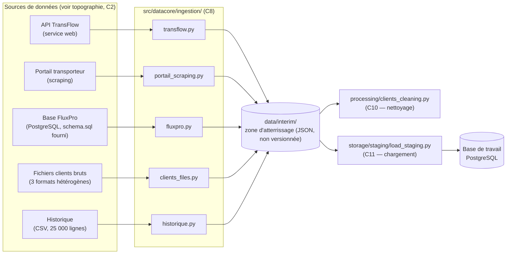
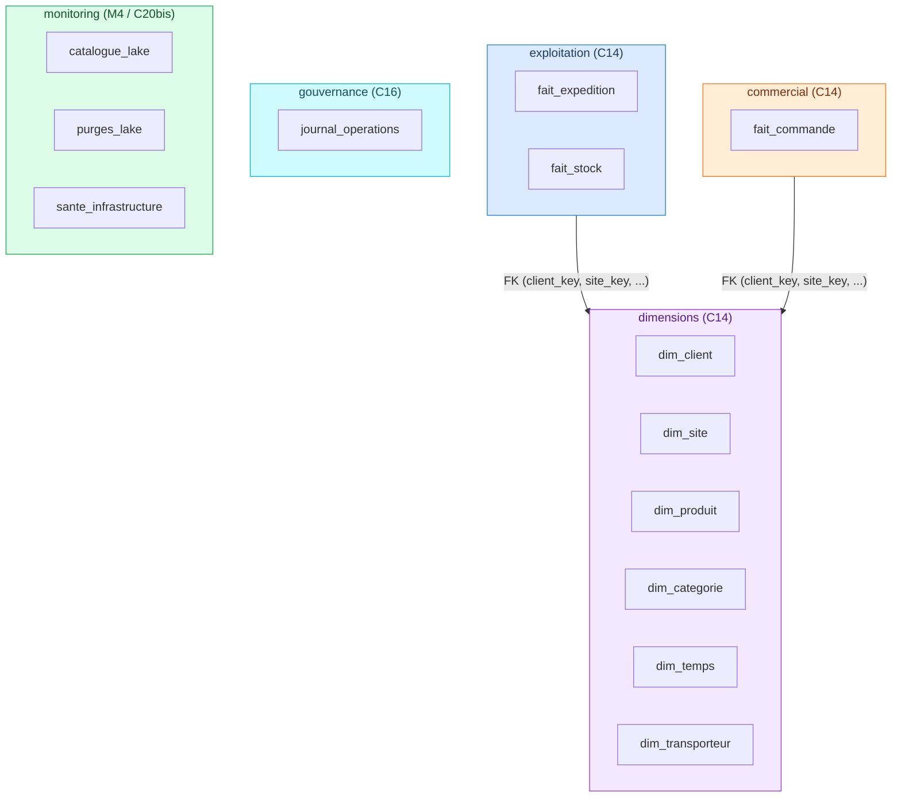
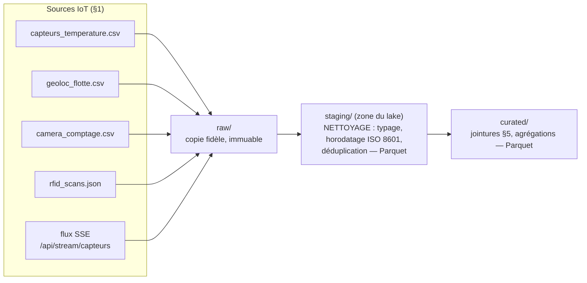
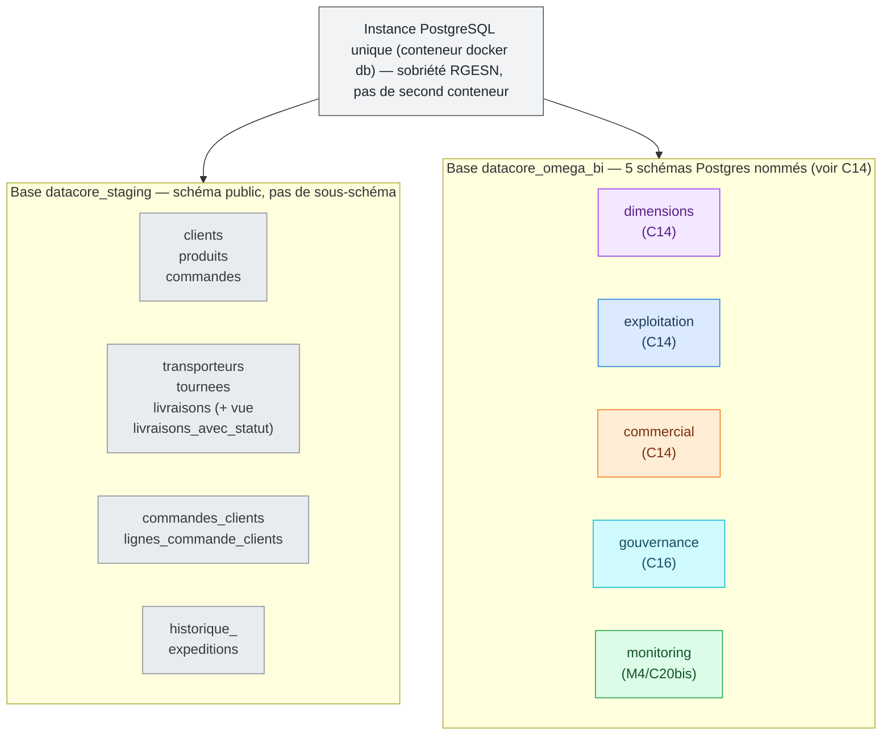
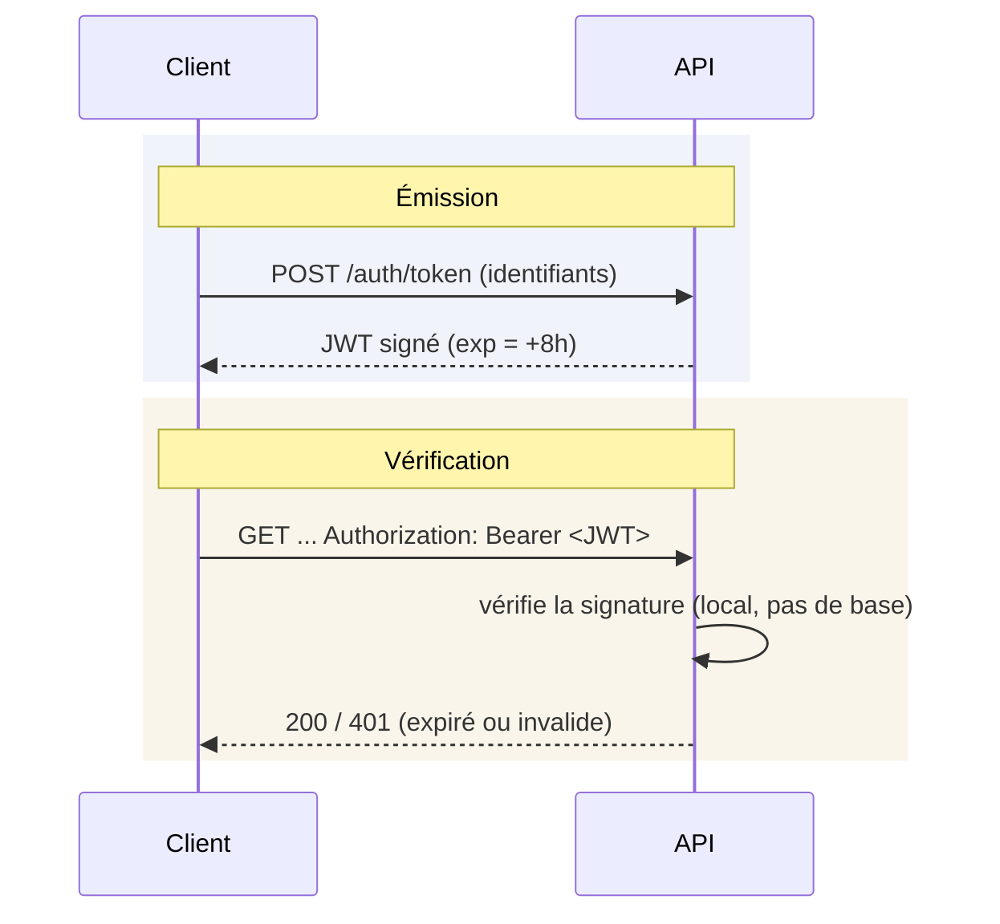

# DATA CORE

Refonte de l'infrastructure data d'Omega Logistics

<div class="pt-8 opacity-80">
Alexandre Laugier — Certification Data Engineer (RNCP37638)
</div>

<div class="abs-bl ml-8 mb-8 bg-white rounded-lg px-4 py-2 inline-block">

</div>

<!--
- Se présenter : nom, certification visée (Data Engineer, RNCP37638)
- Annoncer le plan en une phrase : 4 blocs de compétences + jalon transverse M4
- Durée visée 90 min au total (80' présentation, démos incluses + 10' questions), sans s'excuser du temps
- Ne pas lire le sous-titre à voix haute, juste enchaîner
-->

---
layout: default
---

# Sommaire (90 minutes)

<div class="text-sm">

| Section | Durée visée |
|---|---|
| [Contexte Omega Logistics / DATA CORE](3) | 5' |
| [Bloc 1 — Cadrage (C1-C7)](6) | 22' |
| [Bloc 2 — Collecte & Stockage (C8-C12), avec démonstration](16) | 14' |
| [Bloc 3 — Entrepôt OMEGA BI (C13-C17), avec temps d'échange dédié](26) | 13' |
| [Bloc 4 — Data Lake OMEGA LAKE (C18-C21)](36) | 12' |
| [M4 (Grafana) + synthèse transverse + conclusion](43) | 14' |
| **Total présentation (démos incluses)** | **80'** |
| [Questions & échanges avec le jury](56) | 10' |
| [Annexes](58) | si besoin |

</div>

<!--
- Annoncer le minutage par section une seule fois ici, pas à répéter ensuite
- Préciser que ce minutage est calé sur le déroulé E1-E7 de la certification
- Ne pas s'excuser si le minutage glisse en cours de route
- Budget resserré le 2026-11-17 : plafond dur 80' de présentation (hors questions). Bloc 1 (cadrage) ramené de 30-35' à 22' -- c'est le bloc le moins démonstratif, celui qui supporte le mieux la coupe sans perdre de contenu technique vérifié
-->

---
layout: image-right
backgroundSize: contain
image: /illustrations/logistics.svg
---

# Contexte — Omega Logistics

<div class="flex items-center gap-2">
<div class="w-7 h-7 rounded-full flex items-center justify-center flex-shrink-0" style="background:#1c7ed6"></div>
<p class="text-sm">Prestataire logistique (3PL), 3 sites :</p>
</div>

<div class="grid grid-cols-3 gap-3 mt-2">
<div class="p-2 rounded border border-gray-400/30 text-center">

<div class="text-sm font-bold mt-1">Lyon</div>
</div>
<div class="p-2 rounded border border-gray-400/30 text-center">

<div class="text-sm font-bold mt-1">Lille</div>
</div>
<div class="p-2 rounded border border-gray-400/30 text-center">

<div class="text-sm font-bold mt-1">Marseille</div>
</div>
</div>

<div class="grid grid-cols-1 gap-2 mt-4">
<div class="flex items-center gap-3 p-2 rounded border border-gray-400/30">
<div class="w-9 h-9 rounded-full flex items-center justify-center flex-shrink-0" style="background:#1c7ed6"></div>
<div class="text-sm"><b>NordDrive</b> — pièces automobiles, flux tendus</div>
</div>
<div class="flex items-center gap-3 p-2 rounded border border-gray-400/30">
<div class="w-9 h-9 rounded-full flex items-center justify-center flex-shrink-0" style="background:#2f9e44"></div>
<div class="text-sm"><b>FreshMarket</b> — grande distribution alimentaire, température & traçabilité</div>
</div>
<div class="flex items-center gap-3 p-2 rounded border border-gray-400/30">
<div class="w-9 h-9 rounded-full flex items-center justify-center flex-shrink-0" style="background:#e8590c"></div>
<div class="text-sm"><b>MedioTex</b> — textile, forte saisonnalité</div>
</div>
</div>

<div class="mt-2 text-xs">
Deux systèmes historiques, développés site par site, sans standardisation :
<b>FluxPro</b> (WMS, <i>Warehouse Management System</i> — commandes,
stocks, expéditions) et <b>TransFlow</b> (TMS, <i>Transportation
Management System</i> — tournées de la flotte).
</div>

<!--
- Présenter Omega Logistics en une phrase : 3PL, 3 sites, 3 clients aux besoins très différents
- Nommer le commanditaire (Éléonore RAKOTO, Directrice des Opérations) et le sponsor (Karim BELAÏD, Pôle Data)
- Le vrai problème métier : dispersion → erreurs récurrentes + pas de vision consolidée (pas juste "deux vieux systèmes")
- FluxPro = WMS (entrepôts) / TransFlow = TMS (tournées) — ne pas les inverser à l'oral
-->

---
layout: default
---

# Objectifs SMART<sup>1</sup> du programme

5 objectifs (<code>etude_faisabilite.md</code> <a href="/refs/view.html?file=etude_faisabilite.md" target="_blank" class="underline">voir</a> §7), séquencés par une analyse RICE<sup>2</sup> en 4 blocs de compétences :

1. Centraliser FluxPro, TransFlow, fichiers clients dans une base unique
2. Exposer la donnée consolidée via une **API documentée**
3. Mettre à disposition un **tableau de bord** (taux de service, délais, coûts)
4. **Zéro** traitement de données personnelles non répertorié (registre RGPD)
5. Concevoir une **architecture de data lake** pour le flux IoT

<div class="grid grid-cols-[1fr_auto_1fr_auto_1fr] gap-3 items-center mt-6 text-sm text-center">
<div class="p-3 rounded-lg bg-blue-500/10 border-2 border-blue-500/30">

5 objectifs SMART
</div>
<div class="text-xl opacity-40">→</div>
<div class="p-3 rounded-lg bg-green-500/10 border-2 border-green-500/30">

Score RICE par chantier
</div>
<div class="text-xl opacity-40">→</div>
<div class="p-3 rounded-lg bg-orange-500/10 border-2 border-orange-500/30">

4 blocs de compétences séquencés
</div>
</div>

<div class="mt-6 text-xs opacity-60 border-t border-gray-400/20 pt-2">
<sup>1</sup> SMART : Spécifique, Mesurable, Acceptable/Ambitieux, Réaliste, Temporellement défini &nbsp;·&nbsp;
<sup>2</sup> RICE : Reach, Impact, Confidence, Effort
</div>

<!--
- Lire les 5 objectifs au fil du slide, sans les reformuler un par un
- Dire dès maintenant que l'objectif 3 a nécessité un détour (vues SQL/notebook → Grafana M4) — anticiper plutôt que laisser découvrir
- Sigles SMART/RICE en note de bas de page : les lire seulement si le jury le demande
- Insister sur le schéma : c'est RICE qui a arbitré le séquencement des 4 blocs, pas un choix arbitraire
-->

---
layout: default
---

# Score RICE par chantier

<p class="text-xs opacity-60">Score = (Reach × Impact × Confidence) / Effort — <code>etude_faisabilite.md</code> <a href="/refs/view.html?file=etude_faisabilite.md" target="_blank" class="underline">voir</a> §6</p>

<div class="flex flex-col gap-2 mt-5 text-sm" style="font-variant-numeric: tabular-nums;">
<div class="flex items-center gap-3">
<div style="width: 230px;">FluxPro + fichiers clients</div>
<div class="flex-1 bg-gray-400/10 rounded-full h-6"><div class="h-6 rounded-full flex items-center justify-end pr-2 text-white text-xs font-bold" style="width:100%; background:#1c7ed6;">13,5</div></div>
<span class="text-xs opacity-60" style="width:60px;">Prio. 1</span>
</div>
<div class="flex items-center gap-3">
<div style="width: 230px;">Registre RGPD / pseudonymisation</div>
<div class="flex-1 bg-gray-400/10 rounded-full h-6"><div class="h-6 rounded-full flex items-center justify-end pr-2 text-white text-xs font-bold" style="width:67%; background:#1c7ed6;">9,0</div></div>
<span class="text-xs opacity-60" style="width:60px;">Prio. 2<sup>*</sup></span>
</div>
<div class="flex items-center gap-3">
<div style="width: 230px;">API REST consolidée</div>
<div class="flex-1 bg-gray-400/10 rounded-full h-6"><div class="h-6 rounded-full flex items-center justify-end pr-2 text-white text-xs font-bold" style="width:53%; background:#1c7ed6;">7,2</div></div>
<span class="text-xs opacity-60" style="width:60px;">Prio. 2</span>
</div>
<div class="flex items-center gap-3">
<div style="width: 230px;">Portail transporteur (scraping)</div>
<div class="flex-1 bg-gray-400/10 rounded-full h-6"><div class="h-6 rounded-full flex items-center justify-end pr-2 text-white text-xs font-bold" style="width:36%; background:#1c7ed6;">4,8</div></div>
<span class="text-xs opacity-60" style="width:60px;">Prio. 4</span>
</div>
<div class="flex items-center gap-3">
<div style="width: 230px;">Entrepôt OMEGA BI</div>
<div class="flex-1 bg-gray-400/10 rounded-full h-6"><div class="h-6 rounded-full flex items-center justify-end pr-2 text-white text-xs font-bold" style="width:35%; background:#1c7ed6;">4,7</div></div>
<span class="text-xs opacity-60" style="width:60px;">Prio. 3</span>
</div>
<div class="flex items-center gap-3">
<div style="width: 230px;">Catalogue & gouvernance</div>
<div class="flex-1 bg-gray-400/10 rounded-full h-6"><div class="h-6 rounded-full flex items-center justify-end pr-2 text-white text-xs font-bold" style="width:15%; background:#1c7ed6;">2,0</div></div>
<span class="text-xs opacity-60" style="width:60px;">Prio. 5</span>
</div>
<div class="flex items-center gap-3">
<div style="width: 230px;">Data lake OMEGA LAKE</div>
<div class="flex-1 bg-gray-400/10 rounded-full h-6"><div class="h-6 rounded-full flex items-center justify-end pr-2 text-white text-xs font-bold" style="width:9%; background:#1c7ed6;">1,2</div></div>
<span class="text-xs opacity-60" style="width:60px;">Prio. 5</span>
</div>
</div>

<div class="text-xs opacity-60 mt-3"><sup>*</sup> transverse, non séquençable — traité en continu sur les 4 blocs</div>

<!--
- Score RICE = (Reach × Impact × Confidence) / Effort — chiffres réels de l'étude de faisabilité §6, pas d'ordre de grandeur inventé. Échelles : Reach sur 10 (sites/utilisateurs touchés), Impact de 1 (mineur) à 3 (massif), Confidence en %, Effort en personnes-mois
- FluxPro/clients en tête car Reach=10, Impact=3 (massif — conditionne la fiabilité de tous les livrables suivants), Confidence=0,9, Effort=2 : gros volume, impact maximal, quasi-certain, peu coûteux → (10×3×0,9)/2 = 13,5
- Data lake en dernier car Reach=6, Impact=2, Confidence=0,5 (flux temps réel jamais fait) et Effort=5 (le plus lourd) → (6×2×0,5)/5 = 1,2 — cohérent avec le choix de le traiter en bloc 4
- RGPD priorité 2 mais marqué transverse : Reach=10, Impact=3, Confidence=0,9, Effort=3 → 9,0 ; pas séquencé comme les autres, traité en continu
-->

---
layout: section
---

# Bloc 1 — Cadrage
## C1-C7 — 22'


<!--
- Transition courte : "Premier bloc, le cadrage — 7 compétences, clos le 25/08"
- Ne pas s'attarder sur cette slide, enchaîner vite sur C1
-->

---
layout: default
---

# C1 — Analyser l'expression d'un besoin

<div class="grid grid-cols-[55%_45%] gap-6 items-center mt-2">
<div>
<p class="text-sm"><code>docs/architecture/etude_faisabilite.md</code> <a href="/refs/view.html?file=etude_faisabilite.md" target="_blank" class="underline">voir</a></p>
<ul class="text-sm mt-2 space-y-1">
<li>Entretiens parties prenantes (commanditaire, sponsor, responsables d'entrepôt)</li>
<li>Analyse d'opportunité et de faisabilité</li>
<li>Priorisation <b>RICE</b> des blocs de compétences</li>
<li>Objectifs <b>SMART</b></li>
</ul>
<div class="mt-3 p-3 rounded bg-blue-500/10 border border-blue-500/30 text-sm">
L'analyse RICE arbitre directement le séquencement retenu : collecte avant
entrepôt, entrepôt avant data lake.
</div>
</div>

</div>

<!--
- Citer les 3 types d'entretiens : commanditaire, sponsor, responsables d'entrepôt
- Ordre réel de la méthode : RICE priorise, SMART formule les objectifs ensuite
- Point clé à redire : c'est cette analyse RICE qui arbitre l'ordre des 4 blocs (collecte avant entrepôt avant lake)
-->

---
layout: image-right
backgroundSize: contain
image: /images/topographie_donnees_cartographie_sources.png
---

# C2 — Cartographier les données

<code>docs/architecture/topographie_donnees.md</code> <a href="/refs/view.html?file=topographie_donnees.md" target="_blank" class="underline">voir</a>

7 sources explorées **directement dans le code** (`data/raw/`, `api-mock/`),
pas depuis une description théorique :

- FluxPro (WMS), TransFlow (TMS)
- Portail transporteur (scraping)
- Fichiers clients hétérogènes
- Historique volumineux
- 2 flux IoT (anticipant le Bloc 4) :

<div class="flex items-center gap-4 mt-1 ml-4">
<div class="flex items-center gap-1 text-xs">capteur température</div>
<div class="flex items-center gap-1 text-xs">géolocalisation</div>
<div class="flex items-center gap-1 text-xs">caméra comptage</div>
</div>

<!--
- Insister : sources explorées directement dans le code (data/raw/, api-mock/), pas depuis une description théorique
- Citer les 7 sources si le temps le permet, sinon renvoyer au schéma affiché
- Les 2 flux IoT anticipent le Bloc 4 — le dire explicitement, ça crée un fil avec la suite
-->

---
layout: default
---

# C3 — Concevoir un cadre technique d'exploitation

<div class="grid grid-cols-[62%_38%] gap-4 items-center">
<div>
<p class="text-sm"><code>docs/architecture/architecture_cible.md</code> <a href="/refs/view.html?file=architecture_cible.md" target="_blank" class="underline">voir</a></p>
<ul class="text-sm mt-2 space-y-1">
<li>Cible AS IS / TO BE, matrice des flux (schéma déjà vu : <a href="8" class="underline">cartographie des sources, page 8</a>)</li>
<li>Registre RGPD préliminaire par brique technique</li>
<li>Stratégie RGESN (éco-conception) et RGAA (accessibilité)</li>
</ul>
</div>

</div>

<div class="mt-5 p-3 rounded bg-blue-500/10 border border-blue-500/30 flex items-center gap-4">

<div><b>Décision structurante :</b> MinIO plutôt que Microsoft Fabric pour le
futur data lake — fonctionnement local sans compte cloud, coût,
reproductibilité pour un évaluateur tiers. Confirmée par la veille
technique du même jour.</div>
</div>

<!--
- La décision MinIO vs Microsoft Fabric est LE choix structurant de ce bloc — prendre le temps de la détailler
- 3 raisons dans l'ordre : pas de compte cloud, coût, reproductibilité pour un évaluateur tiers
- RGESN/RGAA : juste les citer ici, détaillés plus tard dans la synthèse transverse
- Comment décrire simplement la matrice des flux (architecture_cible.md §3, 8 colonnes × 9 flux F1-F9) si le jury demande : lire chaque ligne comme la réponse à 6 questions dans l'ordre -- D'OÙ ça vient (Source), COMMENT ça arrive (Mode + Fréquence : batch/streaming/API, quotidien/continu/à la demande), QUOI en est fait (Traitement), OÙ ça atterrit (Destination), QUI/QUOI le protège (Sécurité), et OÙ c'est implémenté dans le code (Module). Exemple concret à dérouler si besoin d'un exemple : F8 (IoT streaming) = vient de /api/stream/capteurs, arrive en continu (SSE), ingéré vers raw/curated du data lake, protégé par clé API + RGPD renforcée (géoloc chauffeurs), implémenté dans ingestion/governance. Pas besoin de citer les 9 lignes -- la structure de lecture suffit, prendre un seul exemple si le jury veut du concret
- Le schéma de cartographie des sources (page 8, C2) est un bon complément visuel à cette matrice texte, pas un doublon : il montre déjà 3 des 6 colonnes en un coup d'œil (Source = les boîtes, Mode = regroupement batch vs flux temps réel SSE encadré à part, Destination = les deux cylindres base de staging / data lake) -- mais pas Traitement/Sécurité/Module, qui restent propres à la matrice texte. Les deux sont complémentaires : montrer le schéma pour l'intuition visuelle, citer la matrice si le jury veut le détail (sécurité, module de code)
-->

---
layout: default
---

# C4 — Veille technique et réglementaire

<div class="flex items-center gap-2">

<p class="text-sm"><code>docs/architecture/veille_technique_reglementaire.md</code> <a href="/refs/view.html?file=veille_technique_reglementaire.md" target="_blank" class="underline">voir</a> — journal hebdomadaire sur <b>3 semaines</b></p>
</div>

<div class="grid grid-cols-2 gap-4 mt-4">
<div class="p-3 rounded bg-blue-500/10 border border-blue-500/30 text-sm">
<b>Technique</b> — DataOps / ETL
<div class="mt-2 pl-2 border-l-2 border-blue-500/50">
<span class="text-xs font-bold uppercase tracking-wide opacity-70">Exemple concret</span><br/>
<span class="opacity-80">Airflow/Dagster/Prefect comparés face à des scripts Python + cron — disproportionné pour le volume du programme</span>
</div>
</div>
<div class="p-3 rounded bg-orange-500/10 border border-orange-500/30 text-sm">
<b>Réglementaire</b> — RGPD / RGAA
<div class="mt-2 pl-2 border-l-2 border-orange-500/50">
<span class="text-xs font-bold uppercase tracking-wide opacity-70">Exemple concret</span><br/>
<span class="opacity-80">Recommandations CNIL sur la géolocalisation de flotte — confirme le niveau de risque RGPD retenu dès l'étude de faisabilité</span>
</div>
</div>
</div>

<div class="grid grid-cols-[72%_28%] gap-4 items-center mt-4">
<div class="text-sm opacity-70">Chaque entrée reliée à une décision réelle du programme — pas un exercice isolé.</div>

</div>

<!--
- 3 semaines de veille, 2 axes : technique et réglementaire
- Donner l'exemple déjà affiché pour chaque axe (Airflow/Dagster/Prefect écartés ; CNIL géolocalisation) — pas besoin d'en improviser d'autres
- Le point à marteler : chaque entrée reliée à une décision réelle, pas un exercice scolaire isolé

SCRIPT ORAL SUGGÉRÉ (si cette slide reste difficile à dérouler de mémoire) :
"La veille a tourné chaque semaine pendant les 3 premières semaines du
programme, sur deux axes. Côté technique : on a comparé Airflow, Dagster
et Prefect dès la semaine 1 -- les trois demandent une infrastructure
dédiée disproportionnée pour notre volume (quelques milliers de lignes
par source), donc on a gardé des scripts Python planifiés par cron pour
le bloc 2, en documentant l'orchestrateur comme évolution possible si le
volume grossit -- ce qui s'est d'ailleurs confirmé en bloc 4 avec
Airflow. Côté réglementaire : les recommandations CNIL sur la
géolocalisation de flotte, lues la même semaine, confirment le niveau de
risque RGPD 'zéro tolérance' déjà identifié par la sponsor et la durée de
conservation courte qu'on avait prévue. Le point important : chaque
entrée de ce journal est reliée à une décision réelle du programme, pas
un exercice de veille isolé -- les semaines suivantes ont par exemple
anticipé le contrôle qualité des données (bloc 2) et l'audit RGAA
(dashboards)."
-->

---
layout: default
---

# C5 — Planifier la réalisation

<div class="grid grid-cols-[31%_69%] gap-4 items-center mt-4">
<div>
<p style="font-size: 0.7rem; white-space: nowrap;"><code>docs/architecture/feuille_de_route.md</code> <a href="/refs/view.html?file=feuille_de_route.md" target="_blank" class="underline">voir</a></p>
<ul class="text-sm mt-3 space-y-1">
<li>4 phases ↔ 4 blocs de compétences</li>
<li>Composition d'équipe</li>
<li>Budget prévisionnel : <b>180 000 €</b></li>
<li>Gantt / PERT en <b>Mermaid</b> (texte versionné)</li>
<li>Suivi : GitHub Projects</li>
</ul>

</div>
<div>

</div>
</div>

<!--
- Montrer le Gantt du doigt, citer les 4 phases dans l'ordre
- Budget 180 000 € — le dire ici une première fois, sera repris en synthèse transverse
- GitHub Projects = outil de suivi réellement utilisé, pas juste mentionné sur le papier
-->

---
layout: default
---

# C6 — Superviser la réalisation

<div class="grid grid-cols-[55%_45%] gap-6 items-center mt-2">
<div>
<p class="text-sm"><code>docs/architecture/supervision_projet.md</code> <a href="/refs/view.html?file=supervision_projet.md" target="_blank" class="underline">voir</a></p>
<ul class="text-sm mt-2 space-y-1">
<li>Rituels d'équipe : point hebdomadaire, comité de suivi mensuel</li>
<li>Tableau de suivi budgétaire actualisé à chaque jalon</li>
</ul>
<div class="mt-3 p-3 rounded bg-green-500/10 border border-green-500/30 text-sm">
Budget du périmètre initial (180 000 €) consommé intégralement sur
l'ensemble du programme (M0 à M4) — <b>aucun dépassement</b>.
</div>
</div>

</div>

<!--
- Rituels d'équipe : point hebdomadaire + comité de suivi mensuel
- Point fort à marteler : budget consommé intégralement, 0 dépassement sur tout le programme
-->

---
layout: default
---

# C7 — Communiquer tout au long du projet

<div class="grid grid-cols-[55%_45%] gap-6 items-center mt-2">
<div>
<p class="text-sm"><code>docs/architecture/communication_lancement.md</code> <a href="/refs/view.html?file=communication_lancement.md" target="_blank" class="underline">voir</a></p>
<ul class="text-sm mt-2 space-y-1">
<li>Plan de communication aux parties prenantes à chaque étape clé</li>
<li>Attention portée à l'accessibilité des documents partagés (RGAA)</li>
</ul>
</div>

</div>

<!--
- Plan de communication aux parties prenantes à chaque étape clé
- RGAA appliqué aussi à la communication, pas seulement au code/aux documents techniques
-->

---
layout: fact
---

# 4 / 7

Compétences couvertes par le suivi GitHub initial du Bloc 1

<!--
- Annoncer le chiffre directement : 4 compétences sur 7 couvertes au départ
- Expliquer : trouvé en rédigeant le compte-rendu M0, PAS découvert après coup par un tiers
- Comblé par 3 issues supplémentaires (C4, C6, C7) avant de considérer le jalon clos
- Message clé : ce réflexe de vérification est resté constant sur tout le programme (cf. C20, Bloc 4)
-->

---
layout: default
---

# Workflow Git

<div class="flex items-center gap-2 text-sm opacity-80">
<a href="https://github.com/alaugier/datacore" target="_blank"></a>
<span><a href="https://github.com/alaugier/datacore" target="_blank" class="underline">github.com/alaugier/datacore</a> — <code>main</code> protégée · <code>dev</code> intégration continue · <code>feat-&lt;n&gt;-&lt;slug&gt;</code> par issue ·
CI : <code>ruff</code> → <code>mypy</code> → <code>pytest</code> (185 tests) · <a href="https://github.com/users/alaugier/projects/3" target="_blank" class="underline">GitHub Projects</a> (6 statuts)</span>
</div>

<div class="grid grid-cols-6 gap-1 mt-1 text-xs">
<div class="p-1 rounded bg-gray-400/10 border border-gray-400/20 text-center">
<div class="font-bold opacity-70">Backlog</div>
<div class="opacity-50 italic">vide</div>
</div>
<div class="p-1 rounded bg-gray-400/10 border border-gray-400/20 text-center">
<div class="font-bold opacity-70">À faire</div>
<div class="opacity-50 italic">vide</div>
</div>
<div class="p-1 rounded bg-gray-400/10 border border-gray-400/20 text-center">
<div class="font-bold opacity-70">En cours</div>
<div class="opacity-50 italic">vide</div>
</div>
<div class="p-1 rounded bg-blue-500/10 border border-blue-500/40 text-center">
<div class="font-bold text-blue-700">En revue (PR)</div>
<div class="p-0.5 rounded bg-white/60 text-left">#104 observabilité</div>
</div>
<div class="p-1 rounded bg-gray-400/10 border border-gray-400/20 text-center">
<div class="font-bold opacity-70">Bloqué</div>
<div class="opacity-50 italic">vide</div>
</div>
<div class="p-1 rounded bg-green-500/10 border border-green-500/40 text-center">
<div class="font-bold text-green-700">Terminé</div>
<div class="p-0.5 rounded bg-white/60">34 / 35</div>
</div>
</div>
<div class="text-xs opacity-60">Chaque carte : milestone (M0-M4), label de bloc, assigné — <a href="59" class="underline">même principe que la matrice des rôles</a>, un extrait réel, pas une maquette</div>

<div class="mt-1">
<div class="text-xs opacity-60">1. Développement, jusqu'à la CI</div>

</div>

<div class="mt-1">
<div class="text-xs opacity-60">2. Revue et intégration, jusqu'à la release</div>

</div>

<!--
- Transition : "avant le Bloc 2, le processus qui a structuré tout le travail"
- Dans l'ordre : main protégée / dev intégration continue / feat-<n> par issue
- CI dans cet ordre précis : ruff → mypy → pytest (185 tests, croissance depuis les 176 de la synthèse transverse — tests ajoutés par le travail en cours sur #104) — le dire si question technique
- Si interrogé sur "linked PR" (point à ne pas mélanger, deux mécanismes différents) :
  1. Le champ GitHub natif "Linked pull requests" (qui PR référence quelle issue) FONCTIONNE et est rempli -- mais seulement pour les PR dev→main (release), car GitHub ne détecte "Closes #N" que sur la branche par défaut (main). Toutes les issues d'un même bloc se retrouvent donc liées à UNE seule PR de release (ex. #25 pour les 10 issues de M0) -- grossier mais réel, assumé le 25/08.
  2. Ce qui a été réellement abandonné le 25/08 : l'AUTOMATISATION de Project ("Pull request linked to issue") qui remettait automatiquement le statut d'une issue à "En cours" dès qu'un lien PR apparaissait -- supprimée car elle cassait le statut "Terminé" de toutes les issues d'un bloc d'un coup à chaque PR de release (ex. les 10 issues de M0 repassées "En cours" au merge de #25). Le lien PR↔issue, lui, n'a jamais été désactivé.
- Pourquoi l'issue #104 n'est pas encore fermée : sa PR (#114) cible dev, pas main (convention du projet) -- "Closes #104" dans sa description ne se déclenche donc qu'au prochain merge dev→main (PR de release). Travail complémentaire toujours en cours sur la branche actuelle (volet visualisation Grafana) avant cette release.
-->

---
layout: section
---

# Bloc 2 — Collecte & Stockage
## C8-C12 — 14' (avec démonstration)


<!--
- Transition rapide : "Bloc 2, collecte et stockage — 5 compétences, avec une démo prévue à C8"
- Prévenir le jury qu'une démonstration live arrive bientôt
-->

---
layout: default
---

# Pourquoi extraire avant de modéliser ?

<div class="grid grid-cols-2 gap-4 mt-6">
<div class="p-3 rounded border-2 border-gray-400/30">
<div class="text-xs opacity-60 mb-2 text-center">Approche classique</div>
<div class="text-sm text-center">Concevoir le schéma de la base <b>d'abord</b>, à partir de la documentation des sources</div>
<div class="mt-2 text-xs text-center opacity-70">Risque : le schéma ne tient pas compte de ce que les données réelles révèlent</div>
</div>
<div class="p-3 rounded border-2 border-green-500/40 bg-green-500/5">
<div class="text-xs opacity-60 mb-2 text-center">Approche retenue</div>
<div class="text-sm text-center">Extraire et nettoyer <b>d'abord</b> (C8, C10, C9), modéliser <b>ensuite</b> (C11) à partir des données réelles</div>
<div class="mt-2 text-xs text-center opacity-70">Le taux de doublons mesuré (13-17 %, slide précédente) n'était connu qu'après extraction</div>
</div>
</div>

<div class="text-xl text-center mt-6 font-bold">
C8 → C10 → C9 → C11 → C12
</div>

<div class="mt-2 text-xs text-center opacity-60">
<code>docs/architecture/sequencement_bloc2.md</code> <a href="/refs/view.html?file=sequencement_bloc2.md" target="_blank" class="underline">voir</a> — C9/C10 indépendants, menés en parallèle
</div>


<!--
- Poser le dilemme avant de donner la réponse : modéliser d'abord semble plus "propre" sur le papier
- La vraie raison du choix : le taux de doublons réel n'était pas connu avant d'extraire concrètement
- Préciser : C9/C10 sont indépendants, menés en parallèle — pas un ordre strictement imposé
-->

---
layout: default
---

# C8 — Automatiser l'extraction

<div class="text-sm">
5 connecteurs, 31 tests : API REST (TransFlow) · Scraping du portail
transporteur · Requêtes SQL directes (FluxPro) · Fichiers clients
hétérogènes · Historique volumineux
</div>

<div class="mt-1 flex justify-center" style="font-size: 0.6em;">



</div>
<div class="text-xs opacity-50 text-center -mt-1">Chaque script est cliquable dans le schéma (ouvre le code réel)</div>

<!--
- 5 connecteurs, 31 tests — citer le chiffre
- Ne pas décrire chaque connecteur un par un, renvoyer au schéma affiché
- Chaque boîte du schéma est cliquable (code réel du script), si le jury demande à voir l'un d'eux en particulier
- Pas de démo live ici : la démo du pipeline complet est repoussée à la slide Airflow (bien plus tard dans le deck), pour que le déclenchement et l'explication de l'orchestration restent au même endroit -- script minuté complet dans docs/architecture/script_demo_soutenance.md (démo répartie sur 5 slides : C12 Swagger, C16bis Grafana, C19 MinIO, C21 pseudonymisation, Airflow)
-->

---
layout: default
---

# C9 — Requêtes SQL d'extraction

<div class="flex items-center gap-2 mb-1">
<div class="flex items-center gap-1.5 text-xs text-center flex-shrink-0">
<div class="flex flex-col items-center gap-0.5"><span>prévue</span></div>
<span class="opacity-40 text-sm">≠</span>
<div class="flex flex-col items-center gap-0.5"><span>réelle</span></div>
</div>
<p class="text-xs"><code>docs/architecture/requetes_sql_extraction.md</code> <a href="/refs/view.html?file=requetes_sql_extraction.md" target="_blank" class="underline">voir</a> — 5 requêtes documentées avec leurs résultats réels</p>
</div>

<div style="font-size: 0.66em;">

```sql
-- Expéditions en retard : alimente l'indicateur « taux de service » (Direction des Opérations)
SELECT exp.tracking_number, exp.transporteur, c.nom AS client,
       exp.date_livraison_prevue, exp.date_livraison_reelle,
       (exp.date_livraison_reelle - exp.date_livraison_prevue) AS jours_retard
FROM expeditions exp
JOIN commandes cmd ON cmd.id = exp.commande_id
JOIN clients c ON c.id = cmd.client_id
WHERE exp.date_livraison_reelle > exp.date_livraison_prevue
ORDER BY jours_retard DESC;
```

</div>

<div class="text-xs leading-tight">
↳ produit (extrait réel) :

| tracking_number | transporteur | client | date_livraison_prevue | date_livraison_reelle | jours_retard |
|---|---|---|---|---|---|
| OMG0001333 | EcoRoute | NordDrive | 2025-08-30 | 2025-09-02 | 3 |
| OMG0000527 | RapidFret | MedioTex | 2025-07-30 | 2025-08-02 | 3 |

</div>

<div class="p-1 rounded bg-blue-500/10 border border-blue-500/30 text-xs leading-tight">
Historique chargé dans la base de staging PostgreSQL existante, pas dans un outil
« big data » séparé : au volume réel (25 000 lignes), disproportionné — choix de
sobriété numérique (RGESN), pas de principe.
</div>

<!--
- Montrer la requête affichée : expéditions en retard = date réelle > date prévue
- Relier explicitement à l'indicateur "taux de service" demandé par la Direction des Opérations
- Rappeler le choix RGESN : staging existant plutôt qu'un outil big data pour 25 000 lignes
-->

---
layout: default
---

# C10 — Règles d'agrégation : le bon grain compte

<div class="grid grid-cols-[55%_45%] gap-4 items-center">
<div>

```python
grain_counts = Counter((r[key], r[prod_key]) for r in rows)
true_dups = {k: v for k, v in grain_counts.items() if v > 1}
```

<div class="text-xs opacity-60">Validation documentée (rapport, chap. 2) — <a href="/refs/view.html?file=02_bloc2_collecte_stockage.tex&line=56" target="_blank" class="underline">voir</a></div>

</div>
<div class="flex justify-center">

</div>
</div>

<div class="mt-5">
<div class="text-xs opacity-60 text-center">Exemple réel — <code>norddrive_commandes.csv</code>, 2 lignes avec même <code>ref_commande</code></div>
<div class="flex items-stretch justify-center gap-0 mt-2">
<div class="flex items-center">
<div class="p-2 rounded border-2 border-gray-400/40 text-sm">ND-000402</div>
</div>
<svg width="28" style="flex-shrink:0; align-self:stretch;" viewBox="0 0 28 100" preserveAspectRatio="none">
<path d="M0 50 L11 50 L11 16 L28 16 M11 50 L11 84 L28 84" fill="none" stroke="#adb5bd" stroke-width="2.5" />
</svg>
<div class="flex flex-col gap-3 text-xs justify-center">
<div class="flex items-center gap-2">
<div class="p-1.5 rounded border-2 border-green-500/40 bg-green-500/5">SKU-10009 · Rétroviseur</div>
<span class="opacity-60">couple distinct</span>
</div>
<div class="flex items-center gap-2">
<div class="p-1.5 rounded border-2 border-green-500/40 bg-green-500/5">SKU-10003 · Filtre à huile</div>
<span class="opacity-60">couple distinct</span>
</div>
</div>
</div>
</div>

<div class="grid grid-cols-2 gap-4 mt-4">
<div class="p-2.5 rounded bg-red-500/10 border border-red-500/30 leading-tight">
<b>Grain « commande » seul</b><br/>
55 à 68 % de doublons — chiffre trompeur (mesure le nombre moyen de
produits par commande)
</div>
<v-click>
<div class="p-2.5 rounded bg-green-500/10 border border-green-500/30 leading-tight">
<b>Grain (commande, produit)</b><br/>
13 à 17 % selon le client — taux réel, retenu et implémenté
(<code>deduplicate()</code>)
</div>
</v-click>
</div>

<!--
- LE moment clé de la présentation : annoncer d'abord le chiffre trompeur (55-68 %, déjà visible) avant de cliquer pour révéler le vrai chiffre (13-17 %, apparaît au clic)
- Expliquer la confusion : grain "commande" seul confond commandes multi-produits et vrais doublons
- Citer deduplicate() comme l'implémentation réelle, pas juste un calcul théorique
- Explication du code si demandé : `key`/`prod_key` sont les noms de colonnes (identifiant de commande, SKU produit) propres à chaque fichier client, fournis par la boucle englobante `for name, (path, sep, key, prod_key) in FILES.items()` — ce ne sont pas des chaînes littérales, d'où `r[key]` sans guillemets. `Counter((r[key], r[prod_key]) for r in rows)` construit un dictionnaire {couple (commande, produit) → nombre d'occurrences} : Counter est une sous-classe de dict de la bibliothèque standard, elle compte automatiquement les répétitions de chaque clé rencontrée dans l'itérable passé en argument — ici chaque couple (valeur de la colonne commande, valeur de la colonne produit) de chaque ligne. La ligne suivante filtre ce dictionnaire pour ne garder que les couples vus plus d'une fois (`v > 1`) : un couple (commande, produit) identique sur 2 lignes est un vrai doublon à ce grain, pas une commande multi-produits légitime
- Si question sur l'illustration (écran avec colonnes A/B/C/D) : c'est une image décorative (undraw), elle ne représente aucune donnée réelle du projet — l'exemple vérifiable est le bloc ND-000402 plus bas, séparé de l'illustration
-->

---
layout: default
---

# C11 — Créer une base de données

<div class="grid grid-cols-[34%_66%] gap-4 items-center mt-4">
<div>
<p class="text-sm">Méthode MERISE, versionnée via Alembic</p>
<ul class="text-sm mt-3 space-y-2">
<li>2 violations de formes normales trouvées <b>empiriquement</b>, corrigées :
  <code>livraisons.statut</code> (3NF, dépendance transitive → <a href="/refs/view.html?file=schema_base_travail.sql&line=58" target="_blank" class="underline">vue SQL</a>) et
  <code>commandes_clients</code> (2NF, dépendance partielle → décomposée en-tête/lignes)</li>
<li>Clé de rapprochement <code>tracking_number</code> (livraisons ↔ expéditions), <b>sans FK formelle</b> — systèmes sources distincts</li>
</ul>
<div class="mt-2 p-2 rounded bg-gray-400/10 border border-gray-400/20 text-xs leading-tight">
<b>Clé métier</b>, pas une FK : un identifiant qui a un sens métier (<code>sku</code>,
<code>tracking_number</code>) sert à rapprocher des données — mais une <b>FK</b>
SGBD exige que la colonne visée soit PK ou UNIQUE (ce n'est pas le cas ici) —
à l'inverse de <code>commande_client_id</code>, FK classique vers une PK du
<i>même</i> schéma.
</div>
</div>
<div class="flex justify-center">
<Zoomable src="/images/modelisation_merise_mcd.png" img-class="rounded" img-style="max-height: 420px; width: auto; max-width: 100%;" />
</div>
</div>

<div class="mt-2 text-xs opacity-60 text-center">Détail des 2 violations, requêtes et résultats : <a href="63" class="underline">annexe</a> — à quel schéma (MCD/MLD/MPD) correspond ce diagramme ? <a href="64" class="underline">annexe</a></div>


<!--
- Méthode MERISE, versionnée via Alembic — pas modélisée "dans la tête", tracée
- tracking_number : expliquer pourquoi pas de FK formelle (deux systèmes sources distincts, FluxPro et TransFlow)
- Si le jury demande si les PK auto-incrémentées ont été ajoutées À CAUSE des violations de formes normales : non, pas comme règle générale -- toutes les tables de ce schéma ont une PK technique dès le départ (pratique standard). Seul le cas 2NF (commandes_clients) a réellement introduit UNE nouvelle PK, celle de la table d'en-tête issue de la décomposition -- le cas 3NF (livraisons.statut), lui, est corrigé par une VUE SQL, sans toucher à aucune clé. Distinction détaillée dans l'annexe (page 63) si le jury insiste.

PENSE-BÊTE "clé métier" (si le jury creuse le vocabulaire) :

- Définition : un identifiant qui a un sens dans le métier/le monde réel
  (ex. un SKU, un numéro de tracking), par opposition à une clé technique
  /de substitution (un entier auto-incrémenté sans signification métier,
  ex. commandes_clients.id). En anglais : "natural key" / "business key".
- PAS une simple convention : une contrainte FOREIGN KEY SGBD exige que
  la colonne référencée soit PK ou UNIQUE. Deux cas réels dans ce projet,
  deux raisons différentes :
  1. tracking_number (expeditions ↔ livraisons) : FluxPro et TransFlow
     sont deux systèmes distincts — aucune FK inter-base n'est possible.
     Vérif. SQL réelle (modelisation_merise.md §4.1) :
     SELECT count(*) FROM livraisons l JOIN expeditions e
       ON e.tracking_number = l.tracking_number; -- -> 1100 = 1100, 100%
  2. lignes_commande_clients.sku ↔ produits.sku : MÊME base de staging,
     mais produits.sku n'est pas contraint UNIQUE dans le schéma FluxPro
     fourni (seul produits.id est PK) -> Postgres refuse une FK dessus,
     même si la table est locale. Vérif. empirique : 0 ligne orpheline
     sur 3593 lignes importées (modelisation_merise.md §3.4). SQL réel
     utilisé en prod (src/datacore/api/repository.py) :
     JOIN produits p ON p.sku = lcc.sku
  - Contre-exemple : commandes_clients.commande_id n'est PAS une clé de
    rapprochement du tout — identifiant propre au client (ref_commande/
    id_commande_client/numero_cde), sans correspondance connue avec
    commandes.id FluxPro (deux processus métier distincts) ; modélisée
    comme entité indépendante, pas jointe (modelisation_merise.md §4.2).
  - commande_client_id (dans lignes_commande_clients), lui, EST une FK
    classique : il référence commandes_clients.id, une PK du même schéma.
- Origine / références si demandées : vocabulaire standard de modélisation
  relationnelle (candidate key, C.J. Date, "An Introduction to Database
  Systems"), popularisé en data warehousing par Kimball & Ross, "The Data
  Warehouse Toolkit" (clé naturelle/"business key" vs clé de substitution
  "surrogate key" — c'est tout l'argument derrière Dim_Client en C17,
  SCD2). Équivalent français : "clé entreprise"/clé naturelle, ex. Éditions
  ENI, "Modélisation BI et OLAP". Pas un terme MERISE officiel au sens
  strict — MERISE parle d'identifiant naturel vs technique, même notion.

PENSE-BÊTE détaillé des 2 violations (si le jury creuse) :

1. livraisons.statut — violation de 3NF (dépendance transitive entre deux attributs non-clés)
   - Hypothèse testée : statut est-il redondant avec heure_reelle ?
   - Vérifié sur les 1100 livraisons : heure_reelle renseignée → statut TOUJOURS "Livree" ; heure_reelle vide → TOUJOURS "En cours"
   - Corrélation 100 %, sans exception → statut est déterminé par heure_reelle, pas par la clé
   - Corrigé par une VUE SQL (livraisons_avec_statut), pas une colonne stockée : élimine la redondance physique, pas juste le risque d'incohérence

2. commandes_clients — violation de 2NF (dépendance partielle sur une clé composite)
   - Table plate initiale, clé naturelle (client, commande_id, sku)
   - Testé : libelle_produit, poids_kg, chaine_froid_requise dépendent de sku SEUL (pas besoin de client+commande_id) — 0 exception sur 30 sku
   - Testé : date_commande, entrepot dépendent de (client, commande_id) SEUL (pas besoin de sku) — 0 exception sur 1396 commandes
   - Bonus trouvé en vérifiant : ces attributs étaient aussi entièrement redondants avec produits.libelle/poids_kg/temperature_dirigee côté FluxPro (0 écart)
   - Corrigé par décomposition en-tête (commandes_clients) / lignes (lignes_commande_clients), même principe que FluxPro
-->

---
layout: default
---

# C12 — Partager le jeu de données

<div class="grid grid-cols-[40%_60%] gap-6 items-center mt-4">
<div>
<div class="flex items-center gap-2">

<p class="text-sm">API <b>Omega Data</b> (FastAPI → OpenAPI auto-générée)</p>
</div>
<p class="text-sm mt-2">Authentification par JWT (depuis le 19/11/2026), autorisation par rôle. <a href="69" class="underline text-xs">annexe — feuille de route sécurité</a></p>
<div class="mt-3 p-3 rounded bg-blue-500/10 border border-blue-500/30 text-sm">
Recherche générale : un référent client externe n'est pas <i>rejeté</i>
s'il demande un autre client — il est <i>silencieusement ramené</i> à
son propre périmètre.
</div>
<div class="mt-2 p-3 rounded bg-orange-500/10 border border-orange-500/30 text-sm">
Ressource précise d'un autre client (ex. détail d'une commande) : refus
<b>explicite 403</b> — <code>"Hors de votre périmètre client"</code>.
Démontré juste après, en direct.
</div>
</div>
<div>
<Zoomable src="/images/diagrammes_techniques_api_sequence_autorisation.png" img-class="w-full rounded" />
<div class="text-xs opacity-60 text-center mt-1">Code réel : <code>main.py</code> <a href="/refs/view.html?file=main.py" target="_blank" class="underline">voir</a> · <code>auth.py</code> <a href="/refs/view.html?file=auth.py" target="_blank" class="underline">voir</a> · <code>repository.py</code> <a href="/refs/view.html?file=repository.py" target="_blank" class="underline">voir</a> · clés : <code>config.py</code> <a href="/refs/view.html?file=config.py&line=49" target="_blank" class="underline">voir</a></div>
</div>
</div>

<!--
- FastAPI choisi pour la génération automatique de la spécification OpenAPI
- Deux cas distincts, tous deux vérifiés en conditions réelles : recherche générale → ramené silencieusement à son périmètre ; ressource précise d'un autre client → 403 explicite
- Donner l'exemple du diagramme (FreshMarket → NordDrive) ; le 403 sera démontré en direct sur la slide suivante (Swagger)

MISE À JOUR DU 19/11/2026, APRÈS LA SOUTENANCE DU MATIN : à l'oral,
l'authentification se faisait encore par clé API directe
(`X-API-Key`) — voir `script_demo_soutenance.md` pour ce qui a été
réellement démontré ce matin-là. Le mécanisme ci-dessous (JWT) a été
implémenté l'après-midi même, avant la date limite de rendu du
20/11, en réponse directe à l'annexe sécurité déjà présentée (p.69) —
détail complet du changement :
[`evolution_authentification_jwt.md`](../../docs/architecture/evolution_authentification_jwt.md).
Rien dans le comportement métier n'a changé (mêmes codes HTTP, même
périmètre par client) — seule la façon de s'identifier change.

SCRIPT ORAL SUGGÉRÉ pour décrire le schéma de séquence (si difficile à dérouler de mémoire) :
"Le référent NordDrive échange d'abord sa clé API contre un jeton JWT,
via POST /auth/token — une étape unique, pas à chaque requête. Avec ce
jeton, il envoie GET /commandes-clients avec le paramètre
client=FreshMarket -- une tentative de regarder les commandes d'un
autre client. main.py ne fait pas confiance à ce paramètre : il
demande d'abord à auth.py de vérifier la signature du jeton, qui
répond role=CLIENT_REFERENT, client='NordDrive' -- c'est le jeton,
donc en amont la clé, qui dit qui on est, jamais le paramètre de la
requête. Ensuite, _resolve_client_scope() compare les deux et ignore
purement et simplement le FreshMarket demandé : le périmètre réel
retenu est NordDrive, celui du Principal. La requête envoyée à
repository.py, puis le SELECT en base, portent donc sur
client='NordDrive' -- jamais FreshMarket. Le référent reçoit un 200 OK
avec ses propres commandes NordDrive, sans message d'erreur : c'est le
cas 'recherche générale', ramené silencieusement à son périmètre --
différent du 403 explicite qu'on verra juste après sur une ressource
précise."

Forme exacte des clés API, si le jury demande : chaîne littérale
`omega-<slug>-2026` (ex. `omega-norddrive-2026`, `omega-data-analyst-2026`),
définies dans un dict statique `API_KEYS: dict[str, Principal]`
(config.py, lien ci-dessus). Depuis le 19/11/2026, ce dict n'est plus
lu à chaque requête : il n'est consulté qu'une fois, par
`POST /auth/token`, pour émettre un JWT -- la clé elle-même n'est plus
jamais envoyée sur une requête de données. Honnête à assumer si creusé
(le docstring du fichier le dit explicitement) : ces clés restent
codées en clair dans le dépôt, une simplification pédagogique assumée
-- "en conditions réelles, ces clés seraient émises individuellement
et stockées dans un coffre-fort de secrets". Cohérent avec le ton déjà
adopté sur "Limites connues".

Si le jury demande "FastAPI n'impose pas JWT ?" ou "pourquoi JWT" :
FastAPI n'impose AUCUN mécanisme précis -- le framework est agnostique
à l'authentification, son module `fastapi.security` propose plusieurs
classes à égalité : `OAuth2PasswordBearer` (utilisée ici, voir
`auth.py` -- souvent associée à JWT dans les tutoriels officiels, mais
JWT lui-même n'est pas fourni par FastAPI, une bibliothèque tierce
comme `python-jose` est nécessaire en plus, voir §5 de l'annexe
d'évolution pour le détail), `HTTPBasic`, `HTTPBearer`, et
`APIKeyHeader`/`APIKeyQuery`/`APIKeyCookie` (utilisée jusqu'au 19/11,
avant ce changement) -- toutes des classes de sécurité FastAPI de
premier rang, aucune n'est "la" façon FastAPI de faire.
Référentiel (RNCP37638, C12), si le jury demande si JWT était une
exigence : non -- le texte exact est "la documentation technique
couvre les règles d'authentification et/ou d'autorisation de l'API" et
"l'API REST (...) restreint par une autorisation (ou authentification)
l'accès aux données" -- aucun mécanisme nommé (ni JWT, ni OAuth2, ni
clé API), volontairement agnostique à l'outil, même logique que le
critère monitorage de C20 (voir Limites connues). La clé API statique
seule remplissait déjà ces deux critères (documentée, réellement
restrictive, 401/403 démontrés en direct) -- JWT n'a pas été ajouté
pour satisfaire le référentiel, mais pour fermer un risque concret
identifié dans l'annexe sécurité (p.69) : le format de clé prévisible.

Pourquoi avoir quand même ajouté JWT après la soutenance, si le jury
demande pourquoi ce n'était pas fait avant : proportionnalité dans le
temps, pas dans le principe -- à l'oral, le risque (clé devinable)
était identifié et assumé comme limite connue, pas corrigé, pour ne
pas risquer de casser une démonstration déjà répétée la veille au
soir (voir l'annexe sécurité, raisonnement détaillé). Une fois l'oral
passé, ce risque n'avait plus de raison de rester ouvert avant la date
de rendu -- le corriger est redevenu la meilleure option dès que le
risque sur la démo a disparu.

Et si le nombre de clients/transporteurs augmente encore, si le jury
pousse plus loin sur la scalabilité : le registre reste codé en dur
dans `config.py` (`API_KEYS`) même après ce changement -- JWT ferme la
devinabilité et l'expiration, pas la gestion du registre lui-même.
Chaque nouveau client exige toujours une modification du code et un
redéploiement. L'étape suivante, si leur nombre croît, serait de
sortir ce registre du code vers une table en base (ajout/révocation
d'une clé sans toucher au code) -- l'émission du JWT resterait
identique, seule la source de `principal_pour_cle()` changerait.
-->

---
layout: default
---

# C12 — Documentation interactive (Swagger)

<div class="flex justify-center mt-2">

</div>

<div class="mt-1 text-xs text-center opacity-60"><code>localhost:8000/docs</code> — spécification OpenAPI générée automatiquement par FastAPI, testable directement dans le navigateur</div>

<div class="mt-1 text-sm text-center opacity-70"><a href="http://localhost:8000/docs" target="_blank" class="underline">→ Démo live à ce point</a></div>

<!--
- Montrer l'URL à l'écran : localhost:8000/docs
- Dire que c'est généré automatiquement par FastAPI, pas écrit/maintenu à la main
- Démo live ici (détail complet : docs/architecture/script_demo_soutenance.md) : bouton Authorize, coller omega-data-analyst-2026, puis Try it out sur GET /kpis/taux-service, Execute -- montrer le JSON retourné
- Preuve 403 (slide suivante) : ré-Authorize avec omega-norddrive-2026, Try it out sur GET /commandes-clients/{commande_client_id}/lignes avec l'id d'une commande FreshMarket (467), Execute -- montrer le 403 "Hors de votre périmètre client" ; la slide suivante a déjà la capture si la démo live ne va pas jusque-là
- Repli : capture déjà affichée ci-dessus si l'API ne répond pas
-->

---
layout: default
---

# Preuve 403 — périmètre client refusé

<div class="text-sm mb-2">
Clé <code>omega-norddrive-2026</code> (référent NordDrive) sur une commande
<b>FreshMarket</b> (id 467, cliente différente) : refus explicite, pas
une liste silencieusement filtrée — contraste direct avec la recherche
générale vue à la slide précédente.
</div>

<div class="flex justify-center">

</div>

<div class="mt-2 text-xs text-center opacity-60">Capture réelle, re-vérifiée le 19/11/2026 (flux JWT) — <code>GET /commandes-clients/467/lignes</code>, Bearer NordDrive → <code>403 {"detail": "Hors de votre périmètre client"}</code></div>
<div class="text-xs text-center opacity-50">Qui a quel rôle, qui peut faire quoi : <a href="59" class="underline">annexe — matrice des rôles</a></div>

<!--
- Preuve capturée en conditions réelles (pas une maquette) : clé NordDrive échangée contre un JWT, sur une commande FreshMarket réelle (id 467), API réellement interrogée le 19/11/2026 -- capture mise à jour le jour même après l'ajout du mécanisme JWT (voir p.22 et evolution_authentification_jwt.md), le comportement métier (403, message) est strictement identique à ce qui a été démontré à l'oral du matin avec l'ancienne clé directe
- Rappel du contraste : recherche générale (slide C12) → ramené silencieusement à son périmètre ; ressource précise d'un autre client → refus explicite 403, pas un simple filtrage
- Si le jury veut le revoir en direct : même manipulation possible immédiatement sur l'onglet Swagger déjà ouvert (Authorize avec username=omega-norddrive-2026, password vide, puis Try it out sur GET /commandes-clients/{commande_client_id}/lignes avec id=467)

SI LE JURY TESTE LUI-MÊME ET OBTIENT UN AUTRE CODE QUE 403 :
- 200 : attendu si commande_client_id appartient réellement au client de
  la clé utilisée (ex. id=1 avec la clé NordDrive, puisque la commande 1
  est une commande NordDrive) -- l'endpoint n'a PAS de paramètre de
  filtre "client" à fournir, le périmètre est dérivé automatiquement de
  la clé API (voir main.py, get_lignes_commande_client) ; avec une clé
  interne (data_engineer/data_analyst), toujours 200 quel que soit l'id,
  ce garde-fou ne s'applique qu'aux référents client externes.
- 422 : id non entier (texte, vide) -- FastAPI valide le type du
  paramètre de chemin avant même d'atteindre la logique d'autorisation.
- Pour trouver un id valide pour son propre client : GET
  /commandes-clients (recherche, slide précédente) avec la même clé --
  elle ne retourne que les commandes de ce client.
-->

---
layout: default
---

# Point ouvert → transmis au Bloc 3

<div class="grid grid-cols-[1fr_auto_1fr] gap-4 items-center mt-6">
<div class="p-3 rounded border-2 border-blue-500/40 text-center">
<div class="text-xs opacity-60 mb-1">FluxPro</div>
<code class="text-sm">clients.nom</code>
<div class="text-sm mt-1">« NordDrive SARL »</div>
</div>
<div class="text-center text-2xl opacity-50">⇢ ?</div>
<div class="p-3 rounded border-2 border-orange-500/40 text-center">
<div class="text-xs opacity-60 mb-1">Historique (texte libre)</div>
<code class="text-sm">historique_expeditions.client</code>
<div class="text-sm mt-1">« NordDrive »</div>
</div>
</div>

<div class="grid grid-cols-[62%_38%] gap-4 items-center mt-6">
<div class="text-sm">
Rapprochement <b>cohérent sur le jeu de données actuel</b>, mais
<b>non garanti par une contrainte formelle</b> — pas de clé étrangère
possible entre deux libellés texte de systèmes sources distincts.
Signalé explicitement pour traitement lors de la modélisation de
l'entrepôt (Bloc 3).
</div>

</div>

<div class="mt-3 p-2 rounded bg-gray-400/10 border border-gray-400/20 text-xs">
Pourquoi c'est un vrai risque, pas une inquiétude de principe : deux
libellés texte peuvent coïncider aujourd'hui et diverger demain (faute
de frappe, raison sociale mise à jour d'un seul côté) — rien dans le
SGBD n'empêcherait cette divergence de passer inaperçue.
</div>

<!--
- Présenter comme une transition honnête vers le Bloc 3, pas une faiblesse cachée
- Lire l'exemple concret affiché à voix haute : "NordDrive SARL" vs "NordDrive"
- Dire explicitement : signalé AVANT d'être découvert par quelqu'un d'autre

SCRIPT ORAL SUGGÉRÉ (si cette slide reste difficile à dérouler de mémoire) :
"On a deux systèmes qui désignent le même client avec deux libellés
texte différents -- 'NordDrive SARL' côté FluxPro, 'NordDrive' côté
historique. Aujourd'hui, sur ce jeu de données, un rapprochement par
égalité textuelle fonctionne à 100 % -- on l'a vérifié, pas supposé.
Mais rien dans la base ne garantit que ça reste vrai : pas de clé
étrangère possible entre deux systèmes sources distincts. On le signale
ici, avant le Bloc 3, plutôt que de le découvrir plus tard."
- Résolution effective en Bloc 3 (si le jury demande "et après ?") :
  modelisation_omega_bi.md §4 absorbe cette hétérogénéité avec une
  dimension dégénérée `source_systeme` (distingue l'origine de chaque
  ligne) plutôt que de forcer une clé étrangère qui n'existe pas
  réellement -- même risque de principe recensé une seconde fois pour
  `expeditions.transporteur` ↔ `Dim_Transporteur.nom`, traité comme un
  contrôle qualité explicite en C15 (ligne rejetée si aucune
  correspondance), pas supposé fiable pour toujours
-->

---
layout: section
---

# Bloc 3 — Entrepôt OMEGA BI
## C13-C17 — 13' (avec temps d'échange)


<!--
- Transition : "Bloc 3, l'entrepôt OMEGA BI — 5 compétences, avec un temps d'échange dédié après C17"
- Prévenir le jury du temps d'échange à venir, pas une surprise
-->

---
layout: default
---

# Séquencement retenu

<code>docs/architecture/sequencement_bloc3.md</code> <a href="/refs/view.html?file=sequencement_bloc3.md" target="_blank" class="underline">voir</a>

<div class="text-2xl text-center mt-6 font-bold">
C13 → C14 → C15 → C17 → C16
</div>

<div class="grid grid-cols-[1fr_auto_1fr] gap-4 items-center mt-6">
<div class="p-3 rounded border-2 border-blue-500/40 text-center text-sm">
<b>C17</b> — historiser <code>Dim_Client</code> (SCD2)
</div>
<div class="text-center text-xl opacity-50">→</div>
<div class="p-3 rounded border-2 border-green-500/40 text-center text-sm">
<b>C16</b> — purge RGPD <i>sur les versions historisées</i>
</div>
</div>

<div class="grid grid-cols-[62%_38%] gap-4 items-center mt-6">
<div class="p-4 rounded bg-blue-500/10 border border-blue-500/30 text-sm">
Inversion volontaire par rapport au Gantt initial : la purge RGPD (C16)
ne peut porter que sur un schéma <b>déjà historisé</b> — il faut donc que
C17 l'ait créé avant.
</div>

</div>

<!--
- Expliquer l'inversion C16/C17 par rapport au Gantt initial
- Raison simple : la purge RGPD (C16) a besoin du schéma déjà historisé, donc C17 doit passer avant
-->

---
layout: default
---

# C13 — Modéliser l'entrepôt

<div class="grid grid-cols-[40%_60%] gap-6 items-center mt-4">
<div>
<p class="text-sm">Approche bottom-up Kimball : <b>2 datamarts<sup>*</sup>, 3 faits, 6 dimensions conformées</b></p>
<div class="flex flex-col gap-1 mt-2">
<span class="inline-flex items-center gap-1 text-xs px-2 py-1 rounded-full bg-blue-500/10 text-blue-700" style="width:fit-content"><b>Exploitation</b> — Fait_Expedition, Fait_Stock</span>
<span class="inline-flex items-center gap-1 text-xs px-2 py-1 rounded-full bg-orange-500/10" style="width:fit-content; color:#d9480f"><b>Commercial</b> — Fait_Commande</span>
</div>
<div class="mt-3 text-sm">
<b>Pourquoi pas de <code>Fait_Livraison</code> séparée ?</b><br/>
100 % des 1100 expéditions FluxPro ont exactement une livraison TransFlow
correspondante (1:1 vérifié empiriquement) — scinder aurait imposé une
jointure fait-à-fait à chaque requête. <a href="/refs/view.html?file=staging_models.py&line=72" target="_blank" class="underline">vérification</a>
</div>
<div class="mt-2 text-xs opacity-60">
<sup>*</sup> <b>Datamart</b> : sous-ensemble de l'entrepôt centré sur un
métier (ici Exploitation, Commercial) — un ou plusieurs faits + les
dimensions qui leur sont rattachées, pas un objet SQL à part (pas de
schéma Postgres dédié) ; livrable et utile seul, exemple page suivante.
</div>
</div>
<div>
<Zoomable src="/images/modelisation_omega_bi_mcd.png" img-class="w-full rounded" />
<div class="text-xs opacity-60 text-center mt-1">À quel schéma (MCD/MLD/MPD) correspond ce diagramme ? <a href="64" class="underline">annexe</a></div>
</div>
</div>

<!--
- Kimball bottom-up, par datamart — pas un modèle monolithique unique
- Citer les 2 datamarts explicitement : Exploitation (expédition + stock) et Commercial (commande)
- LE point à expliquer : pourquoi pas de Fait_Livraison séparée — cardinalité 1:1 vérifiée empiriquement sur 1100 expéditions, voir le commentaire vérifié dans staging/models.py (lien ci-dessus) et modelisation_omega_bi.md §5.1
- "Datamart" (si le jury demande une définition) : ce n'est ni une table ni un schéma SQL physique -- Postgres ne connaît que les 5 schémas nommés (dimensions/exploitation/commercial/gouvernance/monitoring, voir C14). Un datamart est un découpage LOGIQUE/organisationnel de l'entrepôt par domaine métier (Kimball) : un sous-ensemble de faits + leurs dimensions, pensé pour être livrable et utile indépendamment du reste -- voir l'exemple bottom-up page suivante (question métier -> datamart Exploitation)
-->

---
layout: default
---

# C13 — Méthode Kimball (bottom-up)

<p class="text-xs opacity-60"><code>modelisation_omega_bi.md</code> <a href="/refs/view.html?file=modelisation_omega_bi.md" target="_blank" class="underline">voir</a> §1 — chaque datamart est livrable et utile seul, l'ensemble converge vers un entrepôt cohérent</p>

<div class="mt-5">
<div class="flex items-center gap-2 text-xs text-center">
<div class="p-2 rounded border-2 border-blue-500/40 bg-blue-500/5" style="width:150px">Systèmes sources<br/><span class="opacity-70">FluxPro, TransFlow</span></div>
<div style="flex:1; border-top: 3px solid #1c7ed6; position:relative;"><span style="position:absolute; right:-9px; top:-7px; width:0; height:0; border-top:7px solid transparent; border-bottom:7px solid transparent; border-left:9px solid #1c7ed6;"></span></div>
<div class="p-2 rounded border-2 border-blue-500/40 bg-blue-500/5" style="width:120px">ETL<br/><span class="opacity-70">pipelines C15</span></div>
<div style="flex:1; border-top: 3px solid #1c7ed6; position:relative;"><span style="position:absolute; right:-9px; top:-7px; width:0; height:0; border-top:7px solid transparent; border-bottom:7px solid transparent; border-left:9px solid #1c7ed6;"></span></div>
<div class="p-2 rounded border-2 border-blue-500/40 bg-blue-500/5" style="width:160px">Datamarts<br/><span class="opacity-70">Exploitation, Commercial</span></div>
<div style="flex:1; border-top: 3px solid #1c7ed6; position:relative;"><span style="position:absolute; right:-9px; top:-7px; width:0; height:0; border-top:7px solid transparent; border-bottom:7px solid transparent; border-left:9px solid #1c7ed6;"></span></div>
<div class="p-2 rounded border-2 border-blue-500/50 bg-blue-500/10 font-bold" style="width:140px">Entrepôt<br/>OMEGA BI</div>
</div>
<div class="flex items-center gap-2 text-xs text-center mt-3">
<div class="p-2 rounded border-2 border-gray-400/40 opacity-70" style="width:150px">Capteurs IoT<br/><span class="opacity-70">batch + streaming</span></div>
<div style="flex:1; border-top: 3px dashed #adb5bd; position:relative;"><span style="position:absolute; right:-9px; top:-7px; width:0; height:0; border-top:7px solid transparent; border-bottom:7px solid transparent; border-left:9px solid #adb5bd;"></span></div>
<div class="p-2 rounded border-2 border-gray-400/40 opacity-70 font-bold" style="width:430px">Data Lake OMEGA LAKE — zones raw / staging / curated</div>
</div>
<div class="text-xs opacity-50 mt-1">Deux pipelines distincts : le data lake ne descend pas de l'entrepôt (sources, zones et finalité différentes — bloc 4)</div>
</div>

<div class="mt-5 p-3 rounded bg-orange-500/5 border border-orange-500/30">
<p class="text-xs font-bold uppercase tracking-wide opacity-70 mb-2">Exemple bottom-up : du besoin métier au datamart</p>
<div class="flex items-center gap-2 text-xs text-center">
<div class="p-2 rounded border border-orange-500/40" style="width:280px">Question métier (Direction des Opérations)<br/><span class="opacity-80">« Quel taux de service par client ? »</span></div>
<div class="text-sm opacity-40">→</div>
<div class="p-2 rounded border border-orange-500/40" style="width:260px">Requête BI formulée<br/><span class="opacity-80"><code>Fait_Expedition ⋈ Dim_Client ⋈ Dim_Temps</code></span></div>
<div class="text-sm opacity-40">→</div>
<div class="p-2 rounded border border-orange-500/50 bg-orange-500/10" style="width:220px">Datamart construit<br/><span class="opacity-80">Exploitation, <code>Dim_Client</code> conformée</span></div>
</div>
</div>

<!--
- Bottom-up Kimball : on ne part pas d'un modèle décisionnel monolithique, on part du besoin métier et on construit datamart par datamart
- Le schéma du haut distingue bien les deux pipelines : entrepôt (systèmes sources→ETL→datamarts) et data lake (IoT→zones) ne sont PAS la même chaîne
- "Systèmes sources" plutôt que "OLTP" : FluxPro/TransFlow sont accédés via API (api-mock), on ne sait rien de leur architecture interne réelle — OLTP affirmerait quelque chose qu'on ne peut pas vérifier
- L'exemple du bas est le même que celui déjà cité en C14/synthèse : taux de service par client — dimension conformée Dim_Client réutilisée entre Exploitation et Commercial
-->

---
layout: default
---

# C14 — Créer l'entrepôt

<p class="text-xs opacity-60"><code>creation_entrepot_omega_bi.md</code> <a href="/refs/view.html?file=creation_entrepot_omega_bi.md" target="_blank" class="underline">voir</a> — schéma SQLAlchemy : <code>models.py</code> <a href="/refs/view.html?file=models.py" target="_blank" class="underline">voir</a></p>

<div class="grid grid-cols-[34%_66%] gap-4 items-center mt-2">
<div>
<p class="text-sm">PostgreSQL, instance partagée avec le staging (sobriété RGESN)</p>
<p class="text-sm mt-2">5 schémas : <code>dimensions</code>, <code>exploitation</code>, <code>commercial</code>, <code>gouvernance</code>, <code>monitoring</code></p>
<div class="mt-3 text-sm opacity-70">
Cycle upgrade/downgrade vérifié contre une base réelle — un bug latent
Alembic (<code>include_schemas=True</code>) n'a été révélé qu'à la
seconde migration.
<div class="mt-1 text-xs">Script de versionnement : <code>env.py</code> <a href="/refs/view.html?file=alembic_env_entrepot.py&line=47" target="_blank" class="underline">voir</a> · migration 1 (création schémas) <a href="/refs/view.html?file=alembic_migration_1_schemas.py" target="_blank" class="underline">voir</a> · migration 2 (bug révélé ici) <a href="/refs/view.html?file=alembic_migration_2_scd2.py" target="_blank" class="underline">voir</a></div>
</div>
</div>
<div class="flex justify-center" style="font-size: 0.55em;">



</div>
</div>

<!--
- 5 schémas dans la même base Postgres que le staging — sobriété, pas un second conteneur
- Anecdote utile si le jury demande une difficulté rencontrée : bug Alembic (include_schemas=True manquant), trouvé seulement à la 2e migration
- Couleurs du schéma (si question) : monitoring=vert, gouvernance=cyan, commercial=orange, exploitation=bleu, dimensions=violet — cyan et bleu volontairement distincts (gouvernance et exploitation étaient visuellement confondues sur l'ancienne capture statique)
-->

---
layout: default
---

# C11 / C14 — Les deux bases en conditions réelles (Adminer)

<div class="flex items-center gap-2 mb-2">

<span class="text-sm"><code>localhost:8081</code> — Adminer, gestionnaire web léger (~500 Ko), alternative à DBeaver sans rien installer</span>
</div>

<div class="grid grid-cols-2 gap-4">
<div>

<p class="text-xs text-center opacity-60 mt-1"><code>datacore_staging</code> (C11) — 14 tables + 1 vue, volumétrie réelle</p>
</div>
<div>

<p class="text-xs text-center opacity-60 mt-1"><code>datacore_omega_bi</code> (C14) — schéma <code>dimensions</code> (même instance Postgres)</p>
</div>
</div>

<div class="mt-2 text-sm text-center opacity-70"><a href="http://localhost:8081/?pgsql=db&username=datacore&db=datacore_staging" target="_blank" class="underline">→ Démo live à ce point</a></div>

<!--
- Même principe que la slide MinIO (C19) : l'outil de visualisation, en conditions réelles, pas une maquette
- Le lien pré-remplit Système=PostgreSQL, Serveur=db, Utilisateur=datacore, Base=datacore_staging via les paramètres d'URL Adminer (?pgsql=db&...) -- évite le piège du système par défaut d'Adminer (MySQL/MariaDB), qui provoque un "Connection refused" si on ne le change pas à la main. Mot de passe (datacore) à taper, Adminer ne l'accepte jamais par URL.
- Démo live ici (détail complet : docs/architecture/script_demo_soutenance.md) : saisir le mot de passe, Authentification, puis basculer sur datacore_omega_bi (menu DB en haut à gauche) -- cliquer "select clients" pour montrer des valeurs de champs réelles, pas seulement la liste des tables
- Alternative si le jury préfère voir DBeaver (déjà configuré côté Windows) : mentionner que les deux coexistent, Adminer est juste plus rapide à montrer depuis WSL sans changer de fenêtre
- Repli : les deux captures ci-dessus si Adminer est injoignable
-->

---
layout: default
---

# C15 — Développer des pipelines de données

<div class="grid grid-cols-[55%_45%] gap-6 items-center mt-2">
<div>
<p class="text-sm">Pipeline ETL staging (OLTP) → entrepôt (OLAP) — <code>load_warehouse.py</code> <a href="/refs/view.html?file=load_warehouse.py" target="_blank" class="underline">voir</a> <a href="67" class="underline text-xs">annexe OLTP/OLAP</a></p>
<ul class="text-sm mt-2 space-y-2">
<li>6 dimensions puis 3 faits, <b>une transaction unique</b> — rechargement complet à chaque exécution, sauf <code>Dim_Client</code> (historisée SCD2, jamais tronquée)</li>
<li>Contrôles qualité réels : mise en <b>quarantaine</b> des lignes non rapprochées</li>
<li>Cohérence vérifiée par <b>double calcul indépendant</b> : ETL (C15) et API (C12) partent de la <b>même base de staging</b> (C11) — deux chemins de calcul distincts, même résultat</li>
</ul>
</div>

</div>

<!--
- 6 dimensions puis 3 faits, dans une transaction unique
- Rechargement complet à CHAQUE exécution, sauf Dim_Client (SCD2, jamais tronquée) — lien direct avec C17 à venir
- Double calcul indépendant ETL vs API : preuve de cohérence vérifiée, pas juste une affirmation
- OLTP/OLAP si le jury demande une définition rapide : voir annexe dédiée (page 66) -- attention à ne pas confondre avec le point déjà fait en C13 (page 29) sur pourquoi on NE qualifie PAS FluxPro/TransFlow eux-mêmes d'OLTP (architecture interne non vérifiable, accès via API uniquement) : ici on parle de NOTRE PROPRE base de travail (staging), qu'on a conçue nous-mêmes et dont la forme (normalisée, transactionnelle) est bien de nature OLTP, par opposition à l'entrepôt (dénormalisé en étoile, OLAP) qu'on construit à partir d'elle -->

---
layout: default
---

# C16 — Gestion opérationnelle

<p class="text-xs opacity-70"><code>docs/architecture/gestion_operationnelle_omega_bi.md</code> <a href="/refs/view.html?file=gestion_operationnelle_omega_bi.md" target="_blank" class="underline">voir</a> — <code>scripts/backup_omega_bi.sh</code> <a href="/refs/view.html?file=backup_omega_bi.sh" target="_blank" class="underline">voir</a></p>

```bash
# scripts/backup_omega_bi.sh --partiel|--complet
trap journaliser_echec ERR   # enregistre l'échec AVANT la fin du script
pg_dump -U "$PG_USER" -d "$OMEGA_BI_DB" \
  --table=dimensions.dim_client > "$FICHIER"   # --partiel : la seule table non reconstructible
```

- Backup (`pg_dump`) déclenché par `cron` (partiel quotidien / complet hebdo, pensé pour la prod — pas actif en démo locale) — 7 des 8 tables reconstructibles depuis le staging
- Journalisation réelle (`gouvernance`), connexion dédiée (survit à un `ROLLBACK`)
- Registre RGPD : audit automatisé répétable, aucune donnée personnelle trouvée

<div class="flex items-center justify-center gap-2 mt-2 text-xs">
<div class="flex flex-col items-center gap-1"><span>cron<br/>02h/03h</span></div>
<span class="opacity-30 text-lg">→</span>
<div class="flex flex-col items-center gap-1"><span><code>pg_dump</code></span></div>
<span class="opacity-30 text-lg">→</span>
<div class="flex flex-col items-center gap-1"><span><code>backups/</code> <a href="/refs/view.html?file=backup_omega_bi.sh&line=57" target="_blank" class="underline">voir</a></span></div>
<span class="opacity-30 text-lg">+</span>
<div class="flex flex-col items-center gap-1"><span>journal_<br/>operations</span></div>
</div>

<div class="flex items-center gap-3 mt-2">
<Zoomable src="/images/adminer_journal_operations.png" img-class="rounded border border-gray-300" img-style="max-height: 95px; width: auto;" />
<div class="text-xs opacity-70">
Preuve réelle (Adminer) : <code>gouvernance.journal_operations</code>,
dernières opérations réussies (extraction portail, chargement entrepôt).<br/>
<a href="http://localhost:8081/?pgsql=db&username=datacore&db=datacore_omega_bi&ns=gouvernance&select=journal_operations&order=id&desc=1" target="_blank" class="underline">→ Preuve consultable en direct dans Adminer (pas une démo scriptée)</a> ·
<a href="http://localhost:8081/?pgsql=db&username=datacore&db=datacore_omega_bi&ns=exploitation&select=v_taux_service_client" target="_blank" class="underline">vues SQL</a>
</div>
</div>

<div class="mt-1 p-1 mr-16 rounded bg-blue-500/10 border border-blue-500/30 text-xs">
Périmètre étendu après clôture initiale : vues SQL + notebook jugés
insuffisants comme preuve de restitution → jalon transverse M4.
</div>

<!--
- Si le jury demande "le cron tourne vraiment ?" : non, pas dans l'environnement de démo actuel — c'est une planification *pensée pour la mise en production* (exemple de ligne crontab documenté en commentaire dans backup_omega_bi.sh), pas installée sur une machine de démo locale sans hébergement permanent. Honnête à assumer : rien ne distingue techniquement cette exécution planifiée d'une exécution manuelle du même script, seul le déclencheur change
- Backup partiel quotidien (dim_client seule) / complet hebdomadaire (toute la base), déclenché par cron
- Pourquoi le mode partiel suffit : 7 des 8 tables sont reconstructibles depuis le staging, seule Dim_Client (historisée) ne l'est pas
- Journalisation sur une connexion séparée — survit à un ROLLBACK, bon point technique si la question se pose
- Explication du code affiché si demandé : `trap journaliser_echec ERR` enregistre un gestionnaire déclenché par bash dès qu'une commande du script retourne un code d'erreur, et ce AVANT la fin du script -- donc même si pg_dump échoue, l'échec est écrit dans gouvernance.journal_operations avant que le process ne se termine (connexion de journalisation séparée, survit même si la transaction de sauvegarde elle-même a été annulée). --table=dimensions.dim_client cible explicitement la seule table historisée (SCD2), la seule des 8 non reconstructible depuis le staging.
- Preuve disponible en direct dans Adminer (lien sur la slide), pas une démo scriptée
- Où sont stockés les backups, si le jury demande : répertoire `backups/` à la racine du dépôt (créé par `mkdir -p backups` dans le script), sur le disque local de la machine qui exécute `pg_dump` -- pas dans un volume Docker, pas sur un stockage distant/off-site. Fichier `.gitignore`d (jamais commité, ce sont des dumps de données). Limite honnête à assumer si creusé : pas de copie hors site -- un seul disque, un seul point de défaillance ; cohérent avec "Aucun ordonnanceur actif" déjà listé en Limites connues
- Si ce répertoire n'existe pas encore chez vous au moment où vous relisez ceci : normal, `mkdir -p backups` ne le crée qu'à la première exécution réelle du script -- `bash scripts/backup_omega_bi.sh --partiel` (depuis la racine, .env présent) le crée et journalise un succès. Vérifié réellement le 18/11/2026 : fichier `backups/omega_bi_partiel_dim_client_20261118_181430.sql` (4,0K) créé, ligne 'succes' insérée dans gouvernance.journal_operations
- Code exact de la survie au ROLLBACK, si le jury veut le lire ligne à ligne : `scripts/backup_omega_bi.sh` lignes 57-65 (fonction `journaliser_echec()` + `trap ... ERR`, chemin d'échec) et lignes 79-83 (`INSERT ... VALUES (..., 'succes', ...)`, chemin de succès) -- dans les deux cas un appel SÉPARÉ `docker compose exec -T db psql -c "INSERT ..."`, une connexion/transaction à elle seule, indépendante de celle du `pg_dump` qui précède
-->

---
layout: default
---

# C17 — Variation de dimension (SCD2)

```python
if current and current[1] == r["nom"] and current[2] == r["secteur"]:
    mapping[r["id"]] = current[0]
    continue
if current is not None:
    cur.execute("""UPDATE dimensions.dim_client
        SET valid_to = %(today)s, is_current = false
        WHERE client_key = %(client_key)s""", {...})
# ... puis INSERT d'une nouvelle ligne
```
<div class="text-xs opacity-60 -mt-1">Code réel : <code>load_warehouse.py:187</code> <a href="/refs/view.html?file=load_warehouse.py&line=187" target="_blank" class="underline">voir</a></div>

<div class="grid grid-cols-[55%_45%] gap-4 items-center mt-2">
<div class="text-sm">
<code>Dim_Client</code> historisée en <b>SCD2</b> : un changement de <code>nom</code>/<code>secteur</code> ferme
la version courante et en ouvre une nouvelle — jamais d'écrasement.
</div>
<div class="flex items-center justify-center gap-2 text-xs">
<span>Donnée source</span>
<span class="opacity-30">→</span>
<div class="flex flex-col items-center gap-1"><span>changement<br/>détecté</span></div>
<span class="opacity-30">→</span>
<span>ferme v42<br/>+ ouvre v87</span>
</div>
</div>

<div class="mt-3 text-xs overflow-x-auto">

| client_key | nom | secteur | valid_from | valid_to | is_current |
|---|---|---|---|---|---|
| 42 | NordDrive SARL | Automobile | 2026-01-01 | **2026-06-14** | **false** |
| **87** | **NordDrive Group** | **Automobile** | **2026-06-15** | — | **true** |

</div>
<div class="text-xs opacity-60 mt-1">Changement de <code>nom</code> le 15/06 → ligne 42 close, ligne 87 ouverte ; les faits déjà chargés avant cette date référencent toujours <code>client_key=42</code></div>

<!--
- Résumer le code affiché en 3 mots : comparer, fermer, ouvrir — pas besoin de le lire ligne par ligne
- Donner l'exemple du tableau à voix haute : NordDrive SARL (close 14/06) → NordDrive Group (ouverte 15/06)
- Point clé : les faits déjà chargés gardent la clé historique — pas de réécriture silencieuse de l'historique analytique
- Explication ligne à ligne si le jury demande : `current` est la version is_current=true déjà en base pour ce client, récupérée juste avant. La 1re condition compare nom/secteur de la ligne SOURCE à ceux de `current` -- identiques : rien à changer, on associe juste cette source au client_key déjà existant (`mapping[r["id"]] = current[0]`) et on passe à la ligne suivante (`continue`), aucune écriture. Différents (et une version existait déjà, `current is not None`) : l'UPDATE ferme l'ancienne version (`valid_to` = aujourd'hui, `is_current = false`) -- elle n'est jamais supprimée ni écrasée, seulement clôturée. Le code qui suit (hors slide) insère ensuite une toute nouvelle ligne avec le nouveau client_key, is_current=true. C'est ce qui garantit que les faits déjà chargés avant le changement continuent de pointer sur l'ancien client_key (42), donc sur l'ancien nom -- cohérence historique.
-->

---
layout: center
class: text-center
---

# Transition — Bloc 3 → Bloc 4

<div class="opacity-70 mt-4">Entrepôt OMEGA BI conclu — data lake OMEGA LAKE à suivre</div>


<!--
- Pause courte ici (respiration, pas une rupture de format) — l'examen final est une présentation continue, les questions sont posées en fin de soutenance, pas à mi-parcours
- Si le contexte s'y prête (répétition, oral blanc) : vérifier brièvement s'il y a une question immédiate avant d'enchaîner, sinon reprendre directement sur le Bloc 4
-->

---
layout: section
---

# Bloc 4 — Data Lake OMEGA LAKE
## C18-C21 — 12'


<!--
- Transition rapide : "Bloc 4, le data lake OMEGA LAKE — 4 compétences, le plus technique"
- Annoncer que c'est le dernier bloc avant les jalons transverses
-->

---
layout: default
---

# C18 — Architecture du data lake

<div class="text-sm">
Les données sont bien <b>copiées</b> dans <code>raw/</code> (copie fidèle
octet pour octet, C19) — <b>schema-on-read</b> ne veut pas dire « pas de
copie », mais que la <b>structure</b> (colonnes, types) n'est interprétée
qu'à la <b>lecture</b> (DuckDB), jamais imposée à l'écriture comme en
schema-on-write (staging/entrepôt). Flux IoT en ingestion directe,
<b>jamais</b> par la base de staging relationnelle — la zone
<code>curated/</code> se joint <b>à la lecture</b> aux dimensions
conformées de l'entrepôt (code réel : <code>transform.py</code>
<a href="/refs/view.html?file=transform.py&line=46" target="_blank" class="underline">voir</a>).
</div>

<div class="mt-8 flex justify-center">

</div>

<!--
- Bien distinguer schema-on-write (staging/entrepôt) vs schema-on-read (lake)
- Si question "vous copiez quand même les données ?" : oui, raw/ est une copie fidèle octet pour octet — le schema-on-read porte sur l'interprétation de la structure, pas sur la copie elle-même
- Flux IoT jamais par le staging relationnel — flux d'ingestion séparé
-->

---
layout: default
---

# C18 — Zones raw / staging / curated

<p class="text-xs opacity-60"><code>architecture_omega_lake.md</code> <a href="/refs/view.html?file=architecture_omega_lake.md" target="_blank" class="underline">voir</a> — clés naturelles de jointure vérifiées dans les données, jamais supposées</p>

<div class="mt-1 flex justify-center" style="font-size: 0.65em;">



</div>

<div class="text-xs opacity-50 text-center -mt-1">Chaque source et chaque zone est cliquable dans le schéma (ouvre le code ou la donnée réelle)</div>

<!--
- Zones raw / staging / curated — bien les nommer dans l'ordre
- Point clé : clés naturelles de jointure vérifiées dans les données réelles, jamais supposées à l'avance
- Si "pas de nettoyage pour l'IoT ?" : si, il y en a un, volontairement plus léger que C9/C10 (données relationnelles) -- le noeud staging/ (zone du lake) le dit explicitement : typage, horodatage ISO 8601 uniforme, déduplication basique. Proportionné à des flux capteurs (peu de variabilité de structure), pas un gisement de doublons/incohérences comme les fichiers clients hétérogènes de C10
-->

---
layout: default
---

# C19 — Intégrer l'infrastructure

<div class="flex items-center gap-3 mb-2">


<span class="text-sm">MinIO (S3) + <b>DuckDB</b> (jointures) + <b>boto3</b> (4 rôles réels :
<a href="/refs/view.html?file=ingestion_batch.py&line=82" target="_blank" class="underline"><code>upload_file</code></a>,
<a href="/refs/view.html?file=sse_consumer.py&line=94" target="_blank" class="underline"><code>put_object</code></a>,
<a href="/refs/view.html?file=catalogue.py&line=75" target="_blank" class="underline"><code>list_objects_v2</code></a>,
<a href="/refs/view.html?file=purge.py&line=91" target="_blank" class="underline"><code>delete_object</code></a>)</span>
</div>

<div class="mt-3 p-3 rounded bg-blue-500/10 border border-blue-500/30 text-sm">
<b>Pourquoi pas pandas ?</b> <code>pandas.read_sql()</code> existe, mais
charge d'abord un DataFrame complet en mémoire avant de pouvoir joindre —
pas de langage de requête, juste des appels d'API. Aurait aussi introduit
une dépendance que le projet n'utilise nulle part ailleurs (vérifié par
grep avant de choisir). DuckDB s'aligne avec l'existant : requêtes SQL
directes, comme le reste du projet interroge déjà PostgreSQL. Pandas
reste pertinent pour une exploration ponctuelle (notebook) — pas pour un
pipeline en production, qui privilégie un moteur de requête.
</div>

<div class="mt-3 p-3 rounded bg-orange-500/10 border border-orange-500/30 text-sm">
DuckDB peut reformater silencieusement un CSV/JSON en le réécrivant —
incompatible avec la garantie « octet pour octet » de <code>raw/</code>
(vérifiée par somme de contrôle SHA-256). <code>boto3</code> transfère
des octets sans les interpréter.
</div>

<div class="grid grid-cols-[62%_38%] gap-4 items-center mt-3">
<div class="text-sm">
<b>Flux SSE</b> (<i>Server-Sent Events</i> — flux HTTP unidirectionnel,
capteurs IoT) fenêtré par intervalle de 5 minutes, vérifié par <b>coupure
brutale réelle</b> (<code>kill -9</code> puis redémarrage) : aucune collision, aucune
donnée corrompue. <a href="/refs/view.html?file=sse_consumer.py" target="_blank" class="underline">consumer</a>
</div>

</div>

<!--
- 3 outils, 3 rôles différents — ne pas les confondre : MinIO = stockage, DuckDB = jointures, boto3 = copie fidèle
- Argument complet "pourquoi pas pandas" : charge tout en mémoire avant de joindre + dépendance jamais utilisée ailleurs dans le projet ; pandas reste adapté à l'exploration ponctuelle (notebook), DuckDB au pipeline de production
- La "dépendance" évoquée (si le jury demande à quoi ça fait référence) : le paquet `pandas` lui-même — absent de `pyproject.toml` et de tout `requirements*.txt`, confirmé par grep (`import pandas`/`from pandas` : 0 résultat dans tout `src/`). L'ajouter pour ce seul usage aurait introduit une dépendance de plus à maintenir (taille d'image Docker, surface de mise à jour) pour un cas isolé, alors que DuckDB s'alignait avec l'existant (SQL direct, déjà utilisé pour interroger PostgreSQL ailleurs dans le projet)
- Anecdote concrète si "comment vérifié ?" : test kill -9 du consommateur SSE en cours de réception, puis redémarrage — aucune collision
- Si le jury demande comment les capteurs sont simulés : api-mock/app.py (voir lien ci-dessus), fonction event_stream -- température tirée d'une loi normale (random.gauss(3.0, 1.0), cohérent avec une zone froide à ~3°C), latitude/longitude d'une loi uniforme (random.uniform) autour d'un point central. Un générateur réaliste, pas des mesures de capteurs physiques réels — cohérent avec la limite déjà assumée "aucune interaction réelle avec un système tiers externe" (slide Limites connues)
- Bucket / S3, si le jury n'est pas familier : un bucket est un conteneur plat d'objets (fichiers) -- pas une vraie arborescence de dossiers, juste des "préfixes" qui y ressemblent (raw/, staging/, curated/, curated_bi/ dans le bucket unique omega-lake). S3 (Simple Storage Service) est l'API de stockage objet d'AWS, devenue un standard de facto : "compatible S3" veut dire même API HTTP (PUT/GET/LIST), donc n'importe quel client S3 (boto3, l'extension httpfs de DuckDB) parle à MinIO exactement comme il parlerait à AWS, juste en changeant l'adresse du serveur
- Ce que contient MinIO ici : le serveur de stockage objet lui-même, auto-hébergé, compatible S3 -- c'est lui qui stocke réellement les 4 zones (raw/staging/curated/curated_bi) du bucket omega-lake
- DuckDB vs boto3, la distinction clé : boto3 travaille au niveau de l'octet (PUT/GET/LIST un objet) sans jamais interpréter son contenu -- c'est pour ça qu'il garantit une copie fidèle dans raw/. DuckDB est une base de données analytique embarquée (pas de serveur, chargée comme une bibliothèque Python) : son extension httpfs lui permet d'exécuter du SQL (filtrer, joindre, agréger) directement sur des fichiers Parquet/CSV situés dans MinIO, en ne lisant que les données nécessaires
- boto3 fait RÉELLEMENT 4 choses dans ce projet, pas seulement "copier fidèlement" (si le jury demande à préciser) : (1) `upload_file()` -- dépôt octet-pour-octet des 4 fichiers IoT batch dans raw/ (ingestion_batch.py) ; (2) `put_object()` -- écriture directe du JSON d'une fenêtre SSE (sse_consumer.py, pas un fichier local à uploader, le contenu est déjà en mémoire) ; (3) `list_objects_v2()` -- lister les clés présentes, utilisé par le catalogue (C20, schéma+fraîcheur) ET par la purge RGPD (repérer les clés géoloc à supprimer) ; (4) `delete_object()` -- suppression effective lors de la purge RGPD (C21)
- Si le jury relaie la remarque "MinIO pourrait être remplacé par un module de DuckDB" : DuckDB sait écrire/lire des fichiers Parquet vers un endpoint compatible S3 via httpfs, mais c'est DuckDB qui PARLE à un stockage S3 existant -- ce n'est pas un serveur de stockage objet persistant, juste un moteur de requêtes. Il faut toujours un vrai stockage (MinIO ici) où les fichiers vivent réellement ; DuckDB les interroge, il ne les héberge pas
- Si le jury (ou un pair) relaie "pourquoi pas DuckLake plutôt que MinIO" : confusion de catégorie à corriger calmement -- DuckLake (DuckDB Labs, 2025) est un FORMAT de table lakehouse (comme Iceberg/Delta Lake), pas un système de stockage objet. Il stocke les métadonnées/catalogue/transactions dans une base SQL (Postgres, SQLite...) mais les données elles-mêmes restent des fichiers Parquet qui doivent VIVRE QUELQUE PART -- typiquement dans... un stockage S3-compatible comme MinIO. DuckLake se poserait DONC AU-DESSUS de MinIO (ACID, time-travel, évolution de schéma sur curated/), pas à sa place -- évolution envisageable listée si besoin, pas une alternative concurrente
-->

---
layout: default
---

# C19 — MinIO en conditions réelles

<div class="flex items-center gap-2 mb-2">

<span class="text-sm"><code>localhost:9001</code> — console web, bucket <code>omega-lake</code></span>
</div>

<div class="flex justify-center">

</div>

<div class="mt-2 text-xs text-center opacity-60">4 zones visibles comme de vrais préfixes S3 : <code>raw/</code>, <code>staging/</code>, <code>curated/</code>, <code>curated_bi/</code> (export pseudonymisé, C21)</div>

<div class="mt-2 p-2 rounded bg-gray-400/10 border border-gray-400/20 text-xs">
Ce que MinIO ne contient <b>pas</b> : l'entrepôt OMEGA BI (commandes,
expéditions, stocks joints) vit dans <b>PostgreSQL</b> (Adminer, C14) —
seul le data lake (flux IoT) est ici. Et les fichiers Parquet de
<code>curated/</code>/<code>curated_bi/</code> ne s'ouvrent pas
directement dans cette console (format binaire colonne) — c'est le rôle
de DuckDB (déjà vu, C21) et du catalogue (C20), pas de la console MinIO
elle-même.
</div>

<div class="mt-2 text-sm text-center opacity-70"><a href="http://localhost:9001" target="_blank" class="underline">→ Démo live à ce point</a></div>

<!--
- Démo live ici (détail complet : docs/architecture/script_demo_soutenance.md) : console MinIO réelle, montrer les 4 préfixes (raw/staging/curated/curated_bi) -- repli sur la capture ci-dessus si injoignable
- 4 zones visibles comme de vrais préfixes S3 — pas une maquette, l'infrastructure réelle
- Si le jury demande "où est l'entrepôt / les données jointes ?" : nulle part dans MinIO -- l'entrepôt OMEGA BI (C13-C17) est une base PostgreSQL séparée, déjà montrée en Adminer (C14). MinIO ne porte QUE le data lake (flux IoT raw/staging/curated/curated_bi). Les deux se rejoignent seulement "à la lecture" (DuckDB, voir C18) -- jamais physiquement copiés l'un dans l'autre
- Si le jury clique sur un objet .parquet dans la console et s'étonne de ne rien voir de lisible : normal, Parquet est un format binaire colonne, pas du texte -- la console MinIO affiche la présence/taille/date de l'objet, pas son contenu. Pour lire le contenu réel : DuckDB (déjà montré en C21 sur ce même type de fichier) ou le catalogue C20
- Si le jury demande "les fichiers Parquet sont accessibles depuis la racine du projet, sur le disque ?" : non -- `docker-compose.yml` monte le volume MinIO comme un volume Docker NOMMÉ (`datacore-omega-lake-data:/data`), pas un bind mount vers un dossier du dépôt. Vérifié réellement : son emplacement réel sur disque (`docker volume inspect`) est `/var/lib/docker/volumes/.../_data`, hors du dépôt, et illisible sans droits root (`ls` y renvoie "Permission denied" même pour l'utilisateur normal). Ce n'est de toute façon pas le chemin d'accès prévu -- les 3 façons réelles d'ouvrir ces fichiers sont déjà citées sur cette slide et C20 : DuckDB (`read_parquet('s3://...')`), le catalogue (schéma/volumétrie sans ouvrir le fichier), ou télécharger l'objet depuis la console MinIO puis l'ouvrir localement avec un outil Parquet
- VS Code peut-il lire un .parquet, si le jury demande : pas nativement (VS Code l'ouvre comme un fichier binaire illisible) -- il existe des extensions dédiées ("Parquet Visualizer", "Data Preview") qui le rendent en table, non installées par défaut ici
- Récupérer une copie locale d'un objet .parquet, SANS sudo (si le jury veut vérifier par lui-même) -- deux façons vérifiées réellement : (1) le plus simple, bouton "Download" sur l'objet dans la console MinIO (navigateur, aucune commande) ; (2) en ligne de commande, RÉUTILISER DuckDB plutôt que `docker cp` -- piège vérifié : `docker cp` copie le format de stockage interne de MinIO (fragments `xl.meta`, pas un .parquet utilisable), il faut repasser par l'API S3. Commande qui fonctionne réellement :
  `python3 -c "import duckdb; con=duckdb.connect(); con.sql('INSTALL httpfs; LOAD httpfs'); con.sql(\"SET s3_endpoint='localhost:9000'; SET s3_access_key_id='lake_reader'; SET s3_secret_access_key='datacore_lake_reader'; SET s3_use_ssl=false; SET s3_url_style='path'\"); con.sql(\"COPY (SELECT * FROM read_parquet('s3://omega-lake/curated_bi/geoloc_flotte/part-0.parquet')) TO 'geoloc_flotte_local.parquet' (FORMAT PARQUET)\")"` -- crée un vrai fichier .parquet valide à la racine du projet
- Avantage réel du Parquet sur CSV/JSON, si le jury demande (mesuré sur ce projet, pas un ordre de grandeur générique) : un CSV brut (`capteurs_temperature.csv`, 2592 lignes) pèse 130 237 octets, soit ~50 octets/ligne ; la même donnée consolidée en Parquet (`staging/capteurs_temperature/part-0.parquet`, 20736 lignes = 8 dépôts quotidiens) pèse 64 363 octets, soit ~3,1 octets/ligne -- environ 16× moins par ligne. Raisons : stockage colonne par colonne (pas ligne par ligne), compression par colonne adaptée au type, schéma/types embarqués (pas de re-parsing à chaque lecture comme un CSV), et possibilité de ne lire que les colonnes nécessaires à une requête (pas tout le fichier). Contrepartie assumée : binaire, pas lisible tel quel -- d'où DuckDB/catalogue plutôt qu'un simple `cat`
-->

---
layout: default
---

# C20 — Catalogue de données

<p class="text-xs opacity-60">Généré par <b>introspection réelle</b> (<code>boto3</code> + <code>DESCRIBE</code> DuckDB), jamais maintenu à la main — couvre <code>staging/</code> et <code>curated/</code>, pas seulement <code>raw/</code>. Code : <code>catalogue.py:71</code> <a href="/refs/view.html?file=catalogue.py&line=71" target="_blank" class="underline">voir</a></p>

<div class="grid grid-cols-[60%_40%] gap-3 mt-2">
<div class="text-xs">
Sortie réelle, condensée par flux (15 entrées — 5 flux × 3 zones, relevé le 18/11/2026 — détail complet : <a href="/refs/view.html?file=catalogue_omega_lake.md&anchor=2-catalogue-introspection-automatisée-pas-documentation-statique" target="_blank" class="underline">catalogue_omega_lake.md §2</a>) :

| Flux | Lignes | Enrichissement `curated/` |
|---|---|---|
| `capteurs_temperature` | 20 736 | `+ entrepot_nom, entrepot_ville` |
| `geoloc_flotte` | 17 280 | aucun (choix RGPD, C18 §5) |
| `camera_comptage` | 3 456 | `+ entrepot_nom, entrepot_ville` |
| `rfid_scans` | 24 000 | `+ entrepot_nom, produit_libelle...` |
| `flux_sse_capteurs` | 347 | aucun — même raison |

</div>
<div>
<div class="text-xs opacity-80"><b>Visible aussi dans Grafana, sans ligne de commande</b> — déjà un panel du dashboard C20bis (<code>monitoring.catalogue_lake</code>) :</div>
<Zoomable src="/images/grafana_catalogue_lake.png" img-class="w-full rounded border border-gray-300 mt-1" />
<div class="mt-1 flex items-center gap-2">
<div class="text-xs opacity-50 flex-1">Et en CLI si besoin (WSL Ubuntu) :</div>
<Zoomable src="/images/terminal_catalogue_output.png" img-class="rounded flex-shrink-0" img-style="max-height: 34px; width: auto;" />
</div>
</div>
</div>

<!--
- Généré par introspection réelle, jamais maintenu à la main — même principe que l'audit RGPD de C16
- Le tableau affiché est une vraie sortie condensée (pas inventée) — détail complet et schéma colonne par colonne dans catalogue_omega_lake.md §2 si le jury veut creuser. Chiffres mis à jour le 18/11/2026 pour rester cohérents avec les deux captures ci-dessous (Grafana, terminal) -- avant cette date, le tableau montrait un relevé plus ancien (2592...), les flux IoT (simulateur batch + SSE) continuant de produire des données en continu
- Périmètre élargi à staging/curated, pas seulement raw/ — un catalogue réellement exploitable (schéma, volumétrie, fraîcheur)
- Réponse directe si le jury (ou un retour relayé) insiste sur "il faut un dashboard, tout le monde ne connaît pas les commandes Linux" : fait -- ce n'est plus seulement un argument, c'est un panel du dashboard Grafana C20bis déjà construit (`monitoring.catalogue_lake`, table "Volumétrie et fraîcheur par flux/zone"), capturé ci-dessus. Pas d'exigence référentiel (RNCP37638, C20) à ajouter un dashboard dédié spécifiquement au catalogue -- le texte demande "le monitorage permet le suivi" + "génère une alerte", sans préciser l'outil ni un dashboard séparé par livrable -- mais la demande de lisibilité du jury/des parties prenantes était légitime indépendamment du référentiel, et elle est maintenant satisfaite par un panel existant, pas un nouveau dashboard à construire
- Trois façons de visualiser, pas une seule : console MinIO (zones/fichiers/tailles, slide précédente), ce panel Grafana (schéma + volumétrie + fraîcheur, lisible sans terminal), et DuckDB pour lire le contenu réel des lignes (déjà fait en C21 sur un Parquet curated_bi). La commande CLI équivalente reste documentée (capture ci-dessus) pour qui veut la rejouer, pas comme seule option
- Explication du code si demandé : `con` est une connexion DuckDB, `lecture` pointe vers le fichier réel dans MinIO (ex. read_parquet('s3://...')). `DESCRIBE SELECT * FROM {lecture}` fait introspecter à DuckDB le schéma réel du fichier (noms/types de colonnes), pas une liste entretenue à la main. `count(*)` compte vraiment les lignes. La fraîcheur vient d'un appel boto3 (list_objects_v2) sur le même flux, `LastModified` le plus récent -- pas une date codée en dur.
- Nuance Grafana si le jury la soulève (différence entre ce panel et le reste du dashboard C20bis) : les AUTRES panels du même dashboard (débit SSE, scraping, purges) joignent aux données IoT les données métier correspondantes -- construire des graphiques d'évolution dans le temps d'un paramètre (ex. température d'un produit) à partir de ces données jointes est le travail du data analyst en aval, pas ce catalogue lui-même (qui répond à "qu'est-ce qu'il y a dans le lake", pas "comment ça évolue")
-->

---
layout: default
---

# C21 — Gouvernance : le parcours de la pseudonymisation

```python
def pseudonyme(vehicule_id: str, cle: str | None = LAKE_PSEUDONYM_KEY) -> str:
    cle = verifier_cle_configuree(cle)
    return hmac.new(cle.encode(), vehicule_id.encode(), hashlib.sha256).hexdigest()[:16]
```
<div class="text-xs opacity-60 -mt-1">Code réel : <code>curated_bi.py:118</code> <a href="/refs/view.html?file=curated_bi.py&line=118" target="_blank" class="underline">voir</a></div>

<div class="grid grid-cols-[1fr_auto_1fr_auto_1fr] gap-2 items-center mt-3 text-xs text-center">
<div class="p-2 rounded border border-gray-400/30"><code>vehicule_id</code><br/>"VH-007"</div>
<div class="opacity-50">+ clé secrète →</div>
<div class="p-2 rounded border border-blue-500/40 bg-blue-500/5">HMAC-SHA256</div>
<div class="opacity-50">→</div>
<div class="p-2 rounded border border-green-500/40 bg-green-500/5"><code>curated_bi/</code><br/>"a3f9...e21c"</div>
</div>
<div class="text-xs text-center opacity-60 mt-1"><code>curated/</code> (original) reste inaccessible au rôle <code>lake_reader</code>, qui ne voit que <code>curated_bi/</code> (pseudonymisé) — <a href="59" class="underline">annexe — tous les rôles du programme</a></div>

1. Risque identifié dès C18 (recoupement géoloc ↔ chauffeur)
2. Première analyse incomplète — écartée, puis **réintroduite** après vérification approfondie
3. HMAC implémenté — hash simple = recalculable par force brute sur 15 véhicules
4. Repli codé en dur trouvé lors d'un **second contrôle** → garde-fou `verifier_cle_configuree()`
5. Risque résiduel assumé (stabilité de la clé entre exécutions) — documenté, pas masqué

<div class="mt-2 text-sm text-center opacity-70">→ Démo live à ce point, après les 5 étapes</div>

<!--
- C'est le récit le plus riche de la présentation — prendre le temps, ne pas le précipiter
- Dérouler les 5 étapes dans l'ordre affiché, sans en sauter une
- Bien insister sur l'étape 2 (première analyse incomplète, réintroduite après vérification) — montre la rigueur de la démarche, pas une erreur à minimiser
- HMAC vs hash simple : expliquer pourquoi (15 véhicules seulement → recalculable par force brute sans clé)
- Explication ligne à ligne si demandé : la fonction prend l'identifiant réel et une clé secrète (par défaut LAKE_PSEUDONYM_KEY, lue depuis l'environnement/.env, jamais codée en dur). `verifier_cle_configuree(cle)` est le garde-fou ajouté après le second contrôle -- il lève une erreur si la clé est absente ou vaut un placeholder connu, au lieu de retomber silencieusement sur une valeur par défaut codée en dur (la faille trouvée à l'étape 4). `hmac.new(cle, id, sha256)` calcule un hash *avec clé* : contrairement à un simple sha256(vehicule_id), que n'importe qui pourrait retrouver en hashant les ~15 identifiants connus (VH-001 à VH-015) et en comparant, HMAC exige de connaître la clé secrète pour produire ou vérifier la correspondance. `.hexdigest()[:16]` tronque le hash à 16 caractères hexadécimaux (64 bits) -- largement suffisant pour éviter toute collision sur 15 véhicules, tout en gardant l'identifiant pseudonymisé compact
- Étape 4 (repli codé en dur trouvé) : bon exemple concret si le jury demande "une difficulté rencontrée"
- Démo live après avoir déroulé les 5 étapes (commande exacte : docs/architecture/script_demo_soutenance.md) : requête DuckDB montrant vehicule_id pseudonymisé dans curated_bi/ -- repli : comparer juste aux valeurs affichées sur la slide si le temps manque
-->

---
layout: section
---

# M4 — Restitution BI (Grafana)
## + synthèse transverse + conclusion — 14'


<!--
- Transition : "jalon transverse M4, pas un bloc de compétences — ajouté en cours de programme"
- Annoncer qu'on enchaîne aussi la synthèse transverse et la conclusion dans ce même temps
-->

---
layout: default
---

# Pourquoi M4 ? Compléter, pas corriger

<div class="grid grid-cols-2 gap-4 mt-4 text-sm">
<div class="p-3 rounded border border-gray-400/30">
<b>Notebook SLA (C16)</b><br/>
<span class="opacity-80">Preuve exploratoire à la clôture du Bloc 3 — gardé tel quel, jamais retiré ni réécrit</span>
</div>
<div class="p-3 rounded border border-gray-400/30">
<b>Vues SQL (C16)</b><br/>
<span class="opacity-80">KPIs réels, interrogeables — la donnée de référence, déjà correcte</span><br/>
<span class="text-xs opacity-70"><code>gestion_operationnelle_omega_bi.md</code> <a href="/refs/view.html?file=gestion_operationnelle_omega_bi.md&anchor=3-tableau-de-bord-des-indicateurs-de-service" target="_blank" class="underline">voir</a> §3 ·
<a href="http://localhost:8081/?pgsql=db&username=datacore&db=datacore_omega_bi&ns=exploitation&select=v_taux_service_client" target="_blank" class="underline">vues dans Adminer</a></span>
</div>
</div>

<div class="mt-4 p-3 rounded bg-blue-500/10 border border-blue-500/30 text-sm">
Référentiel C16 exige un <b>tableau de bord</b> ; référentiel C20 exige un
<b>monitorage actif avec alerte</b>. Un notebook exploratoire et des vues
SQL interrogeables ne satisfont pas littéralement ces deux formats précis
— écart de <i>forme</i>, pas de <i>fond</i>, repéré en relisant le
référentiel à la lettre après la clôture de M2/M3.
</div>

Grafana, auto-hébergé, ajouté <b>en complément</b> — seule forme satisfaisant
littéralement les deux critères. Décidé avant Power BI (cloud) ou Databricks (workspace dédié).

<!--
- Ne pas laisser penser que le monitoring initial était un échec — c'est un écart de forme, pas de fond
- Notebook = preuve exploratoire gardée telle quelle ; vues SQL = KPIs déjà corrects et interrogeables
- Grafana = complément, pas un remplacement — décidé avant Power BI/Databricks pour rester 100 % local
-->

---
layout: default
---

# Infrastructure : un seul `docker-compose.yml`

<div class="flex items-center gap-2 mb-3">

<code class="text-sm">docker compose -f infra/docker/docker-compose.yml --env-file .env up -d</code>
</div>
<div class="text-xs opacity-60 -mt-2 mb-2">→ Voir le fichier docker-compose.yml <a href="/refs/view.html?file=docker-compose.yml" target="_blank" class="underline">voir</a></div>

<div class="flex flex-col gap-1 mt-2 text-sm">
<div class="flex items-center gap-3 p-2 rounded border-b border-gray-400/20">

<div style="width: 260px;">PostgreSQL (staging + entrepôt)</div>
<div style="width: 60px;" class="opacity-70">5432</div>
<code class="text-xs">psql ou client SQL</code>
</div>
<div class="flex items-center gap-3 p-2 rounded border-b border-gray-400/20">
<div class="rounded-full flex items-center justify-center flex-shrink-0" style="width:28px; height:28px; background:#1c7ed6;"></div>
<div style="width: 260px;">api-mock (FluxPro / TransFlow / portail / capteurs)</div>
<div style="width: 60px;" class="opacity-70">5050</div>
<code class="text-xs">localhost:5050/portail-transporteur/colis</code>
</div>
<div class="flex items-center gap-3 p-2 rounded border-b border-gray-400/20">

<div style="width: 260px;">API Omega Data (FastAPI)</div>
<div style="width: 60px;" class="opacity-70">8000</div>
<code class="text-xs">localhost:8000/docs</code>
</div>
<div class="flex items-center gap-3 p-2 rounded border-b border-gray-400/20">

<div style="width: 260px;">MinIO (console web)</div>
<div style="width: 60px;" class="opacity-70">9001</div>
<code class="text-xs">localhost:9001</code>
</div>
<div class="flex items-center gap-3 p-2 rounded border-b border-gray-400/20">

<div style="width: 260px;">Grafana</div>
<div style="width: 60px;" class="opacity-70">3000</div>
<code class="text-xs">localhost:3000</code>
</div>
<div class="flex items-center gap-3 p-2 rounded">

<div style="width: 260px;">MailHog (boîte des alertes)</div>
<div style="width: 60px;" class="opacity-70">8025</div>
<code class="text-xs">localhost:8025</code>
</div>
</div>

<div class="mt-4 text-sm opacity-70">
Auto-hébergé, sans dépendance à un service cloud — cohérent avec la
sobriété numérique (RGESN) retenue dès C3. Mots de passe injectés via
<code>--env-file .env</code>, jamais codés en dur.
</div>

<!--
- Un seul docker-compose.yml, tout auto-hébergé — pas de service cloud payant
- Mots de passe injectés via .env, jamais codés en dur — bon réflexe sécurité à mentionner si demandé
- Si le jury demande de lancer psql en direct dans un terminal WSL et de faire quelques requêtes (séquence vérifiée réellement le 18/11/2026) :
  1. Connexion : `psql -h localhost -p 5432 -U datacore -d datacore_omega_bi` (mot de passe `datacore`, voir .env ; base staging : `datacore_staging`, même hôte/port/utilisateur)
  2. `\dn` -- liste les 5 schémas applicatifs de l'entrepôt (dimensions, exploitation, commercial, gouvernance, monitoring) + public
  3. `SELECT client_key, nom, secteur, is_current FROM dimensions.dim_client;` -- montre le SCD2 de C17 en direct : plusieurs lignes pour NordDrive (client_key différents), une seule avec is_current=true
  4. `SELECT * FROM exploitation.v_taux_service_client;` -- la vue déjà citée sur cette slide (taux de service par client), résultat immédiat (FreshMarket/MedioTex/NordDrive, ~87-91%)
  5. Pour quitter : `\q`
-->

---
layout: default
---

# C16bis — Restitution OMEGA BI

<div class="grid grid-cols-[42%_58%] gap-6 items-center mt-4">
<div>
<p class="text-sm">Dashboard Grafana connecté en lecture seule (<code>bi_reader</code>)</p>
<ul class="text-sm mt-3 space-y-2">
<li>Taux de service par client : <b>FreshMarket 90,6 %</b>, <b>NordDrive 87,5 %</b>, <b>MedioTex 87,3 %</b></li>
<li>Délai moyen de livraison par transporteur : <b>2,0 j</b> (RapidFret) à <b>2,4 j</b> (EcoRoute)</li>
<li>Stock disponible par entrepôt : <b>11 190</b> (Lyon) à <b>13 757</b> (Marseille) unités, 30 références chacun</li>
</ul>
</div>
<div>

</div>
</div>

<div class="mt-2 text-sm text-center opacity-70"><a href="http://localhost:3000" target="_blank" class="underline">→ Démo live à ce point</a></div>

<!--
- Démo live ici (détail complet : docs/architecture/script_demo_soutenance.md) : vrai dashboard Grafana (localhost:3000), citer les 3 chiffres affichés -- repli sur la capture ci-dessus si injoignable
- bi_reader = rôle lecture seule, pas d'accès en écriture au dashboard
-->

---
layout: default
---

# C20bis — Monitorage du data lake

```python
def verifier_sante_infrastructure(s3, dsn, bucket) -> dict:
    try:
        capacite = sum(o["Size"] for page in paginator.paginate(Bucket=bucket)
                        for o in page.get("Contents", []))
        accessible = True
    except Exception:
        accessible, capacite = False, None  # l'échec EST le résultat à enregistrer
    # ... INSERT dans monitoring.sante_infrastructure
    return {"minio_accessible": accessible, "capacite_utilisee_octets": capacite}
```
<div class="text-xs opacity-60 -mt-1">Code réel : <code>monitoring.py:179</code> <a href="/refs/view.html?file=monitoring.py&line=179" target="_blank" class="underline">voir</a></div>

Relevé de santé infrastructure (MinIO, capacité) + règle d'alerte Grafana réelle

<div class="flex items-center gap-2 text-sm">

<span>→ service interne authentifié → <code>smtplib</code> →</span>

<a href="http://localhost:8025" target="_blank" class="underline">MailHog</a>
</div>

<div class="mt-1 p-2 rounded bg-green-500/10 border border-green-500/30 text-xs">
Testé de bout en bout, deux fois : coupure réelle de MinIO → alerte
active en ~30s → e-mail reçu dans MailHog. Remise en service → alerte résolue.
</div>

<div class="mt-1 flex justify-center">
<Zoomable src="/images/mailhog_alerte_minio.png" img-class="rounded border border-gray-300" img-style="max-height: 90px; width: auto;" />
</div>

<div class="mt-1 text-xs opacity-50 text-center">Capture, pas une démo live — <a href="http://localhost:8025" target="_blank" class="underline">ouvrir MailHog</a> maintenant montrera une boîte vide : aucun seuil n'est franchi tant que MinIO tourne normalement</div>

<!--
- Point technique important si demandé : verifier_sante_infrastructure() ne lève jamais d'exception — l'échec EST le résultat à enregistrer, pas un bug à cacher
- Raconter le test réel dans l'ordre : coupure MinIO → relevé en échec → alerte Grafana active en ~30s → e-mail reçu dans MailHog → remise en service → alerte résolue
- Explication ligne à ligne si demandé : `paginator.paginate(Bucket=bucket)` est le mécanisme standard boto3 pour parcourir tous les objets d'un bucket au-delà de la limite de 1000 clés par appel API ; la somme additionne le champ `Size` de chaque objet, sur toutes les pages, pour obtenir la capacité totale réellement utilisée. Si MinIO est injoignable, le `except Exception` capture l'échec et force explicitement `accessible=False, capacite=None` -- volontairement sans relancer l'exception, car ici l'échec EST la donnée à enregistrer, pas un bug à faire planter le job de monitoring. Le dict résultat est ensuite inséré dans monitoring.sante_infrastructure, la table que la règle d'alerte Grafana interroge.
- Si le jury ouvre MailHog lui-même et le trouve vide, ou demande "comment on justifie qu'il y a des seuils franchis si rien ne s'affiche maintenant" : cette preuve n'est volontairement PAS un des 6 moments de démo live (script_demo_soutenance.md) -- la reproduire en direct demanderait de couper MinIO, ce qui casserait les autres démos (Swagger, Adminer, DuckDB) qui en dépendent. D'où la capture. Si le jury veut vraiment une coupure en direct malgré tout, c'est possible à la demande, procédure exacte (depuis la racine du dépôt, venv activé) :
  1. `docker compose -f infra/docker/docker-compose.yml --env-file .env stop minio` (le nom du SERVICE compose est `minio`, pas `omega-lake` -- `omega-lake` est juste le `container_name` affiché par `docker ps`)
  2. Déclencher un relevé de santé sans passer par le catalogue (qui, lui, plante si MinIO est injoignable -- pas de try/except sur cette partie) :
     `PYTHONPATH=src python3 -c "from datacore.storage.lake.ingestion_batch import client; from datacore.storage.lake.monitoring import verifier_sante_infrastructure as v; print(v(client()))"` -- doit afficher `{'minio_accessible': False, ...}`
  3. Attendre ~30s (intervalle d'évaluation de la règle d'alerte Grafana), ouvrir MailHog
  4. Remettre en service : `docker compose -f infra/docker/docker-compose.yml --env-file .env start minio`
  Piège à éviter : lancer directement `python3 -m datacore.storage.lake.monitoring` (le point d'entrée CLI normal) échouerait AVANT le relevé de santé, car ce `main()` relève d'abord le catalogue (C20), qui lui n'a pas de garde-fou contre une MinIO injoignable -- d'où la commande ciblée ci-dessus à la place
-->

---
layout: default
---

# Airflow — orchestration (stretch goal)

<div class="flex items-center gap-2 mb-2">
<span class="inline-flex items-center gap-1 text-xs px-2 py-1 rounded-full bg-orange-500/10" style="color:#d9480f"><b>Issue #100</b> — optionnel, un plus</span>
<p class="text-xs opacity-60">Profil Docker Compose dédié (<code>airflow</code>), jamais démarré par un <code>docker compose up -d</code> normal</p>
</div>

<div class="flex items-center gap-2 text-xs text-center mt-3">
<div class="p-2 rounded border-2 border-blue-500/40 bg-blue-500/5" style="width:170px">Staging<br/><span class="opacity-70">C8-C11, 5 tâches</span></div>
<div style="flex:1; border-top: 3px solid #1c7ed6; position:relative;"><span style="position:absolute; right:-9px; top:-7px; width:0; height:0; border-top:7px solid transparent; border-bottom:7px solid transparent; border-left:9px solid #1c7ed6;"></span></div>
<div class="p-2 rounded border-2 border-blue-500/40 bg-blue-500/5" style="width:170px">Entrepôt OMEGA BI<br/><span class="opacity-70">C13-C15, 3 tâches</span></div>
<div style="flex:1; border-top: 3px solid #1c7ed6; position:relative;"><span style="position:absolute; right:-9px; top:-7px; width:0; height:0; border-top:7px solid transparent; border-bottom:7px solid transparent; border-left:9px solid #1c7ed6;"></span></div>
<div class="p-2 rounded border-2 border-blue-500/50 bg-blue-500/10 font-bold" style="width:170px">Data lake OMEGA LAKE<br/><span class="opacity-70 font-normal">C18-C21, 4 tâches</span></div>
</div>
<p class="text-xs opacity-60 mt-1">12 tâches, appel direct des scripts déjà existants — aucune logique métier réécrite</p>

<div class="mt-2 flex justify-center">

</div>

<div class="mt-1 text-xs opacity-70 text-center">Capture d'un run réel — déclenchement en direct ci-dessous</div>
<div class="text-xs opacity-60 text-center">Code réel : <code>infra/airflow/dags/datacore_pipeline.py</code> <a href="/refs/view.html?file=datacore_pipeline.py" target="_blank" class="underline">voir</a></div>

<div class="mt-2 text-sm text-center opacity-70"><a href="http://localhost:8080" target="_blank" class="underline">→ Démo live à ce point : déclenchement du DAG</a></div>

<!--
- Bien dire "optionnel, un plus" en ouverture — ne pas laisser croire que c'était exigé ou que ça remet en cause le choix de sobriété du cœur du programme (chapitre 5 du rapport)
- Démo live ici (et seulement ici, pas plus tôt dans le deck -- détail complet : docs/architecture/script_demo_soutenance.md) : onglet Airflow déjà ouvert (localhost:8080), bouton Trigger sur datacore_pipeline -- 12 tâches, ~20-25s réel, commenter les 3 groupes qui passent au vert pendant l'exécution. Repli : la capture ci-dessus si Airflow est injoignable, puis basculer sur les commandes manuelles du chapitre 5 §6.5
- Staging passe à 5 tâches (reset_staging en tête) : load_staging n'est pas idempotent par conception (import one-shot) — reset_staging vide uniquement les 5 tables réécrites par le pipeline à chaque run, jamais les données FluxPro/historique chargées une fois pour toutes. Vérifié par deux déclenchements consécutifs du DAG complet, 12/12 tâches en succès les deux fois.
- sse_consumer (C19, flux temps réel) volontairement exclu du DAG : processus continu (while True), pas une tâche batch qui se termine — un scheduler orchestre des exécutions qui se terminent
- Retries configurés (2, 15s) et vérifiés sur un vrai échec avant correction — pas juste déclarés dans le code, testés
- Si le jury demande "pourquoi pas Airflow partout" : renvoyer à la réponse déjà actée (C7bis / synthese_technique_oral.md) — coût d'intégration concret, aucun pipeline du programme ne tourne sur une cadence récurrente réelle à orchestrer
-->

---
layout: default
---

# Granularité du monitorage — lacune trouvée, puis comblée

<div class="flex flex-col gap-3 mt-4">
<div class="flex items-center gap-4 p-3 rounded border border-gray-400/30">

<div class="text-sm font-bold" style="width: 190px;">SSE capteurs<br/><code class="text-xs font-normal">flux_sse_capteurs</code></div>
<div class="flex gap-2 flex-wrap">
<span class="inline-flex items-center gap-1 text-sm px-2 py-1 rounded-full bg-green-500/15 text-green-700"><b>✓</b> Fraîcheur/volumétrie</span>
<span class="inline-flex items-center gap-1 text-sm px-2 py-1 rounded-full bg-green-500/15 text-green-700"><b>✓</b> Débit par fenêtre / détection de déconnexion</span>
<span class="inline-flex items-center gap-1 text-sm px-2 py-1 rounded-full bg-blue-500/10" style="color:#1c7ed6"><b>▤</b> Visible dans Grafana</span>
</div>
</div>
<div class="flex items-center gap-4 p-3 rounded border border-gray-400/30">

<div class="text-sm font-bold" style="width: 190px;">Scraping portail transporteur</div>
<div class="flex gap-2 flex-wrap">
<span class="inline-flex items-center gap-1 text-sm px-2 py-1 rounded-full bg-green-500/15 text-green-700"><b>✓</b> Suivi persisté — <code class="text-xs">gouvernance.journal_operations</code></span>
<span class="inline-flex items-center gap-1 text-sm px-2 py-1 rounded-full bg-blue-500/10" style="color:#1c7ed6"><b>▤</b> Visible dans Grafana</span>
</div>
</div>
</div>

<div class="mt-6 text-sm opacity-70">
Lacune identifiée en relisant le code (issue #104) : le monitorage
(<code>monitoring</code>, C20bis) avait été construit spécifiquement
pour C20 (data lake, Bloc 4) — le Bloc 2 n'avait jamais eu d'équivalent.
Comblée après la clôture de M6, dashboard Grafana compris — vérifié en
conditions réelles, pas simulé.
</div>

<!--
- Assumer directement, ne pas attendre la question : les deux volets sont désormais couverts, visualisés
- Si le jury demande le détail technique : 2 tables dédiées (monitoring.debit_flux_sse, monitoring.scraping_portail), pas une réutilisation de catalogue_lake (aurait mélangé deux significations sous la même clé) ni un accès donné à bi_reader sur gouvernance (exclu par choix délibéré) -- le journal d'audit gouvernance.journal_operations reste la trace de référence pour le scraping, le relevé monitoring ne sert qu'à Grafana
- Mentionner l'issue #104 (fermée) — montre que la lacune a été tracée puis réellement traitée, pas juste repérée
-->

---
layout: default
---

# Synthèse transverse — Budget par phase

<div class="flex flex-col gap-2 mt-6 text-sm">
<div class="flex items-center gap-3">
<div style="width: 260px;">Phase 1 — Cadrage (M0)</div>
<div class="flex-1 bg-gray-400/10 rounded-full h-6 relative"><div class="h-6 rounded-full flex items-center justify-end pr-2 text-white text-xs font-bold" style="width:45%; background:#1c7ed6;">25 000 €</div></div>
<span class="inline-flex items-center gap-1 text-xs text-green-700" style="width:110px;"><b>✓</b> Consommé</span>
</div>
<div class="flex items-center gap-3">
<div style="width: 260px;">Phase 2 — Collecte & Stockage (M1)</div>
<div class="flex-1 bg-gray-400/10 rounded-full h-6 relative"><div class="h-6 rounded-full flex items-center justify-end pr-2 text-white text-xs font-bold" style="width:82%; background:#1c7ed6;">45 000 €</div></div>
<span class="inline-flex items-center gap-1 text-xs text-green-700" style="width:110px;"><b>✓</b> Consommé</span>
</div>
<div class="flex items-center gap-3">
<div style="width: 260px;">Phase 3 — Entrepôt OMEGA BI (M2)</div>
<div class="flex-1 bg-gray-400/10 rounded-full h-6 relative"><div class="h-6 rounded-full flex items-center justify-end pr-2 text-white text-xs font-bold" style="width:100%; background:#1c7ed6;">55 000 €</div></div>
<span class="inline-flex items-center gap-1 text-xs text-green-700" style="width:110px;"><b>✓</b> Consommé</span>
</div>
<div class="flex items-center gap-3">
<div style="width: 260px;">Phase 4 — Data Lake OMEGA LAKE (M3)</div>
<div class="flex-1 bg-gray-400/10 rounded-full h-6 relative"><div class="h-6 rounded-full flex items-center justify-end pr-2 text-white text-xs font-bold" style="width:100%; background:#1c7ed6;">55 000 €</div></div>
<span class="inline-flex items-center gap-1 text-xs text-green-700" style="width:110px;"><b>✓</b> Consommé</span>
</div>
<div class="flex items-center gap-3 mt-2 pt-2 border-t-2 border-gray-400/30 font-bold">
<div style="width: 260px;">Total</div>
<div class="flex-1 text-lg">180 000 €</div>
<span class="inline-flex items-center gap-1 text-xs text-green-700" style="width:110px;">Aucun dépassement</span>
</div>
</div>

<div class="mt-4 text-sm opacity-70">
Jalons transverses (M4, M5, M6) : staffing interne uniquement, outils
open source auto-hébergés — jamais de ligne budgétaire propre.
</div>

<!--
- Lire le total : 180 000 €, aucun dépassement sur l'ensemble du programme
- Préciser que M4/M5/M6 (jalons transverses) n'ont jamais eu de ligne budgétaire propre — staffing interne, outils open source
- Si besoin de clarifier : chaque barre est le montant de LA phase (non cumulé), le Total en bas additionne les 4 — à distinguer de la slide suivante (tests), où chaque barre est un total cumulé au fil des jalons
-->

---
layout: default
---

# Synthèse transverse — Qualité : évolution cumulée des tests

<div class="grid grid-cols-[58%_42%] gap-4 mt-3">
<div>
<div class="flex flex-col gap-1.5 text-sm">
<div class="flex items-center gap-2">
<div style="width: 170px;">M0 — Cadrage & Setup</div>
<div class="flex-1 bg-gray-400/10 rounded-full h-5"><div class="h-5 rounded-full flex items-center justify-end pr-2 text-white text-xs font-bold" style="width:7%; min-width:28px; background:#0ca678;">13</div></div>
<span class="text-xs opacity-60" style="width:55px;">—</span>
</div>
<div class="flex items-center gap-2">
<div style="width: 170px;">M1 — Collecte & Stockage</div>
<div class="flex-1 bg-gray-400/10 rounded-full h-5"><div class="h-5 rounded-full flex items-center justify-end pr-2 text-white text-xs font-bold" style="width:38%; background:#0ca678;">67</div></div>
<span class="text-xs text-green-700" style="width:55px;">▲ ×5,2</span>
</div>
<div class="flex items-center gap-2">
<div style="width: 170px;">M2 — Entrepôt OMEGA BI</div>
<div class="flex-1 bg-gray-400/10 rounded-full h-5"><div class="h-5 rounded-full flex items-center justify-end pr-2 text-white text-xs font-bold" style="width:55%; background:#0ca678;">96</div></div>
<span class="text-xs text-green-700" style="width:55px;">▲ +43 %</span>
</div>
<div class="flex items-center gap-2">
<div style="width: 170px;">M3 — Data Lake OMEGA LAKE</div>
<div class="flex-1 bg-gray-400/10 rounded-full h-5"><div class="h-5 rounded-full flex items-center justify-end pr-2 text-white text-xs font-bold" style="width:82%; background:#0ca678;">143</div></div>
<span class="text-xs text-green-700" style="width:55px;">▲ +49 %</span>
</div>
<div class="flex items-center gap-2">
<div style="width: 170px;">M4 — Restitution BI</div>
<div class="flex-1 bg-gray-400/10 rounded-full h-5"><div class="h-5 rounded-full flex items-center justify-end pr-2 text-white text-xs font-bold" style="width:100%; background:#0ca678;">174</div></div>
<span class="text-xs text-green-700" style="width:55px;">▲ +22 %</span>
</div>
</div>
<div class="text-xs opacity-60 mt-1">174 fonctions de test à la clôture M4 (176 cas <code>pytest</code>) — <b>185</b> aujourd'hui (travail en cours sur #104)</div>
<div class="mt-2 text-sm opacity-70">
Croissance non linéaire : les blocs 2 et 3 ajoutent proportionnellement
plus de tests, cohérent avec une couverture systématique des cas limites.
</div>
</div>
<div>
<div class="text-xs opacity-60 mb-1">Preuve réelle : suite complète exécutée (unitaires + intégration)</div>
<Zoomable src="/images/terminal_pytest_run.png" img-class="w-full rounded border border-gray-300" />
</div>
</div>

<!--
- 174 fonctions de test (176 cas pytest une fois les tests paramétrés comptés) à la clôture M4 — expliquer la nuance seulement si demandé
- Chiffre vivant : 185 aujourd'hui (136 unitaires + 49 intégration), capture terminal réelle à l'appui -- croissance normale, pas une incohérence avec la barre M4 (snapshot à la clôture de ce jalon, pas mis à jour rétroactivement, même logique que la slide budget)
- Non-régression : la CI (ruff -> mypy -> pytest) rejoue cette même suite sur chaque PR avant merge -- c'est elle qui catche une régression, pas une relecture manuelle
- Croissance pas linéaire : blocs 2 et 3 ajoutent proportionnellement plus de tests, cohérent avec une couverture des cas limites
- Chaque barre est un total CUMULÉ (nombre de tests existants à la fin du jalon, pas les tests ajoutés pendant ce seul jalon) — les % affichés sont la croissance par rapport au total précédent. À distinguer de la slide précédente (budget), où chaque barre est le montant propre à la phase, non cumulé
-->

---
layout: default
---

# Gouvernance : un fil transverse RGPD-RGESN-RGAA

<p class="text-xs opacity-60">Rapport, chap. 7 §7.3, p.28 — <a href="/refs/rapport.pdf#page=28" target="_blank" class="underline">voir</a></p>

<div class="flex items-start gap-3">

<div class="text-sm"><b>RGPD</b> — la pseudonymisation (C21) : risque identifié → analyse
incomplète écartée → réintroduite après vérification approfondie →
faille (repli codé en dur) trouvée lors d'un second contrôle →
risque résiduel assumé</div>
</div>
<div class="flex items-start gap-3 mt-3">

<div class="text-sm"><b>RGESN</b> — critère invoqué à chaque choix d'infrastructure
(pas de « big data » séparé, pas d'orchestrateur, outils auto-hébergés)</div>
</div>
<div class="flex items-start gap-3 mt-3">

<div class="text-sm"><b>RGAA</b> — accessibilité appliquée en continu aux livrables
Markdown/PDF, pas vérifiée une seule fois en fin de programme — <span class="opacity-70">pas auditée sur les dashboards Grafana eux-mêmes, limite assumée</span></div>
</div>

<div class="mt-6 text-sm font-bold">
Motif qui se répète : chaque étape déclenchée par un contrôle qualité
supplémentaire qui trouve un défaut dans l'étape précédente — jamais un
audit générique ponctuel.
</div>

<!--
- LE message à faire passer : contrôle qualité à chaque étape, pas un audit ponctuel en fin de programme
- RGPD : renvoyer en une phrase au parcours pseudonymisation déjà vu en C21, ne pas tout redérouler
- RGESN : citer 2-3 exemples déjà vus (pas de big data séparé, pas d'orchestrateur, outils auto-hébergés)
- Avantages éco-conception de l'auto-hébergement (si le jury demande à développer RGESN) : pas de sur-provisionnement à l'échelle cloud pour un volume de quelques milliers de lignes/jour (dimensionné au réel, pas à une marge "au cas où") ; pas de double transfert réseau client->cloud->client qu'implique un SaaS ; durée de vie du matériel local non pilotée par un cycle de renouvellement commercial cloud ; coût et empreinte mesurables et maîtrisés localement, pas mutualisés/opaques dans la facture d'un tiers
- RGAA sur les dashboards (si le jury demande une preuve technique, pas seulement documentaire) : honnêtement non vérifié -- le RGAA a été appliqué aux livrables documentaires (Markdown/PDF, voir communication_lancement.md), pas audité sur l'interface Grafana elle-même (contrastes, navigation clavier des panels). Écart assumé, à traiter si le programme continue -- cohérent avec le ton "limites assumées" déjà adopté ailleurs (slide Limites connues)
-->

---
layout: default
---

# Conclusion — Objectifs SMART

Les 5 objectifs sont atteints à la clôture (M0 à M4) — **mais pas tous du
premier coup** :

1. Centraliser FluxPro/TransFlow/fichiers clients ✅
2. API REST documentée (Omega Data) ✅
3. Tableau de bord ✅ — en **deux temps** (vues SQL/notebook → Grafana M4)
4. Zéro traitement RGPD non répertorié ✅
5. Architecture data lake pour le flux IoT ✅


<!--
- Revenir sur les 5 objectifs, insister sur "pas tous du premier coup" — honnêteté assumée, pas une excuse
- Objectif 3 (tableau de bord) = le seul avec un détour (vues SQL/notebook → Grafana M4) — le redire une dernière fois ici
-->

---
layout: default
---

# Limites connues

<div class="text-sm" style="columns: 2; column-gap: 24px;">
<ul class="space-y-1" style="list-style-position: outside;">
<li style="break-inside: avoid;"><b>Aucune interaction réelle avec un système tiers externe</b> — toutes les sources sont simulées par <code>api-mock</code></li>
<li style="break-inside: avoid;">Rapprochement <code>clients.nom</code> ↔ <code>historique_expeditions.client</code> non garanti par contrainte formelle</li>
<li style="break-inside: avoid;">Aucun ordonnanceur actif (sauvegardes, purge RGPD) — exécution manuelle/cron</li>
<li style="break-inside: avoid;">Stabilité de la clé de pseudonymisation entre exécutions non surveillée</li>
<li style="break-inside: avoid;">Prestataire SupervIT jamais mobilisé — écart assumé</li>
<li style="break-inside: avoid;">Observabilité partielle par choix — pas d'agrégateur de logs (<b>Loki</b>, l'outil Grafana Labs, ou la stack <b>ELK</b> : Elasticsearch-Logstash-Kibana), pas de <b>Prometheus</b> (métriques), pas de tracing distribué</li>
<li style="break-inside: avoid;">RGAA vérifié sur les livrables documentaires, pas audité sur les dashboards Grafana eux-mêmes</li>
</ul>
</div>

<div class="mt-1.5 p-1 rounded bg-gray-400/10 border border-gray-400/20" style="font-size:0.68rem; line-height:1.25;">
Aucun de ces 3 outils n'est exigé par le référentiel (RNCP37638, C20) —
seulement « le monitorage permet le suivi… » et « génère une alerte lors
d'une rupture de service », sans imposer d'outil. Couvert ici par Postgres
(<code>monitoring.*</code>) + Grafana, cohérent avec le volume du
programme — mêmes arbitrages que C4 (écarter Airflow/Dagster/Prefect).
</div>

<div class="flex items-center gap-3 mt-2">
<div class="p-2 rounded border-2 border-green-500/50 text-xs text-center" style="width:200px">
<code>api-mock</code><br/><span class="opacity-70">FluxPro, TransFlow, portail, capteurs</span>
</div>
<div style="flex:1; border-top: 3px solid #2f9e44; position:relative;">
<span style="position:absolute; right:-10px; top:-7px; width:0; height:0; border-top:7px solid transparent; border-bottom:7px solid transparent; border-left:10px solid #2f9e44;"></span>
</div>
<div class="p-2 rounded border-2 border-green-500/50 bg-green-500/5 text-xs text-center font-bold" style="width:140px">Pipeline<br/>DATA CORE</div>
<span class="text-xs text-green-700 ml-1">câblé, testé</span>
</div>
<div class="flex items-center gap-3 mt-2">
<div class="p-2 rounded border-2 border-gray-400/40 text-xs text-center opacity-60" style="width:200px">
Systèmes réels<br/><span class="opacity-70">ERP, TMS, portail, capteurs physiques</span>
</div>
<div style="flex:1; border-top: 3px dashed #adb5bd; position:relative;">
<span style="position:absolute; right:-10px; top:-7px; width:0; height:0; border-top:7px solid transparent; border-bottom:7px solid transparent; border-left:10px solid #adb5bd;"></span>
</div>
<div class="p-2 rounded border-2 border-gray-400/40 text-xs text-center opacity-60" style="width:140px">Pipeline<br/>DATA CORE</div>
<span class="text-xs opacity-50 ml-1">jamais connecté</span>
</div>
<div class="text-xs text-center opacity-60 mt-2">Même interface des deux côtés — reconfigurer <code>*_API_URL</code>/<code>API_KEY</code> suffirait, rien n'est codé en dur</div>

<!--
- Ne pas minimiser : lire les limites clairement, avec un ton assumé plutôt que gêné
- Le schéma câblé/pas câblé résume tout : même interface des deux côtés, question de configuration, pas de code à réécrire
-->

---
layout: default
---

# Apprentissages

- **Décider avant de coder** — un document de séquencement par bloc,
  écrit et daté avant la première ligne de code
- **Vérifier empiriquement plutôt que supposer** — grain réel des
  doublons, cardinalité 1:1 vérifiée, citations du référentiel relues au mot près
- **Le contrôle qualité à plusieurs niveaux comme détecteur d'angles
  morts** — la restitution BI (M4) et la faille de repli codé en dur ont
  toutes deux été trouvées lors d'une vérification approfondie, alors
  qu'une première analyse les avait jugées suffisantes


<!--
- 3 apprentissages, dans l'ordre affiché : décider avant de coder, vérifier empiriquement, contrôle qualité à plusieurs niveaux
- Ne PAS écrire "assistance IA" sur la slide (décision du 22/10/2026)
- Si la question de l'IA est posée par le jury, le dire oralement ici : chaque décision structurante a été arbitrée et validée par le Data Engineer, jamais déléguée — historique Git public disponible si besoin de preuve
-->

---
layout: center
class: text-center
---

# Questions & échanges avec le jury

<div class="opacity-70 mt-4">~10' — ouvert à tous les blocs</div>


<!--
- Rester silencieux, laisser le jury prendre la parole en premier
- Se relire mentalement synthese_technique_oral.md avant la soutenance, pas pendant
-->

---
layout: end
---


# Merci

<div class="opacity-70">
Dépôt public : github.com/alaugier/datacore
</div>

<!--
- Remercier le jury pour son temps et son attention
- Rappeler que le dépôt est public, consultable après la soutenance
- Rester disponible pour des questions complémentaires même après la clôture officielle
-->

---
layout: section
---

# Annexes


<!--
- Slides de réserve, non présentées dans le temps imparti — à n'ouvrir que si le jury demande à creuser un point précis
-->

---
layout: default
---

# Annexe — Matrice des rôles

<p class="text-xs opacity-60"><code>etude_faisabilite.md</code> <a href="/refs/view.html?file=etude_faisabilite.md&anchor=33-parties-prenantes" target="_blank" class="underline">voir</a> §3.3</p>

<div class="mt-2 text-xs overflow-x-auto">

| Entité | Rôle technique | Peut | Ne peut pas |
|---|---|---|---|
| Karim BELAÏD, Éléonore RAKOTO | *(aucun — pas d'accès système)* | Valider les livrables, arbitrer budget/périmètre | Accéder aux systèmes techniques |
| Moi, Sophie MARTIN, Yanis DUPONT, Léa FONTAINE | `data_engineer` / `data_analyst` | Tout interroger : commandes, KPIs, **livraisons** (transport) | — (accès interne complet, les deux rôles ont les mêmes droits API) |
| Thomas NGUYEN | *(aucun rôle API)* | Infrastructure, secrets, déploiement | Données métier via l'API (hors de son périmètre DevOps) |
| Référents NordDrive/FreshMarket/MedioTex | `client_referent` | Ses propres commandes et KPIs | Données d'un autre client (403, C12) ; **aucune livraison** (données personnelles chauffeur/adresse) |
| SupervIT | *(aucun — jamais mobilisé)* | — | — |

</div>

<div class="mt-2 p-1.5 rounded bg-gray-400/10 border border-gray-400/20 text-xs">
Rôles définis dans <code>config.py</code> <a href="/refs/view.html?file=config.py" target="_blank" class="underline">voir</a>,
appliqués dans <code>auth.py</code> <a href="/refs/view.html?file=auth.py" target="_blank" class="underline">voir</a> (API) —
côté bases : <code>bi_reader</code> (lecture seule, exclut <code>gouvernance</code>) <a href="/refs/view.html?file=schema_entrepot_omega_bi.sql&line=234" target="_blank" class="underline">voir</a>,
<code>lake_reader</code> (restreint à <code>curated_bi/</code>) <a href="/refs/view.html?file=curated_bi.py" target="_blank" class="underline">voir</a>.
<code>data_engineer</code>/<code>data_analyst</code> ont aujourd'hui les mêmes droits API — distinction organisationnelle, pas (encore) technique.
L'API entière est en <b>lecture seule</b> (uniquement des routes <code>GET</code>, aucun <code>POST</code>/<code>PUT</code>/<code>DELETE</code>
dans <code>main.py</code>) — donc "ses propres commandes" pour un client_referent, ce n'est pas une restriction d'écriture propre à ce rôle, c'est vrai pour tout le monde.
</div>

<!--
- Annexe disponible si le jury demande "qui peut faire quoi" sur le programme — désormais reliée depuis 2 slides (Preuve 403, Gouvernance pseudonymisation), pas seulement perdue en annexe
- Point à assumer si relevé : data_engineer et data_analyst ont EXACTEMENT les mêmes droits dans l'API aujourd'hui (require_internal les traite identiquement) — seul client_referent est distingué et restreint
- SupervIT : prestataire prévu mais jamais mobilisé en pratique (déjà vu en "Limites connues") — ne pas laisser penser qu'il a été actif
- Si le jury demande "et les fournisseurs ?" : le domaine du programme n'a pas de rôle "fournisseur" au sens propre — Omega Logistics traite avec des CLIENTS (NordDrive/FreshMarket/MedioTex, dont les commandes et KPIs sont restitués) et des TRANSPORTEURS (sous-traitants du transport, jamais utilisateurs du système : aucun compte, aucune clé API — simple donnée référencée dans expeditions.transporteur/livraisons). Pas un oubli : juste un rôle qui n'existe pas dans ce métier logistique
-->

---
layout: default
---

# Annexe — Stockage objet : bucket, S3, MinIO, DuckDB

<div class="text-sm mt-2">
Un <b>bucket</b> est un conteneur plat d'objets (fichiers) — pas une vraie
arborescence de dossiers. <b>S3</b> (Simple Storage Service) est l'API de
stockage objet d'origine AWS, devenue un standard de facto : « compatible
S3 » signifie que n'importe quel client S3 parle au serveur par la même
API HTTP (PUT/GET/LIST), qu'il s'agisse d'AWS ou d'un serveur auto-hébergé.
</div>

<div class="flex items-center justify-center gap-3 mt-6">
<div class="flex flex-col items-center gap-1 text-xs text-center" style="width:150px">
<div class="rounded-full flex items-center justify-center mx-auto" style="width:40px; height:40px; background:#1c7ed6;"></div>
<b>boto3</b>
<span class="opacity-70">copie fidèle, octet pour octet</span>
</div>
<div class="opacity-40 text-2xl">⇄</div>
<div class="p-3 rounded-lg border-2 border-blue-500/40 bg-blue-500/5 text-xs text-center" style="width:260px">

<b>MinIO</b> — serveur de stockage objet auto-hébergé, compatible S3
<div class="mt-2 p-2 rounded bg-white/60 border border-blue-500/20 text-left">
bucket <code>omega-lake</code>
<div class="opacity-70 mt-1">raw/ · staging/ · curated/ · curated_bi/</div>
</div>
</div>
<div class="opacity-40 text-2xl">←</div>
<div class="flex flex-col items-center gap-1 text-xs text-center" style="width:150px">

<b>DuckDB</b>
<span class="opacity-70">requêtes SQL (httpfs), jointures</span>
</div>
</div>

<div class="mt-6 p-3 rounded bg-orange-500/10 border border-orange-500/30 text-sm">
<b>DuckDB ne remplace pas MinIO</b> : son extension <code>httpfs</code> lui permet
d'interroger des fichiers déjà présents sur un stockage compatible S3 —
c'est un moteur de requêtes, pas un serveur de stockage objet persistant.
Il faut toujours un vrai stockage (MinIO ici) où les fichiers vivent
réellement ; DuckDB les lit, il ne les héberge pas.
</div>

<!--
- Annexe disponible si le jury (ou un collègue en répétition) relance sur "bucket/S3/DuckDB/boto3, c'est quoi la différence ?"
- Point soulevé en répétition : "MinIO pourrait être remplacé par un module de DuckDB" — la réponse est dans l'encadré orange, bien la développer à l'oral si demandé
- boto3 = octets sans interprétation (copie fidèle raw/) ; DuckDB = données structurées interrogeables (SQL sur curated/)
-->

---
layout: default
---

# Annexe — Staging / entrepôt dans Postgres

<p class="text-xs opacity-60">Schémas SQLAlchemy : <code>staging/models.py</code> <a href="/refs/view.html?file=staging_models.py" target="_blank" class="underline">voir</a> · <code>warehouse/models.py</code> <a href="/refs/view.html?file=models.py" target="_blank" class="underline">voir</a></p>

<div class="mt-2 flex justify-center" style="font-size: 0.6em;">



</div>

<div class="text-xs opacity-60 text-center -mt-1">
Même instance Postgres, même sobriété RGESN partout — mais deux
organisations différentes : <code>staging</code> reste un schéma unique
(zone de travail transitoire), <code>omega_bi</code> est explicitement
cloisonné en 5 schémas nommés dès sa conception (C14).
</div>

<!--
- Annexe disponible si le jury demande à voir comment les deux bases s'organisent l'une par rapport à l'autre
- Point clé : staging n'a PAS de sous-schémas (tout dans public) car c'est une zone de travail transitoire, pas un entrepôt structuré — l'entrepôt, lui, est pensé dès C14 en 5 schémas nommés par responsabilité
- Les deux bases vivent sur la même instance Postgres (un seul conteneur db) — cohérent avec le principe de sobriété déjà vu ailleurs
-->

---
layout: default
---

# Annexe — Les 4 zones du data lake OMEGA LAKE

<p class="text-xs opacity-60"><code>architecture_omega_lake.md</code> <a href="/refs/view.html?file=architecture_omega_lake.md" target="_blank" class="underline">voir</a></p>

<div class="flex flex-col gap-2 mt-3 text-sm">
<div class="flex items-center gap-3 p-2 rounded border-2 border-gray-400/40">
<div class="font-bold" style="width:110px">raw/</div>
<div class="flex-1 opacity-80">Copie fidèle, octet pour octet (<code>boto3</code>), vérifiée par somme de contrôle SHA-256 — jamais réinterprétée</div>
</div>
<div class="flex items-center gap-3 p-2 rounded border-2 border-blue-400/40 bg-blue-500/5">
<div class="font-bold" style="width:110px">staging/</div>
<div class="flex-1 opacity-80">Structure interprétée à la lecture (DuckDB, schema-on-read) — première étape de nettoyage du lake</div>
</div>
<div class="flex items-center gap-3 p-2 rounded border-2 border-green-400/40 bg-green-500/5">
<div class="font-bold" style="width:110px">curated/</div>
<div class="flex-1 opacity-80">Données jointes aux dimensions conformées de l'entrepôt — <code>vehicule_id</code> en clair, zone interne uniquement</div>
</div>
<div class="flex items-center gap-3 p-2 rounded border-2 border-orange-400/50 bg-orange-500/10">
<div class="font-bold" style="width:110px">curated_bi/</div>
<div class="flex-1 opacity-80">Export pseudonymisé (<code>vehicule_id</code> → HMAC-SHA256, C21) — la <b>seule</b> zone accessible au rôle <code>lake_reader</code></div>
</div>
</div>

<div class="mt-3 p-2 rounded bg-gray-400/10 border border-gray-400/20 text-xs">
Pourquoi cette 4<sup>e</sup> zone ne ressort pas sur les slides C18 (architecture)
ou C19 (MinIO) : les deux montrent le data lake à un instant où le
raisonnement porte sur raw/staging/curated (schema-on-read, zones de
transformation) — <code>curated_bi/</code> est le résultat final de la
gouvernance RGPD (C21), montré et expliqué à ce moment précis du récit,
pas avant.
</div>

<!--
- Annexe disponible si le jury demande pourquoi curated_bi/ n'apparaît pas plus tôt dans le deck (C18/C19) — déjà visible en revanche sur la capture MinIO réelle (C19) et évidemment sur C21
- Les 4 zones sont réellement toutes les 4 visibles dans la console MinIO (C19) — ce n'est pas une zone ajoutée après coup, juste expliquée en détail plus tard, au moment de la pseudonymisation (C21)
-->

---
layout: default
---

# Annexe — Formes normales : les 2 violations trouvées (C11)

<p class="text-xs opacity-60">Les deux corrections ci-dessous <b>ne sont pas</b> la raison pour laquelle les tables ont une clé primaire technique — voir l'encart en bas de page.</p>

<div class="grid grid-cols-2 gap-4 mt-3 text-sm">
<div class="p-3 rounded border-2 border-blue-500/40 bg-blue-500/5">
<b>3NF — <code>livraisons.statut</code></b>
<div class="text-xs mt-2 space-y-1">
<div><b>Dépendance :</b> <code>statut</code> dépendait en réalité de <code>heure_reelle</code> (attribut non-clé → attribut non-clé), pas de la clé <code>id</code>.</div>
<div><b>Test :</b> sur les 1100 livraisons, <code>heure_reelle</code> renseignée ⟺ <code>statut = "Livree"</code>, sans exception.</div>
<div class="p-1.5 rounded bg-gray-400/10 font-mono" style="font-size:0.65rem;">SELECT count(*) FROM livraisons<br/>WHERE (heure_reelle IS NOT NULL) !=<br/>&nbsp;&nbsp;(statut = 'Livree');<br/>→ <b>0</b> (sur 1100)</div>
<div><b>Correction :</b> VUE SQL (<code>livraisons_avec_statut</code>), pas une colonne — élimine la redondance physique. <b>Aucune clé touchée.</b></div>
<div class="opacity-70" style="font-size:0.65rem;"><code>SELECT *,</code> : la virgule sépare <code>*</code> (toutes les colonnes) de la colonne calculée ajoutée ensuite (<code>CASE...END AS statut</code>).</div>
<div><a href="/refs/view.html?file=schema_base_travail.sql&line=58" target="_blank" class="underline">voir la vue (SQL)</a></div>
</div>
</div>
<div class="p-3 rounded border-2 border-orange-500/40 bg-orange-500/5">
<b>2NF — <code>commandes_clients</code></b>
<div class="text-xs mt-2 space-y-1">
<div><b>Dépendance :</b> clé composite (client, commande_id, sku) initiale — <code>libelle_produit</code>/<code>poids_kg</code> ne dépendaient que de <code>sku</code> ; <code>date_commande</code>/<code>entrepot</code> ne dépendaient que de (client, commande_id).</div>
<div><b>Test :</b> 0 exception sur 30 sku, 0 exception sur 1396 commandes.</div>
<div class="p-1.5 rounded bg-gray-400/10 font-mono" style="font-size:0.65rem;">-- vérif. dépendance partielle, requêtes<br/>-- réelles : modelisation_merise.md §3.4</div>
<div><b>Correction :</b> décomposition en-tête (<code>commandes_clients</code>) / lignes (<code>lignes_commande_clients</code>) — <b>c'est ici</b>, et seulement ici, qu'une nouvelle PK technique (<code>id SERIAL</code>) a été introduite.</div>
<div><a href="/refs/view.html?file=schema_base_travail.sql&line=68" target="_blank" class="underline">voir la table (SQL)</a></div>
</div>
</div>
</div>

<div class="mt-2 p-1.5 rounded bg-gray-400/10 border border-gray-400/20" style="font-size:0.68rem;">
<b>Clé de substitution ≠ correction de forme normale.</b> Dépendances entre
attributs <i>non-clés</i> — pas une clé naturelle absente/non unique.
Toutes les tables ont une PK technique dès le départ (pratique standard).
Seule la décomposition 2NF ci-dessus a produit une nouvelle PK. Détail :
<a href="/refs/view.html?file=modelisation_merise.md" target="_blank" class="underline">modelisation_merise.md</a>.
</div>

<!--
- Annexe disponible si le jury veut le détail complet des 2 violations trouvées sur C11 — vue d'ensemble déjà donnée à l'oral, ceci est le niveau de détail si le jury creuse
- Point à ne pas confondre si le jury le soulève : une clé de substitution (PK auto-incrémentée) n'est pas "la solution" aux violations de formes normales — c'est une pratique de modélisation à part, déjà présente sur toutes les tables dès la conception
-->

---
layout: default
---

# Annexe — MCD / MLD / MPD : quel schéma est montré ?

<div class="grid grid-cols-3 gap-3 mt-4 text-xs">
<div class="p-3 rounded border-2 border-gray-400/40">
<b>MCD</b> — conceptuel
<div class="mt-2 opacity-80">Entités, associations, cardinalités. Aucun type, aucune clé technique, indépendant de tout SGBD.</div>
</div>
<div class="p-3 rounded border-2 border-blue-500/40 bg-blue-500/5">
<b>MLD</b> — logique
<div class="mt-2 opacity-80">Tables, colonnes, clés primaires/étrangères. Types encore génériques, toujours indépendant d'un SGBD précis.</div>
</div>
<div class="p-3 rounded border-2 border-green-500/40 bg-green-500/5">
<b>MPD</b> — physique
<div class="mt-2 opacity-80">SQL concret pour un SGBD donné : types précis, contraintes, index. C'est le code exécutable.</div>
</div>
</div>

<div class="mt-4 p-3 rounded bg-blue-500/10 border border-blue-500/30 text-sm">
Les diagrammes <code>erDiagram</code> Mermaid montrés en C11 et C13 sont
un <b>hybride MCD/MLD</b> : ils gardent la notation de cardinalités du
MCD (<code>||--o{</code>) <i>et</i> les attributs typés + PK du MLD
(<code>int id PK</code>) — Mermaid ne distingue pas nativement les deux
niveaux. Choisi pour cohérence avec tous les autres diagrammes du
programme (texte versionné, un seul outil), pas pour prétendre être un
MCD strict.
</div>

<div class="mt-2 text-xs opacity-60">
Oui, c'est de la vraie syntaxe Mermaid standard — pas inventée pour ce
deck : <code>erDiagram</code> déclare un diagramme entité-association ;
<code>||--o{</code> encode une cardinalité <i>crow's-foot</i> (<code>||</code> = exactement un, <code>o{</code> = zéro-ou-plusieurs) sur une seule ligne, convertie en notation Merise (min,max) dans l'annexe suivante. <a href="https://mermaid.js.org/syntax/entityRelationshipDiagram.html" target="_blank" class="underline">Doc officielle Mermaid</a>.
</div>

<div class="mt-3 text-sm">
Le <b>MPD réel</b> de ce programme n'est pas un diagramme à part : c'est
le code déjà montré et lié ailleurs dans ce deck —
<a href="/refs/view.html?file=schema_base_travail.sql" target="_blank" class="underline">schema_base_travail.sql</a>
(base de travail, C11) et
<a href="/refs/view.html?file=models.py" target="_blank" class="underline">models.py</a>
/
<a href="/refs/view.html?file=schema_entrepot_omega_bi.sql" target="_blank" class="underline">schema_entrepot_omega_bi.sql</a>
(entrepôt OMEGA BI, C13-C14).
</div>

<div class="mt-3 text-xs opacity-60">
Un MCD et un MLD strictement conformes (cardinalités (min,max) Merise,
sans type ni clé pour le MCD) <b>ont été produits séparément</b> pour
l'extrait C11 le plus discuté — notation inspirée de
<a href="https://www.mocodo.net/" target="_blank" class="underline">Mocodo</a>,
dessinés en LaTeX/TikZ plutôt que Mermaid (cardinalités (min,max)
impossibles à exprimer proprement en <code>erDiagram</code>) : <a href="65" class="underline">annexe suivante</a>.
</div>

<!--
- Si le jury demande "c'est un MCD, un MLD ou un MPD ?" sur les schémas C11/C13 : répondre directement "hybride MCD/MLD, via Mermaid erDiagram" -- ne pas prétendre que c'est un MCD strict
- Le vrai MPD, c'est le code SQL/SQLAlchemy déjà montré ailleurs dans le deck -- pas un schéma de plus à produire
- Si le jury demande un vrai MCD/MLD strict (pas juste l'hybride Mermaid) : fait, voir l'annexe suivante -- extrait centré sur C11 plutôt que les 14 entités du modèle complet, pour rester lisible sur un seul diagramme
-->

---
layout: default
---

# Annexe — MCD et MLD réels (extrait C11)

<p class="text-xs opacity-60">Cardinalités Merise (min,max) au lieu des symboles crow's-foot Mermaid — dessinés en LaTeX/TikZ, exportables SVG/PNG. Sources : <a href="/refs/view.html?file=modelisation_merise_mcd_reel.tex" target="_blank" class="underline">MCD (.tex)</a> · <a href="/refs/view.html?file=modelisation_merise_mld_reel.tex" target="_blank" class="underline">MLD (.tex)</a></p>

<div class="grid grid-cols-2 gap-3 mt-2">
<div>
<div class="text-xs font-bold uppercase tracking-wide opacity-60 mb-1 text-center">MCD — aucune FK, cardinalités sur les associations</div>
<Zoomable src="/images/modelisation_merise_mcd_reel.png" img-class="w-full rounded border border-gray-300" />
</div>
<div>
<div class="text-xs font-bold uppercase tracking-wide opacity-60 mb-1 text-center">MLD — mêmes 7 tables, FK explicites, types génériques</div>
<Zoomable src="/images/modelisation_merise_mld_reel.png" img-class="w-full rounded border border-gray-300" />
</div>
</div>

<div class="mt-2 text-xs opacity-60">
Périmètre : les 7 entités modélisées/liées en C11 (pas les 14 du modèle
complet, pour rester lisible sur un seul diagramme — modèle complet :
<a href="/refs/view.html?file=modelisation_merise.md" target="_blank" class="underline">modelisation_merise.md</a> §2).
Trait plein = association / contrainte FK formelle ; trait pointillé =
rapprochement par clé métier (<code>tracking_number</code>, <code>sku</code>),
jamais une FK SGBD — le point déjà détaillé en C11 et annexe formes normales.
</div>

<!--
- Diagrammes produits en réponse directe à la remarque du jury (relais Alexandre) : l'annexe précédente explique le choix Mermaid hybride, celle-ci montre à quoi ressemblerait un MCD/MLD strict sur le même périmètre
- Style TikZ (entité = rectangle à 2 parties, en-tête coloré + attributs, PK soulignée, cardinalités (min,max) sur chaque branche) -- même convention que des rapports LaTeX antérieurs de l'auteur, pas improvisée pour l'occasion
- Si le jury demande pourquoi pas les 14 entités complètes : lisibilité -- un MCD à 14 entités sur un seul diagramme devient illisible en soutenance ; le choix de l'extrait (7 entités créées/liées en C11) est assumé et documenté, le modèle complet reste disponible (modelisation_merise.md §2, déjà lié ailleurs dans le deck)
- Lecture rapide des cardinalités si demandé : le couple (min,max) collé à une entité se lit "une occurrence de cette entité participe entre min et max fois à cette association" -- ex. (0,n) près de TRANSPORTEURS : un transporteur effectue entre 0 et n tournées ; (1,1) près de TOURNEES : une tournée est effectuée par exactement 1 transporteur
-->

---
layout: default
---

# Annexe — API REST : principes et intérêt

<p class="text-xs opacity-60">Définition générale : <a href="https://www.redhat.com/fr/topics/api/what-is-a-rest-api" target="_blank" class="underline">Red Hat — Qu'est-ce qu'une API REST ?</a></p>

<div class="grid grid-cols-2 gap-4 mt-2 text-sm">
<div>
<p class="font-bold mb-1">REST — un style d'architecture, pas un protocole</p>
<ul class="mt-1 space-y-0.5 text-xs leading-snug">
<li><b>Sans état</b> : chaque requête porte tout le nécessaire (la clé API) — aucune session gardée entre deux appels</li>
<li><b>Ressources par URL</b> : <code>/commandes-clients/{id}/lignes</code>, pas des noms de fonction</li>
<li><b>Verbes HTTP standards</b> : GET (lire), POST/PUT (écrire), DELETE — le verbe porte l'intention</li>
<li><b>Représentations</b> : JSON ici, même ressource rendable en XML/HTML ailleurs</li>
<li><b>Interface uniforme</b> : mêmes conventions (codes HTTP, erreurs) sur tous les endpoints</li>
</ul>
</div>
<div>
<p class="font-bold mb-1">Pourquoi REST pour ce programme</p>
<ul class="mt-1 space-y-0.5 text-xs leading-snug">
<li>Besoin dès l'étude de faisabilité (C1-C3) : équipes/clients hétérogènes accédant au même jeu de données, sans accès base de données direct partagé</li>
<li>Sans état → <b>auditable</b> : chaque requête journalisée porte sa propre autorisation (clé → <code>Principal</code>, C12)</li>
<li>Documentation générée automatiquement (OpenAPI/Swagger, FastAPI) depuis le code</li>
<li>Standard connu des consommateurs externes (référents clients)</li>
</ul>
</div>
</div>

<div class="mt-2 p-2 rounded bg-blue-500/10 border border-blue-500/30 text-xs leading-snug">
Exemple déjà vu dans ce deck : <code>GET /commandes-clients/{commande_client_id}/lignes</code>
— ressource par URL, verbe GET = lecture seule, 200/403/422 selon le
résultat (interface uniforme), aucune session entre deux appels (clé
API envoyée à chaque requête).
</div>

<!--
- Annexe disponible si le jury demande une définition générale de REST ou pourquoi ce choix précisément (plutôt que GraphQL, SOAP, ou un accès base de données direct)
- GraphQL écarté (si demandé) : plus pertinent pour des clients hétérogènes voulant chacun des sous-ensembles de champs différents -- ici les besoins par rôle sont stables et déjà bien couverts par des endpoints dédiés (REST plus simple à auditer et documenter automatiquement)
- Accès base de données direct écarté : aucun contrôle d'autorisation fin possible (périmètre client, C12), aucune journalisation applicative -- l'API est la seule porte d'entrée pour les référents externes
- "Stateless" si le jury demande un exemple concret : chaque appel Swagger envoie la clé API dans l'en-tête, le serveur ne se souvient de rien entre deux requêtes -- contraste avec une session web classique (cookie de session)
-->

---
layout: default
---

# Annexe — OLTP / OLAP : où se situe ce programme ?

<div class="grid grid-cols-2 gap-3 mt-2 text-sm">
<div class="p-2 rounded border-2 border-blue-500/40 bg-blue-500/5">
<b>OLTP</b> — <i>OnLine Transaction Processing</i>
<div class="mt-1 text-xs opacity-80">Optimisé pour <b>écrire</b> beaucoup de petites transactions rapides —
schéma normalisé (3NF), peu de redondance. Ici : la <b>base de
travail</b> (staging, C11) — <code>commandes_clients</code>, etc.</div>
</div>
<div class="p-2 rounded border-2 border-orange-500/40 bg-orange-500/5">
<b>OLAP</b> — <i>OnLine Analytical Processing</i>
<div class="mt-1 text-xs opacity-80">Optimisé pour <b>lire</b>/agréger de gros volumes — schéma
dénormalisé en étoile (Kimball), redondance assumée. Ici :
l'<b>entrepôt OMEGA BI</b> (C13-C14) — <code>Fait_Expedition</code>, etc.</div>
</div>
</div>

<div class="mt-2 p-1.5 rounded bg-gray-400/10 border border-gray-400/20" style="font-size:0.8rem;">
Le pipeline ETL de C15 (<code>load_warehouse.py</code>) est exactement
cette transition : lit le staging <b>OLTP</b> (normalisé), écrit
l'entrepôt <b>OLAP</b> (dénormalisé) — « extraire avant de modéliser »
(slide d'ouverture du Bloc 2).
</div>

<div class="grid grid-cols-2 gap-3 mt-2 text-xs">
<div>
<div class="opacity-60 mb-1">OLTP — une ligne à la fois (<code>load_staging.py</code> <a href="/refs/view.html?file=load_staging.py&line=150" target="_blank" class="underline">voir</a>)</div>

```sql
INSERT INTO commandes_clients
  (client, commande_id, date_commande, entrepot)
VALUES
  (%(client)s, %(commande_id)s,
   %(date_commande)s, %(entrepot)s)
RETURNING id
```

</div>
<div>
<div class="opacity-60 mb-1">OLAP — agrégation pré-jointe (<code>schema_entrepot_omega_bi.sql</code> <a href="/refs/view.html?file=schema_entrepot_omega_bi.sql&line=142" target="_blank" class="underline">voir</a>)</div>

```sql
CREATE VIEW exploitation.v_taux_service_client AS
SELECT dc.nom AS client,
  count(*) AS nb_expeditions,
  round(100.0 * sum(
    CASE WHEN fe.livre_a_lheure THEN 1 ELSE 0 END
  ) / count(*), 1) AS taux_service_pct
FROM exploitation.fait_expedition fe
JOIN dimensions.dim_client dc
  ON dc.client_key = fe.client_key
-- WHERE omis ici (voir code réel)
GROUP BY dc.nom
```

</div>
</div>

<div class="mt-1.5 opacity-60" style="font-size:0.68rem; line-height:1.3;">
Nuance à ne pas perdre (déjà faite en C13, page 29) : on qualifie
d'OLTP <b>notre propre</b> base de travail, vérifiable dans
<code>schema_base_travail.sql</code> — jamais FluxPro/TransFlow
eux-mêmes (« systèmes sources »), dont l'architecture interne n'est
pas observable (accès uniquement via API/fichiers fournis).
</div>

<!--
- Annexe disponible si le jury demande une définition d'OLTP/OLAP, ou pourquoi ce vocabulaire n'est pas utilisé pour désigner FluxPro/TransFlow ailleurs dans le deck
- Point à ne pas confondre avec la note déjà faite en C13 (Kimball, page 29) : "systèmes sources" plutôt que "OLTP" pour FluxPro/TransFlow -- cette annexe ne contredit pas ce choix, elle l'explicite et l'applique à ce qu'on peut vérifier nous-mêmes (staging vs entrepôt), pas à des systèmes externes dont on ignore l'architecture réelle
- Si le jury demande un exemple très concret de la différence : une commande client passe par une seule ligne insérée dans commandes_clients (OLTP, staging) ; au moment de l'analyse, cette même donnée se retrouve dénormalisée dans Fait_Commande avec les clés de Dim_Client/Dim_Temps déjà résolues (OLAP, entrepôt) -- pas besoin de JOIN coûteux à la lecture côté BI
- Explication ligne à ligne de la requête OLAP affichée (le CASE WHEN n'est pas évident à l'oral) : `fe.livre_a_lheure` est une colonne booléenne (vrai/faux) du fait `fait_expedition` -- une ligne par expédition. `CASE WHEN fe.livre_a_lheure THEN 1 ELSE 0 END` transforme ce booléen en 1 ou 0 pour CHAQUE ligne (c'est un `CASE` ligne par ligne, pas encore une agrégation). `sum(...)` additionne ensuite ces 1/0 sur tout le groupe -- ça compte simplement le nombre de lignes où `livre_a_lheure` est vrai. `count(*)` compte le nombre total de lignes du groupe (livrées à l'heure ou non). Diviser l'un par l'autre, multiplier par 100.0 (le `.0` force un calcul en décimal, pas une division entière qui tronquerait à 0), et `round(..., 1)` arrondit à 1 décimale : le résultat est un pourcentage de lignes "livré à l'heure" par client -- exactement le taux de service déjà vu en direct dans Adminer (page 45) et psql. `GROUP BY dc.nom` fait ce calcul séparément pour chaque client (un résultat par nom, pas un total global)
-->

---
layout: default
---

# Annexe — Index du code par compétence

<p class="text-sm">Pour chaque compétence (C1-C21) : quel fichier ouvrir, quelle
fonction montrer, quoi en dire — préparé pour répondre à « montrez-nous
le bout de code qui fait X » sans chercher en direct pendant la
soutenance.</p>

<div class="mt-3 p-3 rounded bg-blue-500/10 border border-blue-500/30 text-sm">
<code>docs/architecture/index_code_par_competence.md</code>
<a href="/refs/view.html?file=index_code_par_competence.md" target="_blank" class="underline">voir</a>
— une table par bloc (C1-C7 documentaire, C8-C21 code), chaque ligne un
lien cliquable vers le fichier réel. Les compétences C1, C4-C7 sont
marquées explicitement « pas de code associé » (livrables documentaires)
pour ne pas chercher un script qui n'existe pas.
</div>

<!--
- Pas un résumé à lire pendant l'oral — une carte de navigation à s'entraîner à utiliser avant : ouvrir chaque fichier cité, relire la fonction indiquée directement dans l'éditeur
- Annexe de confort pour la préparation, pas destinée à être présentée telle quelle au jury -- utile si le jury demande "montrez-moi le code de X" et qu'il faut retrouver le bon fichier vite
- Document volontairement limité à des objets de code concrets (fichier/fonction/variable) -- les questions de jugement (performance, passage à l'échelle, arbitrages) vivent dans synthese_technique_oral.md §3, pas ici
-->

---
layout: default
---

# Annexe — Clé API : feuille de route sécurité

<p class="text-xs opacity-60">Suite directe de la page 22. <b>Mise à jour du 19/11/2026, après la soutenance</b> : le palier 2 (JWT) est désormais implémenté — voir <a href="/refs/view.html?file=evolution_authentification_jwt.md" target="_blank" class="underline">evolution_authentification_jwt.md</a> pour le détail complet du changement.</p>

<div class="grid grid-cols-[72%_28%] gap-4 items-start mt-1">
<div class="text-xs">

| Palier | Ferme | Ne ferme pas | Statut |
|---|---|---|---|
| 0. Clé statique | — | devinable, interceptable, pas de révocation sans redéploiement | remplacé le 19/11 |
| 1. Clé aléatoire (token opaque) | devinabilité | interception, brute-force, révocation sans redéploiement | absorbé par le palier 2 |
| 2. JWT (expiration + révocation) | devinabilité, révocation, expiration | **interception** (transite en clair comme la clé), brute-force | **implémenté le 19/11** |
| 3. TLS + rate-limiting | interception, brute-force | — | pas fait — prochaine priorité réelle |

</div>

</div>

<div class="mt-1 p-1.5 rounded bg-orange-500/10 border border-orange-500/30" style="font-size:0.72rem; line-height:1.25;">
<b>JWT seul ne suffit pas — ça reste vrai même implémenté.</b> Un jeton
— clé statique ou JWT, même combat — qui transite en HTTP non chiffré
est également interceptable dans les deux cas : la signature JWT
empêche la <i>falsification</i> d'un jeton, pas son <i>interception</i>.
Ce que JWT a réellement changé ici : expiration automatique et
révocation sans toucher au code. Ce qu'il ne change toujours pas :
confidentialité du transport (TLS) et protection contre le brute-force
(rate-limiting) — toujours pas en place, prochaine étape si un vrai
déploiement était prévu.
</div>

<div class="mt-1 opacity-70" style="font-size:0.68rem; line-height:1.25;">
Pourquoi le palier 2 avant le palier 3, dans l'ordre inverse de la
priorité « risque » discutée à l'oral : disponibilité du temps, pas
une réévaluation du risque — TLS/rate-limiting touchent
l'infrastructure, plus lourd que l'échange clé→jeton côté application,
qui tenait dans la fenêtre avant la date de rendu. L'interception
(non fermée) reste une limite assumée, pas oubliée.
</div>

<!--
- Annexe construite en réponse directe à "il faudrait JWT" -- montrer que c'est vrai en partie seulement, pas une solution complète à elle seule, MÊME maintenant que c'est fait
- Le point à ne pas rater si le jury pousse : signature ≠ chiffrement. JWT signé prouve que le jeton n'a pas été modifié ET par qui il a été émis (intégrité + authenticité) -- ça n'empêche absolument pas un tiers en interception réseau de LIRE le jeton (il n'est pas chiffré, juste encodé en base64 + signé). D'où TLS, un sujet complètement séparé, toujours pas traité
- Si le jury demande "pourquoi pas dès le départ" (avant l'oral) : proportionnalité dans le temps -- risque identifié et assumé comme limite connue à l'oral pour ne pas risquer de casser une démo déjà répétée la veille ; corrigé l'après-midi même une fois ce risque sur la démo levé
- Schéma d'implémentation concret (code) : annexe suivante (page 70), toujours valable -- c'est exactement le code réellement livré, pas une révision à faire
-->

---
layout: default
---

# Annexe — JWT : comment c'est implémenté (depuis le 19/11)

<div class="grid grid-cols-2 gap-3" style="font-size:0.65rem; line-height:1.2;">
<div>
<div class="opacity-60">Émission — <code>auth.py</code> <a href="/refs/view.html?file=auth.py&line=79" target="_blank" class="underline">voir le vrai code</a></div>

```python
from jose import jwt  # python-jose, déjà utilisé
from datetime import datetime, timedelta, UTC

def creer_token(principal: Principal,
                 duree=timedelta(hours=8)) -> str:
    payload = {"role": principal.role.value,
               "client": principal.client,
               "exp": datetime.now(UTC) + duree}
    return jwt.encode(payload, SECRET_KEY,
                       algorithm="HS256")
```

</div>
<div>
<div class="opacity-60">Vérification — <code>auth.py</code> <a href="/refs/view.html?file=auth.py&line=97" target="_blank" class="underline">voir le vrai code</a></div>

```python
from jose import JWTError, jwt
from fastapi.security import OAuth2PasswordBearer
oauth2_scheme = OAuth2PasswordBearer(
    tokenUrl="/auth/token")

def get_current_principal(
    token: str = Depends(oauth2_scheme),
) -> Principal:
    try:
        payload = jwt.decode(token, SECRET_KEY,
                              algorithms=["HS256"])
    except JWTError:
        raise HTTPException(401, "Jeton invalide")
    return Principal(role=Role(payload["role"]),
                      client=payload.get("client"))
```

</div>
</div>

<div class="text-xs opacity-60 text-center">
Code réel (légèrement condensé pour la lisibilité de la slide — voir les liens ci-dessus pour la version exacte), implémenté et testé le 19/11/2026 (187 tests, ruff/mypy clean — détail : <a href="/refs/view.html?file=evolution_authentification_jwt.md" target="_blank" class="underline">evolution_authentification_jwt.md</a> §6). Diagramme de séquence : annexe suivante.
</div>

<!--
- Code réel, réutilise les types déjà existants du projet (dataclass Principal, enum Role de config.py) -- pas une réécriture complète, confirmé en le livrant : aucune route de main.py n'a eu à changer, seule auth.py et un nouvel endpoint
- Différence clé à expliquer si demandé : avant le 19/11, la vérification était un lookup dans un dict Python EN MÉMOIRE (déjà rapide, aucun aller-retour réseau). Avec JWT, la vérification est un calcul cryptographique LOCAL (vérifier une signature HMAC), toujours sans aller-retour -- le vrai gain de JWT apparaîtra quand le registre de clés sera déplacé vers une base partagée (palier 1->2 de l'annexe précédente, pas encore fait) : à ce moment-là, un dict en mémoire deviendrait une requête base à chaque appel, et JWT permet de l'éviter
- JWT_SECRET_KEY : une seule clé de signature HMAC partagée (HS256) -- suffisant ici (un seul service émetteur et vérificateur). Si plusieurs services indépendants devaient seulement VÉRIFIER sans jamais émettre, un algorithme asymétrique (RS256, clé publique/privée) serait plus approprié -- distinction à donner si le jury creuse
- Sur la slide, SECRET_KEY/"HS256" sont écrits en clair pour la lisibilité -- dans le vrai code (`config.py`), ce sont `JWT_SECRET_KEY`/`JWT_ALGORITHM`, lues depuis l'environnement (`.env`, jamais codées en dur en valeur réelle) : même approche que `JWT_SECRET_KEY`/`JWT_ALGORITHM`/`JWT_ACCESS_TOKEN_EXPIRE_MINUTES` dans le projet de référence (healthai_coach_backend)
- Pourquoi python-jose et pas PyJWT, si le jury demande : pas un choix arbitraire -- c'est la bibliothèque déjà utilisée dans un projet personnel antérieur (healthai_coach_backend, FastAPI + python-jose + OAuth2PasswordBearer, même schéma de dépendances `Depends()`). Réponse honnête et directe si demandé "vous l'avez déjà fait ?" : oui, dans un autre contexte (authentification utilisateur avec mot de passe) avant ce projet-ci, et maintenant ici aussi
- `OAuth2PasswordBearer(tokenUrl="/auth/token")` plutôt que `HTTPBearer` : même bénéfice que dans le projet de référence -- s'intègre nativement au bouton "Authorize" de Swagger (déjà utilisé sur ce deck, C12 p.23), vérifié en conditions réelles (capture p.24 mise à jour avec ce flux)
- Différence de contexte avec le projet de référence, à ne pas confondre si le jury compare : healthai_coach_backend gère de vrais comptes utilisateur (inscription, mot de passe haché via passlib/bcrypt, endpoint /auth/register). Pas transposé ici -- les 3 référents clients reçoivent une clé pré-distribuée, pas un compte avec mot de passe à créer : `CleAPIForm` (auth.py) rend le champ password réellement optionnel, contrairement au `OAuth2PasswordRequestForm` standard de FastAPI qui le rend obligatoire -- bug rencontré en écrivant les tests, pas supposé (détail : evolution_authentification_jwt.md §5)
- `except JWTError` capture aussi l'expiration : `jose.JWTError` est la classe mère de toutes les erreurs de décodage python-jose (y compris l'expiration), même principe que PyJWT -- capturer le parent suffit, pas un oubli
-->

---
layout: default
---

# Annexe — JWT : flux de bout en bout

<div class="flex justify-center" style="margin-top: 12px;">



</div>

<div class="text-xs opacity-60 text-center">
Flux réel, implémenté le 19/11/2026 — code d'émission/vérification page 70, vérifié en direct (curl + Swagger, voir evolution_authentification_jwt.md §6)
</div>

<!--
- Même diagramme que la version compacte de la page précédente, agrandi sur sa propre slide pour rester lisible
- Deux temps bien distincts à faire ressortir si le jury demande : l'émission (une seule fois, à la connexion) et la vérification (à CHAQUE requête suivante, signature uniquement, sans aller-retour base ni réseau vers un tiers)
-->


